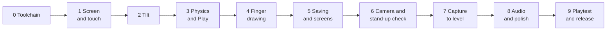
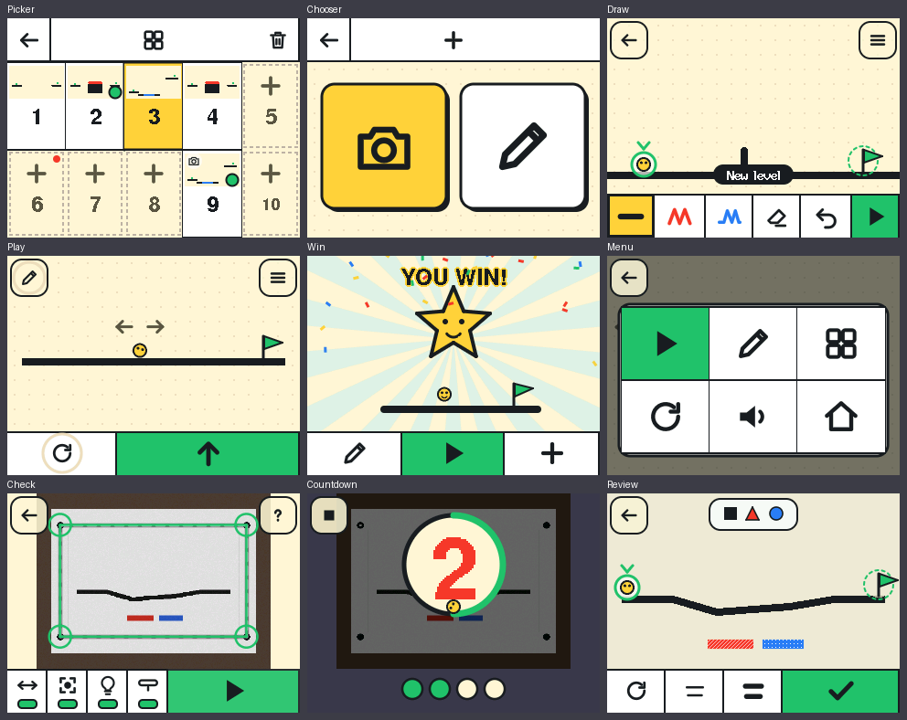

# Scribble Run — Build Plan (device phase)

> Target: **M5Stack CoreS3** · PlatformIO (board `m5stack-cores3`) · M5Unified · M5GFX · esp32-camera
> Companion docs: [game-design.md](game-design.md) · [screens.md](screens.md) · [system-design.md](system-design.md)

## How to use this plan

* **Flash early, flash often.** Every step ends with something you can hold, tilt or point at a crayon drawing. Never go more than one step without running on the device.
* **The browser simulator is the reference.** Physics and vision are written and tuned there first, then ported line by line; the **golden tests** (`shared/golden/`) prove the two agree.
* **Record real numbers.** Steps 1, 2 and 6 write what the hardware actually does into `docs/hardware-notes.md`. Wherever [system-design.md](system-design.md) says "to be measured", this is where it gets measured, and the constants get updated.
* **Each step has a checklist.** A step is done when every box is ticked on the device (or in the native test run where stated).
* **Order matters for risk:** the camera is the riskiest part, so it comes after the core game works. A working game without the camera is still a good game, and the camera features slot in cleanly.

---

## Where we are

Everything below was written **before the device arrived** and checked on the PC: the portable C++ core against the simulator
(byte-identical files, physics and vision), and the whole game running in the **PC emulator** (`firmware/emu`, which runs the real
firmware source on M5GFX's SDL display; see [firmware/emu/README.md](../firmware/emu/README.md)). **No step is ticked on a real
CoreS3 yet**: that is what the device is for.

| Step | Code | Checked in the emulator / on the PC | Needs the device for |
|---|---|---|---|
| 0 Toolchain | done | native tests, CI | CI green on GitHub |
| 1 Screen and touch | hardware-check app (`pio run -e hwcheck`) | layout and flow | colours, push time, touch, his finger |
| 2 Tilt | hardware-check app, `input.cpp` | filter maths (unit tests) | axis and sign, noise, feel |
| 3 Physics and Play | `game_play.cpp` | scripted wins, pops, bounces, jump rules | feel, fps (display push is ~31 ms) |
| 4 Finger drawing | `game_draw.cpp` | strokes byte-identical to the shared level code | latency, eraser cost |
| 5 Saving and screens | `level_store.cpp`, title, picker, chooser, menu | saves, corrupt files, power-cut simulation, every flow | real power cuts on LittleFS |
| 6 Camera and stand-up | `camera.cpp`, `game_paper.cpp` | golden photos give the exact golden levels | **everything about the camera** (pins, power, colour order, exposure) |
| 7 Vision | `vision.cpp` | byte-identical to the simulator on 10 photo cases | speed on the S3 (software doubles), real photos |

Not started: sound clips (`shared/audio/`), the microSD import/export, the second game mode, polish (Steps 8-10).
The list of things the camera code **guesses** is in [hardware-notes.md](hardware-notes.md) under "Camera bring-up".

---

## Before the device arrives (this week)

These need no hardware.

- [x] **Approve the four docs** (done).
- [x] **Build the browser simulator**: finger/mouse drawing, arrow-key tilt, `.scrb` download, plus **Upload photo / Webcam / Demo photo** running the same vision pipeline (done; see `sim/README.md`, run it with `cd sim && npm install && npm run dev`).
- [ ] **Print the template** ([assets/scribble-run-level-template-a4.pdf](assets/scribble-run-level-template-a4.pdf)) at **100 % / Actual size** on white A4 and **measure the 10 cm line** with a ruler (it must read 10.0 cm ±1 mm). Print 10 copies. (Regenerate with `python3 tools/template/make_template.py` if you change anything.)
- [ ] **Make a paper test set:** draw **10 levels** on the template with a fat black marker/crayon plus red and blue (some simple, some messy, one with a mark smudged). Photograph each with a phone, **landscape, from about 40 cm**, in **3 lights** (daylight, lamp, dim), some **tilted 10–20°** → about 30 photos. Keep them in `shared/golden/photos/`.
- [ ] **Tune vision in the simulator** until ≥ 80 % of the test set gives a level you'd happily play, and the four marks are found in ≥ 95 % of the photos. This gives us the default parameters before the camera even arrives.
- [ ] **Record the countdown voice:** "three", "two", "one", "snap!" (about 0.5 s each, a quiet room, a phone is fine), saved as 16 kHz mono WAV in `shared/audio/` (CC0). Or let the kids do it.
- [ ] **Make a paper holder:** a clipboard or a sheet of stiff card, leaned against a stack of books, and a **40 cm string** to measure the distance.
- [ ] **Gather:** **fat crayons or markers** (black, red, blue; lines ≥ 3 mm), **white paper**, a **desk lamp**, a **microSD card**, a **USB-C data cable**, a **ruler**, and something to **stand the device** on (its DinBase, or a small phone stand).
- [ ] **Install PlatformIO** and make sure Step 0 builds (below).

---

## Step 0 — Toolchain and skeleton

**Goal:** an empty project that builds for the CoreS3 and a native test runner that passes, before touching hardware.

**Tasks**
1. `firmware/platformio.ini`: `board = m5stack-cores3`, `framework = arduino`, libraries M5Unified and M5GFX; the camera driver `esp_camera.h` comes with the Arduino-ESP32 core (add `esp32-camera` as a library only if it doesn't); PSRAM enabled; a **16 MB partition table** (app 3 MB, OTA slot 3 MB, LittleFS ≈ 9.9 MB).
2. A `[env:native]` environment with Unity for **PC unit tests** of the portable core.
3. The constants generator (`shared/constants.json` → `config.h` and `config.ts`).
4. CI (GitHub Actions): `pio run -e cores3` and `pio test -e native` on every push.
5. Port `level.h/.cpp` (bit helpers + encoder/decoder) first, with tests against `.scrb` files produced by the simulator.

**Test checklist**
- [x] `pio run -e cores3` builds with no errors (RAM 15.9 %, flash 17.9 % with the hardware-check app).
- [x] `pio test -e native` runs and passes the level-codec tests (valid file loads; wrong magic, wrong CRC, wrong size are rejected).
- [x] A `.scrb` written by the simulator decodes in C++ **byte-identically**, and vice versa (lessons and a brush-stroke level; thumbnails included).
- [x] Bonus: `physics.h/.cpp` is ported too and replays the simulator's golden vectors (worst difference 0.0000005 px).
- [ ] CI is green on the branch (`.github/workflows/firmware.yml`).

**Already built for Steps 1–3:** `firmware/hwcheck/main.cpp` is a hardware-check app (pages INFO, TOUCH, SPEED, TILT, BALL, SOUND) that runs the Step 1–3 measurements and prints them over serial. Flash it the day the device arrives: `cd firmware && pio run -e cores3 -t upload && pio device monitor`. It compiles but has **not run on a real CoreS3 yet**.

---

## Step 1 — Screen and touch

**Goal:** draw on the screen and read touches; **measure** the display, because the whole rendering strategy depends on it.

**Tasks**
1. Hello world with M5Unified/M5GFX; fill the screen with each of the 9 palette colours; print an RGB565 swatch chart.
2. Touch test: draw a dot where the finger is; print raw coordinates, a finger-down/up counter and the rate (Hz).
3. **Benchmarks** (print to serial and the screen): time for a **full 320×240 push**, a **40×40 rectangle push**, with the source sprite in **internal SRAM** vs **PSRAM**, with and without DMA.
4. Button hit-test grid: a 6 × 4 grid of 48 px squares; he taps each in turn.
5. Write the numbers to `docs/hardware-notes.md`.

**Test checklist**
- [ ] The palette looks right (cream paper, not white; ink, not pure black).
- [ ] Full-screen push time recorded (expect ≈ 31 ms at 40 MHz). If > 40 ms, investigate the SPI speed setting.
- [ ] 40×40 dirty-rect push ≤ 1.5 ms and **PSRAM sprite DMA** works (no tearing, no crash). If not, switch to the SRAM composite buffer ([system-design §6.2](system-design.md#62-rendering-a-double-buffered-sprite-in-psram)).
- [ ] Touch latency feels immediate; coordinates match the screen edges (corner taps land in the corners).
- [ ] **Your son's finger** hits 48 px squares ≥ 95 % of the time; note any dead zones near the screen edges.
- [ ] The screen shows nothing odd when the device is rotated and held at the usual angle.

---

## Step 2 — Tilt sensor

**Goal:** a trustworthy `tilt` value from −1 to +1.

**Tasks**
1. Print BMI270 `ax, ay, az` (via `M5.Imu`) at 60 Hz while tilting left, right, forwards and back; find the **axis and sign** for left-right roll when held in landscape (screen up).
2. Implement dead-zone, full-scale and the low-pass filter from [game-design §5.4](game-design.md#54-tilt-mapping).
3. A tilt bar demo on screen.
4. Note noise at rest and the angle at which the bar saturates.

**Test checklist**
- [ ] Tilting the right edge **down** moves the bar right (or the sign is flipped in config and documented).
- [ ] At rest on a table: `|tilt| = 0` (inside the dead-zone), no drift over 60 s.
- [ ] A gentle tilt of about 24° gives full scale; it doesn't feel twitchy or numb. Your son tries it.
- [ ] Holding the device pitched back (the natural way) does not change the left-right value much.
- [ ] Axis mapping and noise recorded in `hardware-notes.md`.

---

## Step 3 — Physics and Play mode

**Goal:** the ball rolls, jumps, bounces, dies and wins on a hard-coded level. This is the first fun moment.

**Tasks**
1. Port `physics.cpp` from the simulator; run the **golden physics vectors** on the PC (`pio test -e native`).
2. Renderer: draw a level from the bit layers with textures into the `scene` sprite; dirty-rectangle ball drawing ([system-design §6](system-design.md#6-game-loop-and-rendering)); ball with eyes.
3. Game loop at fixed 60 Hz with the accumulator.
4. A hard-coded level: the starter level (§4.4 of game-design) plus a spike and a bouncy pad.
5. Controls: tilt rolls, **tap anywhere jumps** (with the grip-safe edge margin), on-screen Jump pad, hold-to-restart.
6. Respawn rules and flag detection (no sounds yet; a screen flash is enough).

**Test checklist**
- [ ] Golden physics vectors pass (≤ 0.5 px drift over 600 ticks).
- [ ] Frame rate holds **60 fps** in Play (measure with a frame counter; the CPU budget is ≈ 2.6 ms per frame).
- [ ] Jump apex ≈ 50 px; bouncy apex ≈ 128 px (measure on screen with a ruler line).
- [ ] The ball never tunnels through an 8 px line at full speed; never gets stuck inside ground.
- [ ] Spike → pop and respawn in ≈ 0.5 s; pit → respawn; flag → win flash.
- [ ] Jump works only when grounded, with the 0.10 s / 0.12 s forgiveness.
- [ ] **Accidental jumps from the grip are rare** (hold the device the way he does for a minute).
- [ ] **Tuning session with your son:** he plays 10 minutes; note anything that feels "too slow", "too slippery", "too hard to jump"; update `constants.json` and re-run the sim.

---

## Step 4 — Finger drawing (Draw / Edit)

**Goal:** draw a level with a finger and play it.

**Tasks**
1. Draw mode screen: playfield, **corner chips (← and ☰)**, the 6-button bottom toolbar (**Ground, Spike, Bouncy, Eraser, Undo, ▶ Play**), exclusive materials.
2. Brush stamping with interpolation between touch samples; eraser; **8-level undo** (snapshots in PSRAM).
3. **Pins** (Start, Flag): dragging with a 24 px grab radius; clearing material around a dropped pin.
4. The **ghost finger** on a fresh starter level.
5. The Draw → Play → Draw round trip keeps the level in memory (saving comes in Step 5).

**Test checklist**
- [ ] Ink appears **under the fingertip**, with no visible lag or gaps even when scribbling fast.
- [ ] Every toolbar button is ≥ 48 px wide and he can hit them reliably; the corner chips are easy to hit but rarely hit by accident.
- [ ] Painting a material removes the others at those pixels; eraser works; undo restores exactly 8 steps.
- [ ] Dragging a pin never also draws; drawing near a pin doesn't move it by accident (24 px rule).
- [ ] Dropping Start/Flag on ground clears a hole; the ball doesn't spawn stuck.
- [ ] A level drawn from scratch can be won in under a minute.
- [ ] Frame rate stays 60 fps while drawing.

---

## Step 5 — Saving and the screens

**Goal:** the full finger-mode app: Title, Level picker with thumbnails, Menu, Win, all saved to flash.

**Tasks**
1. `level_store`: LittleFS init, list/load/save/delete, **atomic writes** (temp file + rename), `rev`, CRC, autosave rules ([system-design §4.7](system-design.md#47-storage-and-autosave)), `settings.bin`.
2. Thumbnails: generation at save, the 4 bpp format, cache of ten.
3. The state machine (`modes`) and `ui` widgets: hold-to-activate ring, top-bar pattern, tab bar.
4. Screens: **Title, Level picker, New-level chooser, Menu, Win** (Camera/Review are placeholders).
5. Built-in lessons in slots 1–3 (embedded in flash, copied on first run).
6. **Measure RLE sizes** of real levels (for the QR question) and record them.
7. microSD export of a level to `/sd/scribble/levels/`.

**Test checklist**
- [ ] A level drawn on the device survives a **power cycle** (battery out / USB reset).
- [ ] **Pulling the power during a save** never corrupts a level (old version intact; run this 20 times).
- [ ] A corrupt file shows as an empty slot with a warning dot; the game keeps working.
- [ ] Picker shows 10 slots with correct thumbnails; the last-played slot is highlighted; the beaten tick persists.
- [ ] All the flows in [screens.md §11](screens.md#11-screen-flow) work; **← always saves and never discards**; Play's Edit/Restart need the 0.4 s hold.
- [ ] Win screen appears, "Play again" restarts, "Edit" returns to the level in Draw, "New level" opens the chooser.
- [ ] First-run: Title → Play opens the starter level in Draw with the ghost finger.
- [ ] A `.scrb` copied from the simulator onto the SD card appears (after import) and plays identically.
- [ ] RLE sizes of ≥ 10 real levels recorded in `hardware-notes.md`.

---

## Step 6 — Camera and the stand-up check

**Goal:** the device stands up, sees the printed template, and tells us (with four lights) whether the paper is in the right place. Also: **confirm the camera facts** that the whole paper mode rests on.

**Tasks**
1. Bring up the GC0308 through `esp32-camera` with M5Unified running (pins from M5's CoreS3 camera example); **VGA RGB565**, 2 frame buffers in PSRAM. Check orientation (`hmirror`/`vflip`) so the preview is **not mirrored**.
2. **Stand the device up** (DinBase or a stand) and read the **accelerometer**: record the angle it settles at; make the camera look level at the paper.
3. The **Camera check screen**: preview sampled down to 256 × 192, target frame, **live mark finder** (the light version of vision stage 1), detected-page outline, the four **lights** (distance, sharp, light, level), the ? chip and the 2-second **numbers overlay**. The **Stand-up guide** screen.
4. **Calibrate** with the printed template on a board, at **35, 40 and 45 cm** (use the string and ruler), and also **30 and 50 cm**:
   - read the dot-rectangle width `w` (QVGA px) and compute `f = w × d / 270 mm`; compare with the expected **377 px** and the FOV of **46° × 35°**;
   - read the **edge width** (sharpness) at each distance to confirm "sharp from about 30 cm";
   - measure **fps**, mean paper brightness in 3 lights, and the effect of the **exposure lock**;
   - tilt the board ±10° and ±20° and check the **Level** light and the side ratios.
5. Write all measured numbers into `docs/hardware-notes.md` and update `shared/constants.json` (`CAM_FOCAL_PX_320`, the green ranges).
6. Camera start/stop when entering and leaving the screens.

**Test checklist**
- [ ] Preview runs at ≥ 10 fps (target 15–30) with the overlays.
- [ ] The preview is **not mirrored** (a word on the paper reads correctly) and upright.
- [ ] The printed template's **10 cm line measures 10 cm** before you start (scale check).
- [ ] With the sheet at 35, 40 and 45 cm the four marks are **inside the frame and found**; the **estimated distance is within ±5 %** of the ruler (otherwise the focal length is recalibrated).
- [ ] Sharpness is "green" at 35–45 cm; a fingerprint on the lens turns **Sharp** yellow/red and wiping fixes it.
- [ ] **Distance** goes yellow/red with the right arrow at 30 cm and at 55 cm; **Level** reacts to a tilted board; **Light** reacts to dimming the room and to lamp glare.
- [ ] The device standing on its base or stand looks level (the **Level** light is green by default); lying flat shows the "stand me up" picture.
- [ ] Entering and leaving the Camera screens 50 times: no crash, free heap and PSRAM stay flat; touch and IMU keep working with the camera running (shared I²C).
- [ ] **Ergonomics with your son:** where does the paper go (a parent holding it, a clipboard leaned on books, taped to a wall)? Can he press **GO** and step away in time? Record what works.
- [ ] Battery drain in the Camera screens recorded (% per 5 minutes).

---

## Step 7 — Capture to level

**Goal:** the full flow: **GO → "3, 2, 1, snap!" → Review → Play**, with the page found and straightened.

**Tasks**
1. Port `vision.cpp` from the simulator, including **mark finding, the homography and the warp**; run the **golden vision tests** on the PC (the marks within ≤ 0.1 px and ≥ 99.5 % of mask pixels identical; stages 3–10 byte-identical). **Done on the PC** (`firmware/lib/core/src/vision.*`, `pio test -e native -f test_vision`): the marks and every stage come out *identical*, not just within tolerance; what remains is timing it on the S3 and re-running the tests on real photos.
2. The **Countdown screen** and sequence: lock exposure and white balance, play the four clips (placeholder tones if the clips aren't ready), take the frame at "snap" (average 3 VGA frames), then flash.
3. The **Processing** animation while the vision task runs on core 0; the **Review** screen (straightened page, materials, pins, legend, Retake, thinner/thicker ink, Looks good).
4. Quality statuses and the automatic single retry ([system-design §5.8](system-design.md#58-limits-and-fallbacks)); friendly pictures for each; the **marks-not-found** fallback (centre-crop) and the "paper not found" picture.
5. Re-tune the parameters on **real camera captures** of the paper test set (not just phone photos) and write the final defaults back to `constants.json` (and the simulator).
6. Look at the failure cases and decide whether anything beyond the corner marks is needed for v1.

**Test checklist**
- [ ] Golden vision tests pass on the PC (tolerances above).
- [ ] The four marks are found in **≥ 95 %** of 40 captures across 3 lights and tilts of 0–20°; the ring identifies the top-left even if the sheet is held **upside down or sideways**.
- [ ] A page tilted **15–20°** still gives a straight level (the straightened preview in Review shows an undistorted drawing).
- [ ] **GO → Review in about 4 s** (3.3 s countdown + ≤ 0.8 s processing); each vision stage timed and recorded.
- [ ] **Real-world success rate:** with the 10 test drawings × 3 lights, **≥ 80 %** give a level playable without Edit (or fixable in < 1 minute). Record the table.
- [ ] Black, red and blue are classified correctly; yellow and pencil are ignored harmlessly; the legend and footer printed on the template are ignored.
- [ ] A smudged or covered mark falls back to the centre-crop with the "paper not found" picture; **Retake** works.
- [ ] Start and Flag land on ground in ≥ 80 % of captures and are draggable.
- [ ] The countdown works with sound **Off** (digits and flash only), and with the device gently tapped at GO (the 3 s settle time is enough: the picture is sharp).
- [ ] Heap and PSRAM return to baseline after leaving Review.
- [ ] **Your son draws three levels on the template and plays them** with no help beyond setting the device up; note where he hesitates.

---

## Step 8 — Audio, effects and polish

**Goal:** everything feels good, with no vibration to lean on.

**Tasks**
1. `audio` task and tone queue; the full effects table in [game-design §7](game-design.md#7-feedback-win-lose-and-everything-in-between-no-vibration) (jump, land, bounce, pop, fall, respawn, win jingle, shutter, ta-da, hmm), and **speech-clip playback** for the countdown. A small **voice recorder** (the two microphones) lets the kids record their own "3, 2, 1, snap!" to replace the default clips.
2. Screen effects: ball squash/stretch, particles (pool of 32), screen shake, red/green flashes, paper-wipe transitions, review recolour animation.
3. Volume Off/Low/Med; default Low; the speaker icon states.
4. Idle screen dim (60 s) and wake; battery icon below 20 %.
5. Error paths: SD missing, flash full, camera init failure (the Paper tile hides and Draw still works), low memory.
6. Performance pass and a **1-hour soak test** (random taps and mode changes).

**Test checklist**
- [ ] Each event has its sound **and** its screen effect, and nothing sounds harsh at Low volume.
- [ ] Sounds never block or stutter the 60 fps loop; the four countdown clips are one second apart (±30 ms).
- [ ] Recording a new countdown voice works, replaces the clips, and survives a reboot; the defaults can be restored.
- [ ] Mute works from Title and menu and persists across reboots.
- [ ] Camera failure leaves the rest of the game fully working.
- [ ] 1-hour soak: no crash, no memory growth, frame time stays within budget.
- [ ] Battery: a full charge lasts long enough for a play session; record the real number (and set expectations for the family).

---

## Step 9 — Playtest and release

**Goal:** a version your son loves, and an open-source repo others can build.

**Playtest protocol** (do it three times, on different days; **you watch, you don't help**):

| Measure | Target |
|---------|--------|
| Time from power-on to his first stroke | < 10 s |
| Time to first win (finger path) | < 60 s |
| Times he gets stuck and asks "how do I…?" | note each one; each is a design bug |
| Accidental exits from Play (thumbs) | ≤ 1 per session |
| Does he ask to play again, unprompted? | yes |
| Paper mode: drawings that work without retake | note rate |
| Does he make levels for *you*? | the real success signal |

**Release tasks**
- [ ] Fix the top 5 playtest issues.
- [ ] README with photos, a **"crayon guide" PDF**, build and flash instructions, license (MIT).
- [ ] Firmware `.bin` attached to a GitHub release; a one-line flash command (`esptool` or `pio run -t upload`).
- [ ] The simulator deployed to GitHub Pages so friends can try paper levels from a phone photo.
- [ ] Tag `v1.0`.

---

## After v1 (version 2)

Not part of the device phase, but designed for: **Wi-Fi + tldraw editor** ([system-design §10.1](system-design.md#101-version-2-a-tldraw-web-editor-that-sends-levels-over-wi-fi)), **microSD sharing and QR scanning** ([§10.2](system-design.md#102-sharing-without-wi-fi)), **stars, timer, ghost race and Dad's challenge** ([game-design §11](game-design.md#11-stretch-ideas-not-in-v1-the-data-format-reserves-room)), **auto-deskew** for tilted pages.
