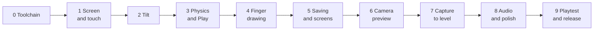

# Scribble Run — Build Plan (device phase)

> Target: **M5Stack CoreS3** · PlatformIO (board `m5stack-cores3`) · M5Unified · M5GFX · esp32-camera
> Companion docs: [game-design.md](game-design.md) · [screens.md](screens.md) · [system-design.md](system-design.md)

## How to use this plan

* **Flash early, flash often.** Every step ends with something you can hold, tilt or point at a crayon drawing. Never go more than one step without running on the device.
* **The browser simulator is the reference.** Physics and vision are written and tuned there first, then ported line by line; the **golden tests** (`shared/golden/`) prove the two agree.
* **Record real numbers.** Steps 1, 2 and 6 write what the hardware actually does into `docs/hardware-notes.md`. Wherever [system-design.md](system-design.md) says "to be measured", this is where it gets measured, and the constants get updated.
* **Each step has a checklist.** A step is done when every box is ticked on the device (or in the native test run where stated).
* **Order matters for risk:** the camera is the riskiest part, so it comes after the core game works. A working game without the camera is still a good game, and the camera features slot in cleanly.

---

## Before the device arrives (this week)

These need no hardware.

- [ ] **Approve the four docs** (this is the review you asked for).
- [ ] **Build the browser simulator** (after approval): finger/mouse drawing, arrow-key tilt, `.scrb` download, plus **Upload photo / Webcam** running the same vision pipeline.
- [ ] **Make a paper test set:** draw **10 levels** with a fat black crayon/marker plus red and blue (some simple, some messy, one on the back of a crumpled page). Photograph each with a phone in **3 lights** (daylight, lamp, dim) → ~30 photos. Keep them in `shared/golden/photos/`.
- [ ] **Tune vision in the simulator** until ≥ 80 % of the test set gives a level you'd happily play. This gives us the real default parameters before the camera even arrives.
- [ ] **Print the "crayon guide"** (do / don't, from [game-design §3.1](game-design.md#31-paper-mode-the-headline-feature)) and gather: **fat crayons or markers** (black, red, blue), **white paper**, a **desk lamp**, a **microSD card**, a **USB-C data cable**, and something to **prop the device** up (a phone stand).
- [ ] **Install PlatformIO** and make sure Step 0 builds (below).

---

## Step 0 — Toolchain and skeleton

**Goal:** an empty project that builds for the CoreS3 and a native test runner that passes, before touching hardware.

**Tasks**
1. `firmware/platformio.ini`: `board = m5stack-cores3`, `framework = arduino`, libraries M5Unified and M5GFX; the camera driver `esp_camera.h` comes with the Arduino-ESP32 core (add `esp32-camera` as a library only if it doesn't); PSRAM enabled; a **16 MB partition table** (app 3 MB, OTA slot 3 MB, LittleFS ≈ 9.9 MB).
2. A `[env:native]` environment with Unity for **PC unit tests** of the portable core.
3. The constants generator (`shared/constants.json` → `config.h` and `config.ts`).
4. CI (GitHub Actions): `pio run -e cores3` and `pio test -e native` on every push.
5. Port `level.h/.cpp` (bit helpers + encoder/decoder) first, with tests against `.scrb` files produced by the simulator.

**Test checklist**
- [ ] `pio run -e cores3` builds with no errors.
- [ ] `pio test -e native` runs and passes the level-codec tests (valid file loads; wrong magic, wrong CRC, wrong size are rejected).
- [ ] A `.scrb` written by the simulator decodes in C++ **byte-identically**, and vice versa.
- [ ] CI is green on the branch.

---

## Step 1 — Screen and touch

**Goal:** draw on the screen and read touches; **measure** the display, because the whole rendering strategy depends on it.

**Tasks**
1. Hello world with M5Unified/M5GFX; fill the screen with each of the 9 palette colours; print an RGB565 swatch chart.
2. Touch test: draw a dot where the finger is; print raw coordinates, a finger-down/up counter and the rate (Hz).
3. **Benchmarks** (print to serial and the screen): time for a **full 320×240 push**, a **40×40 rectangle push**, with the source sprite in **internal SRAM** vs **PSRAM**, with and without DMA.
4. Button hit-test grid: a 6 × 4 grid of 48 px squares; he taps each in turn.
5. Write the numbers to `docs/hardware-notes.md`.

**Test checklist**
- [ ] The palette looks right (cream paper, not white; ink, not pure black).
- [ ] Full-screen push time recorded (expect ≈ 31 ms at 40 MHz). If > 40 ms, investigate the SPI speed setting.
- [ ] 40×40 dirty-rect push ≤ 1.5 ms and **PSRAM sprite DMA** works (no tearing, no crash). If not, switch to the SRAM composite buffer ([system-design §6.2](system-design.md#62-rendering-a-double-buffered-sprite-in-psram)).
- [ ] Touch latency feels immediate; coordinates match the screen edges (corner taps land in the corners).
- [ ] **Your son's finger** hits 48 px squares ≥ 95 % of the time; note any dead zones near the screen edges.
- [ ] The screen shows nothing odd when the device is rotated and held at the usual angle.

---

## Step 2 — Tilt sensor

**Goal:** a trustworthy `tilt` value from −1 to +1.

**Tasks**
1. Print BMI270 `ax, ay, az` (via `M5.Imu`) at 60 Hz while tilting left, right, forwards and back; find the **axis and sign** for left-right roll when held in landscape (screen up).
2. Implement dead-zone, full-scale and the low-pass filter from [game-design §5.4](game-design.md#54-tilt-mapping).
3. A tilt bar demo on screen.
4. Note noise at rest and the angle at which the bar saturates.

**Test checklist**
- [ ] Tilting the right edge **down** moves the bar right (or the sign is flipped in config and documented).
- [ ] At rest on a table: `|tilt| = 0` (inside the dead-zone), no drift over 60 s.
- [ ] A gentle tilt of about 24° gives full scale; it doesn't feel twitchy or numb. Your son tries it.
- [ ] Holding the device pitched back (the natural way) does not change the left-right value much.
- [ ] Axis mapping and noise recorded in `hardware-notes.md`.

---

## Step 3 — Physics and Play mode

**Goal:** the ball rolls, jumps, bounces, dies and wins on a hard-coded level. This is the first fun moment.

**Tasks**
1. Port `physics.cpp` from the simulator; run the **golden physics vectors** on the PC (`pio test -e native`).
2. Renderer: draw a level from the bit layers with textures into the `scene` sprite; dirty-rectangle ball drawing ([system-design §6](system-design.md#6-game-loop-and-rendering)); ball with eyes.
3. Game loop at fixed 60 Hz with the accumulator.
4. A hard-coded level: the starter level (§4.4 of game-design) plus a spike and a bouncy pad.
5. Controls: tilt rolls, **tap anywhere jumps** (with the grip-safe edge margin), on-screen Jump pad, hold-to-restart.
6. Respawn rules and flag detection (no sounds yet; a screen flash is enough).

**Test checklist**
- [ ] Golden physics vectors pass (≤ 0.5 px drift over 600 ticks).
- [ ] Frame rate holds **60 fps** in Play (measure with a frame counter; the CPU budget is ≈ 2.6 ms per frame).
- [ ] Jump apex ≈ 50 px; bouncy apex ≈ 128 px (measure on screen with a ruler line).
- [ ] The ball never tunnels through an 8 px line at full speed; never gets stuck inside ground.
- [ ] Spike → pop and respawn in ≈ 0.5 s; pit → respawn; flag → win flash.
- [ ] Jump works only when grounded, with the 0.10 s / 0.12 s forgiveness.
- [ ] **Accidental jumps from the grip are rare** (hold the device the way he does for a minute).
- [ ] **Tuning session with your son:** he plays 10 minutes; note anything that feels "too slow", "too slippery", "too hard to jump"; update `constants.json` and re-run the sim.

---

## Step 4 — Finger drawing (Draw / Edit)

**Goal:** draw a level with a finger and play it.

**Tasks**
1. Draw mode screen: playfield, **corner chips (← and ☰)**, the 6-button bottom toolbar (**Ground, Spike, Bouncy, Eraser, Undo, ▶ Play**), exclusive materials.
2. Brush stamping with interpolation between touch samples; eraser; **8-level undo** (snapshots in PSRAM).
3. **Pins** (Start, Flag): dragging with a 24 px grab radius; clearing material around a dropped pin.
4. The **ghost finger** on a fresh starter level.
5. The Draw → Play → Draw round trip keeps the level in memory (saving comes in Step 5).

**Test checklist**
- [ ] Ink appears **under the fingertip**, with no visible lag or gaps even when scribbling fast.
- [ ] Every toolbar button is ≥ 48 px wide and he can hit them reliably; the corner chips are easy to hit but rarely hit by accident.
- [ ] Painting a material removes the others at those pixels; eraser works; undo restores exactly 8 steps.
- [ ] Dragging a pin never also draws; drawing near a pin doesn't move it by accident (24 px rule).
- [ ] Dropping Start/Flag on ground clears a hole; the ball doesn't spawn stuck.
- [ ] A level drawn from scratch can be won in under a minute.
- [ ] Frame rate stays 60 fps while drawing.

---

## Step 5 — Saving and the screens

**Goal:** the full finger-mode app: Title, Level picker with thumbnails, Menu, Win, all saved to flash.

**Tasks**
1. `level_store`: LittleFS init, list/load/save/delete, **atomic writes** (temp file + rename), `rev`, CRC, autosave rules ([system-design §4.7](system-design.md#47-storage-and-autosave)), `settings.bin`.
2. Thumbnails: generation at save, the 4 bpp format, cache of ten.
3. The state machine (`modes`) and `ui` widgets: hold-to-activate ring, top-bar pattern, tab bar.
4. Screens: **Title, Level picker, New-level chooser, Menu, Win** (Camera/Review are placeholders).
5. Built-in lessons in slots 1–3 (embedded in flash, copied on first run).
6. **Measure RLE sizes** of real levels (for the QR question) and record them.
7. microSD export of a level to `/sd/scribble/levels/`.

**Test checklist**
- [ ] A level drawn on the device survives a **power cycle** (battery out / USB reset).
- [ ] **Pulling the power during a save** never corrupts a level (old version intact; run this 20 times).
- [ ] A corrupt file shows as an empty slot with a warning dot; the game keeps working.
- [ ] Picker shows 10 slots with correct thumbnails; the last-played slot is highlighted; the beaten tick persists.
- [ ] All the flows in [screens.md §11](screens.md#11-screen-flow) work; **← always saves and never discards**; Play's Edit/Restart need the 0.4 s hold.
- [ ] Win screen appears, "Play again" restarts, "Edit" returns to the level in Draw, "New level" opens the chooser.
- [ ] First-run: Title → Play opens the starter level in Draw with the ghost finger.
- [ ] A `.scrb` copied from the simulator onto the SD card appears (after import) and plays identically.
- [ ] RLE sizes of ≥ 10 real levels recorded in `hardware-notes.md`.

---

## Step 6 — Camera preview

**Goal:** a good live camera preview with a framing guide, and real numbers for how the camera sees paper.

**Tasks**
1. Bring up the GC0308 through `esp32-camera` with M5Unified running (pins from M5's CoreS3 camera example); QVGA, RGB565, 2 frame buffers in PSRAM.
2. Show the live frame **cropped to 320×192** with the framing guide; **un-mirrored** (check `hmirror`/`vflip`).
3. Exposure: let auto-exposure settle, then **lock exposure and white balance**; try `AE_LEVEL` biases.
4. Live **brightness check** → the lamp hint.
5. Measure: **frames per second**, **focus range** (closest sharp distance), **field of view** (how far away must an A4 / A5 page be to fill the guide?), and white-paper pixel values in 3 lights.
6. Print a small "hold the paper this far away" cue on the guide card; record in `hardware-notes.md`.
7. Camera start/stop when entering/leaving the screen (no leaks; no touch-screen glitches while the camera runs).

**Test checklist**
- [ ] Preview runs at ≥ 15 fps (target ≈ 30) with the guide overlay.
- [ ] Left/right and up/down of the preview match the paper as he sees it.
- [ ] The paper is sharp at the distance we plan to use; the sharp range is documented.
- [ ] White paper reads ≥ 200 (of 255) in the **lamp** light after the exposure lock; the lamp hint appears in dim light and vanishes when the lamp is on.
- [ ] Entering and leaving Camera 50 times: no crash, no memory leak (free heap and PSRAM stay flat).
- [ ] Touch and IMU still work correctly while the camera is running (I²C is shared).
- [ ] **Ergonomics test with your son:** can he hold the paper and tap Snap? Try: device leaning on a stand + one hand for paper; and you tapping Snap while he holds the paper. Decide whether the self-timer is needed.
- [ ] Battery drain in Camera mode recorded (% per 5 minutes).

---

## Step 7 — Capture to level

**Goal:** snap a crayon drawing and get a playable level.

**Tasks**
1. Port `vision.cpp` from the simulator; run the **golden vision tests** on the PC (the photos in `shared/golden/photos/` converted to 320×240 RGB565 must give **byte-identical** masks to the simulator).
2. The **Snap** flow: shutter click, white flash, frozen frame, frame averaging, the `Processing` animation while the vision task runs on core 0.
3. The **Review** screen: dimmed photo + coloured materials, pins, legend, **Retake**, **− / + ink**, **Looks good**.
4. Quality statuses and the automatic single retry ([system-design §5.7](system-design.md#57-limits-and-fallbacks)); friendly pictures for each status.
5. Re-tune the parameters on **real camera captures** of the paper test set (not just phone photos) and write the final defaults back to `constants.json` (and the simulator).
6. Look at the failure cases on the device and decide whether auto-deskew is needed for v1.

**Test checklist**
- [ ] Golden vision tests pass on the PC: masks match the simulator **byte for byte**.
- [ ] Snap → Review in **≤ 0.6 s** (measure stages and record).
- [ ] **Real-world success rate:** with the 10 test drawings × 3 lights, **≥ 80 %** give a level that is playable without Edit (or fixable in < 1 minute). Record the table.
- [ ] Black, red, blue are correctly classified; yellow/pencil are ignored without breaking anything.
- [ ] Start and Flag land on ground in ≥ 80 % of captures and are draggable.
- [ ] − / + ink re-runs in ≤ 0.3 s and visibly changes the result.
- [ ] Each bad-photo status shows its friendly picture; **Looks good** and **Retake** always work; **Edit** repairs a bad level.
- [ ] A paper level is saved with the "from paper" flag and a thumbnail, and plays correctly.
- [ ] Heap/PSRAM return to baseline after leaving Review (workspace freed).
- [ ] **Your son draws three levels on paper and plays them** with no help from you; note where he hesitates.

---

## Step 8 — Audio, effects and polish

**Goal:** everything feels good, with no vibration to lean on.

**Tasks**
1. `audio` task and tone queue; the full effects table in [game-design §7](game-design.md#7-feedback-win-lose-and-everything-in-between-no-vibration) (jump, land, bounce, pop, fall, respawn, win jingle, shutter, ta-da, hmm).
2. Screen effects: ball squash/stretch, particles (pool of 32), screen shake, red/green flashes, paper-wipe transitions, review recolour animation.
3. Volume Off/Low/Med; default Low; the speaker icon states.
4. Idle screen dim (60 s) and wake; battery icon below 20 %.
5. Error paths: SD missing, flash full, camera init failure (the Paper tile hides and Draw still works), low memory.
6. Performance pass and a **1-hour soak test** (random taps and mode changes).

**Test checklist**
- [ ] Each event has its sound **and** its screen effect, and nothing sounds harsh at Low volume.
- [ ] Sounds never block or stutter the 60 fps loop.
- [ ] Mute works from Title and menu and persists across reboots.
- [ ] Camera failure leaves the rest of the game fully working.
- [ ] 1-hour soak: no crash, no memory growth, frame time stays within budget.
- [ ] Battery: a full charge lasts long enough for a play session; record the real number (and set expectations for the family).

---

## Step 9 — Playtest and release

**Goal:** a version your son loves, and an open-source repo others can build.

**Playtest protocol** (do it three times, on different days; **you watch, you don't help**):

| Measure | Target |
|---------|--------|
| Time from power-on to his first stroke | < 10 s |
| Time to first win (finger path) | < 60 s |
| Times he gets stuck and asks "how do I…?" | note each one; each is a design bug |
| Accidental exits from Play (thumbs) | ≤ 1 per session |
| Does he ask to play again, unprompted? | yes |
| Paper mode: drawings that work without retake | note rate |
| Does he make levels for *you*? | the real success signal |

**Release tasks**
- [ ] Fix the top 5 playtest issues.
- [ ] README with photos, a **"crayon guide" PDF**, build and flash instructions, license (MIT).
- [ ] Firmware `.bin` attached to a GitHub release; a one-line flash command (`esptool` or `pio run -t upload`).
- [ ] The simulator deployed to GitHub Pages so friends can try paper levels from a phone photo.
- [ ] Tag `v1.0`.

---

## After v1 (version 2)

Not part of the device phase, but designed for: **Wi-Fi + tldraw editor** ([system-design §10.1](system-design.md#101-version-2-a-tldraw-web-editor-that-sends-levels-over-wi-fi)), **microSD sharing and QR scanning** ([§10.2](system-design.md#102-sharing-without-wi-fi)), **stars, timer, ghost race and Dad's challenge** ([game-design §11](game-design.md#11-stretch-ideas-not-in-v1-the-data-format-reserves-room)), **auto-deskew** for tilted pages.
