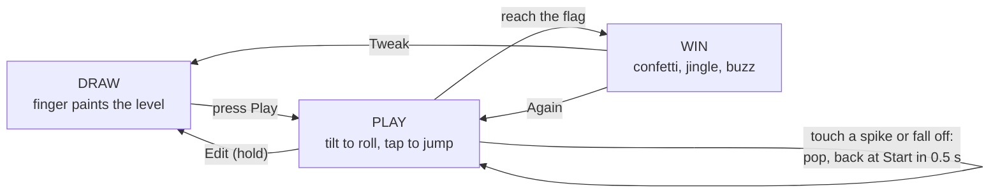

# Scribble Run — Game Design

> **Status:** design draft for review · **Target:** M5Stack Core2 (320×240, tilt + touch) · **License:** MIT
>
> Companion docs: [screens.md](screens.md) · [system-design.md](system-design.md) · [build-plan.md](build-plan.md)

## 1. The one-sentence game

**Draw a level with your finger, tap Play, then tilt the device to roll a ball through your drawing to the flag. Tap to jump.**

### Design pillars

| # | Pillar | What it means in practice |
|---|--------|---------------------------|
| 1 | **Fun in 10 seconds** | First launch drops you into a half-made level with a visible gap. A ghost finger shows how to draw a bridge. One button press later the ball is rolling. |
| 2 | **No reading** | Every action is an icon, a colour, or a sound. Numbers (1–10) are the only "text" a player must understand. |
| 3 | **Nothing feels like failing** | No lives, no game-over, no score loss. A spike is a funny *pop* and the ball is back at the start in half a second. |
| 4 | **The drawing is the game** | Winning is the cue to *change the level*, not to move on. Tweak → play → tweak is the loop we optimise for. |
| 5 | **Dad can't break it** | Auto-save everything, undo everything, no destructive buttons without a hold. |

---

## 2. Core loop



### The first 10 seconds (the script we design to)

| Time | What the player sees / does | Why |
|------|------------------------------|-----|
| 0 s | Power on. Title screen: a ball rolls and jumps over the logo. Three big icon buttons. | Motion + colour instantly says "game". |
| 2 s | Tap ▶ (or press **B**). The **starter level** appears: Start on a ledge at left, Flag on a ledge at right, **a wide gap between**. | Problem is visible without words. |
| 3 s | After 3 s of no touching, a **ghost finger** slowly draws a black line across the gap, then fades. Repeats until the first touch. | Teaches "draw here" without text. |
| 4–6 s | Child draws a bridge. Ink appears instantly under the finger. A quiet pen-tick plays. | Immediate cause and effect. |
| 6 s | Press the big green ▶ (**B**). Ball drops from Start and rolls. | One obvious next step. |
| 7–10 s | Tilt → ball rolls across their line → flag → confetti + jingle + buzz. | First win, drawn by them. |

If the bridge is bad, the ball falls into the pit, reappears at Start, and the child presses **A**/pencil (or just Play again). Nothing is lost.

### Built-in "lesson" levels

Slots 1–3 ship pre-filled. They teach one material each *by playing*, with no text:

| Slot | Teaches | Layout idea |
|------|---------|-------------|
| 1 | **Ground** | The starter level (gap to bridge). |
| 2 | **Spike** | A hill with a red patch on top; draw a bridge or go around. |
| 3 | **Bouncy** | Flag on a high ledge that a jump can't reach; a blue pad below it. |

They are normal, editable levels (a child can wreck level 1 and nothing is lost forever — see "Reset lessons" in [§9](#9-open-questions-for-review)).

---

## 3. The world

### 3.1 Playfield

* **320 × 192 px** logical world. 1 world pixel = 1 screen pixel.
* The remaining **48 px** at the bottom of the 320×240 screen is the *bottom bar* (tools in Draw mode, button hints elsewhere). See [screens.md](screens.md).
* Coordinates: `x` right, `y` down, origin top-left, units are pixels, time is seconds, so velocities are **px/s** and accelerations **px/s²**.
* **Edges:** left and right edges are solid invisible walls. The top is open (the ball can fly above the screen and come back). The bottom is a **pit**: when the ball centre falls below `y = 192 + 3·radius`, it respawns (§7).

### 3.2 Materials and objects

| Thing | Colour | Behaviour | How it's made |
|-------|--------|-----------|---------------|
| **Ground** | Black (ink) | Solid. Ball rolls on it, bumps into it, stands on it. Low bounce. | Paint with the Ground tool. |
| **Spike** | Red + saw-tooth texture | **Not solid.** Touching it with the ball's *inner* hit-circle (75 % of the ball size, deliberately forgiving) pops the ball → respawn at Start. | Paint with the Spike tool. |
| **Bouncy** | Blue + dot texture | Solid. On contact the ball is **launched along the surface normal at 480 px/s** (≈ 2.5× a normal jump). A tilted blue ramp flings the ball sideways. | Paint with the Bouncy tool. |
| **Start** | Green ring with a ball outline | Where the ball (re)appears. Always exactly one. | Drag the Start pin. |
| **Flag** | Green flag on a pole | Touching it (generous 16 px radius) wins. Always exactly one. | Drag the Flag pin. |
| **Eraser** | — | Removes all three materials. | Tool. |

Every material has a **distinct texture as well as a colour**, so the game also works for colour-blind players (about 1 in 12 boys). Red/blue/black are separable for the common types, and the textures make it certain. See [screens.md §Visual style](screens.md#visual-style).

### 3.3 Drawing rules

* **Brush:** round, **8 px** diameter (radius 4). Eraser: **20 px** diameter (radius 10).
* The brush stamps discs along the segment between successive touch samples (spacing ≤ 2 px), so fast strokes never leave gaps.
* **Materials are exclusive:** painting a material clears the other two at those pixels (last stroke wins). A pixel is therefore in at most one layer.
* **Minimum thickness is 8 px**, which is what lets physics prevent tunnelling (see [system-design.md §Collision](system-design.md#7-collision)).
* **Pins** (Start, Flag) are dragged like physical tokens. Grabbing one has priority over drawing within a 24 px radius of it. When dropped, **all material within 12 px (Start) / 14 px (Flag) is cleared**, so a pin can never be buried inside ground.
* **Undo:** 8 levels. **Clear** requires a hold and is undoable too.
* **Auto-save** on leaving Draw mode and after 5 s idle. There is no Save button.

### 3.4 The starter level (used for first launch and as lesson 1)

| Item | Value (world px) |
|------|-------------------|
| Start (ball centre) | (40, 104) — ball rests on the ledge top |
| Flag base | (280, 112) — pole stands on the right ledge |
| Left ledge (Ground) | x 16 – 72, y 112 – 120 |
| Right ledge (Ground) | x 248 – 304, y 112 – 120 |
| Gap | 176 px wide — too wide to jump (max jump ≈ 100 px), so the child *must* draw. |

---

## 4. Controls

### 4.1 Touch targets

* Every tappable target is **≥ 44 × 44 px**; our standard is **≥ 48 px**, and primary buttons are 80 – 107 px wide.
* ⚠️ **Physical size check:** the Core2 screen is ~2.0″ diagonal ≈ **7.9 px/mm**, so **44 px ≈ 5.6 mm** — smaller than a child's fingertip (≈ 8–10 mm). That is why:
  * every button is ≥ 48 px (6.1 mm) and we use full-width tabs where possible;
  * the physical **A / B / C** zones (~107 × 40 px each) carry the most-used actions;
  * touch hit-testing is *forgiving*: the nearest button within 6 px of the touch wins.
* Single touch only. A second finger is ignored (capacitive multi-touch on the Core2 is unreliable).

### 4.2 Controls by mode

| Mode | Touch screen | Tilt | **A** (left) | **B** (middle) | **C** (right) |
|------|--------------|------|--------------|----------------|----------------|
| **Title** | Tap a bottom tab | — | Levels | Play | Sound toggle |
| **Level picker** | Tap a slot to open it | — | Home | New level (first empty slot) | Delete mode (toggle) |
| **Draw** | Drag on canvas = paint with selected tool · drag a pin = move it · tap a toolbar tool to select | — | **Undo** | **▶ Play** | **Menu** |
| **Play** | **Tap anywhere = jump** · tap ☰ (top-right, 48×48) = menu | **Roll** left / right | **Edit** (hold 0.4 s) | **Jump** | **Restart** (hold 0.4 s) |
| **Win** | Tap a bottom tab | — | Tweak (back to Draw) | Play again | Levels |
| **Menu** | Tap a big button | — | Close | — | — |

Notes:

* **Why hold for Edit / Restart in Play?** On a 54 mm device, a child's thumbs rest exactly where the A/C zones are. A 0.4 s hold (with a visible filling ring) prevents accidental exits. **B (jump) is instant** because it's the action they use constantly.
* **Grip-safe jump:** touches that begin within 12 px of the left/right screen edge don't count as jumps (thumbs holding the device). The margin is a constant to tune on the real device.
* **Jump is forgiving:** a tap up to 0.10 s *after* walking off a ledge still jumps ("coyote time"); a tap up to 0.12 s *before* landing is remembered ("jump buffer").

### 4.3 Tilt mapping

* We use only the **left-right tilt** (roll) from the MPU6886 accelerometer, as a fraction of gravity `ax` (≈ sin of the tilt angle).
* **Dead-zone** 0.06 g (≈ 3.5°) so a resting device doesn't drift. **Full speed at 0.40 g (≈ 24°)** — a gentle tilt. Between those it's linear.
* A light low-pass filter (α = 0.25 per tick) removes hand jitter.
* Holding the device pitched back at 45° (the natural way to hold it) doesn't matter because roll is measured on a different axis.
* Sign and axis are confirmed on the real hardware in [build-plan.md Step 1](build-plan.md).

---

## 5. Physics feel

All values live in one shared constants file used by both the simulator and the firmware (see [system-design.md](system-design.md#9-code-sharing-between-simulator-and-firmware)). **Starting values** (tune by playing):

| Constant | Start value | Unit | What it feels like |
|----------|------------:|------|--------------------|
| `BALL_RADIUS` | **8** | px | 16 px across (~2 mm on screen); the screen is 20 ball-widths wide. |
| `GRAVITY` | **900** | px/s² | A 100 px drop takes 0.47 s. Snappy, not floaty. |
| `JUMP_SPEED` | **300** | px/s | Apex = v²/2g = **50 px** (≈ 3 ball-widths), 0.67 s in the air. |
| `BOUNCY_SPEED` | **480** | px/s | Apex = **128 px** (≈ 2.5× a jump), 1.07 s in the air. |
| `MAX_SPEED` | **520** | px/s | Terminal velocity cap (also bounds tunnelling risk). |
| `MAX_ROLL_SPEED` | **150** | px/s | Crossing the whole screen takes ~2 s at full tilt. |
| `ROLL_ACCEL` | **700** | px/s² | Reaches full roll speed in 0.21 s. Responsive. |
| `AIR_CONTROL` | **0.5** | × | Tilt steers at half strength in the air (350 px/s²). |
| `GROUND_FRICTION` | **500** | px/s² | With no tilt, stops from full speed in 0.3 s (~22 px). Ball sticks on gentle slopes (< ~30°). |
| `RESTITUTION` | **0.25** | — | Small bounce on landing. |
| `BOUNCE_MIN_SPEED` | **60** | px/s | Slower impacts don't bounce (prevents endless micro-bounces). |
| `COYOTE_TIME` | **0.10** | s | Late-jump grace. |
| `JUMP_BUFFER` | **0.12** | s | Early-jump memory. |
| `TILT_DEADZONE` / `TILT_FULL` | **0.06 / 0.40** | g | See §4.3. |
| `SPIKE_HIT_SCALE` | **0.75** | × radius | Spike hit-circle is smaller than the ball. |
| `FLAG_HIT_RADIUS` | **16** | px | Generous goal. |
| `RESPAWN_DELAY` | **0.5** | s | Pop → back at start. |

**Derived feel checks** (so we can retune on paper): a full-speed jump travels `150 × 0.67 ≈ 100 px` horizontally, so gaps up to ~100 px are jumpable and ~176 px (the starter gap) is not. To change gravity but keep the same jump height `h`, set `JUMP_SPEED = √(2·GRAVITY·h)`.

**Rolling model (deliberately simple and "kid-forgiving")**

```
target_vx = tilt × MAX_ROLL_SPEED
rate      = grounded ? ROLL_ACCEL : ROLL_ACCEL × AIR_CONTROL
if grounded or tilt ≠ 0:  vx moves toward target_vx by at most rate × dt
(no tilt, grounded)       →  rate = GROUND_FRICTION  (the ball settles)
(no tilt, airborne)       →  vx unchanged (momentum is kept)
```

**Feel dials** (not shown to the child, handy for us): *Chill* = ×0.8 roll speed & accel; *Normal* = as above; *Zippy* = ×1.25. Keep jump apex constant when changing gravity (formula above).

---

## 6. Feedback: win, lose, and everything in between

Every event has **sound + vibration + animation** so it feels good in the hand. Sounds are synthesised tones (no audio files in v1). Vibration is short (≤ 80 ms) to save battery.

| Event | Sound | Vibration | Animation |
|-------|-------|-----------|-----------|
| Pen down / drawing | Very quiet 12 ms tick every ~24 px; pitch by material (Ground 220 Hz · Spike 880 Hz · Bouncy 440 Hz) | — | Ink appears instantly under the finger. |
| Tool picked | 1 kHz tick, 15 ms | — | Button depresses; active tool gets a yellow halo. |
| **Jump** | Rising chirp 400 → 700 Hz, 80 ms | — | Ball stretches tall (1.25×) for 0.1 s. |
| **Land** (fall speed > 150 px/s) | Soft thump 150 Hz, 30 ms | — | Ball squashes flat for 0.08 s, tiny dust puff. |
| **Bouncy launch** | "Boing" sweep 300 → 900 Hz, 140 ms | 30 ms | Pad squishes; ball stretches; 4 blue sparkles. |
| **Spike → pop** | Pop + descending 700 → 150 Hz, 160 ms | 60 ms | Ball bursts into 8 red/white particles; 2 px screen shake for 150 ms; a faint grey **oops puff** stays where it happened (cleared on next edit). |
| **Fell in the pit** | Soft "whoosh" 500 → 200 Hz, 80 ms | — | Ball fades out (no burst — it's not a punishment). |
| **Respawn** | Tiny "bloop" 300 → 500 Hz | — | Ball grows from nothing at Start with an expanding ring (0.2 s). |
| **Flag reached (win)** | Jingle C5-E5-G5-C6 (523 · 659 · 784 · 1047 Hz, 90 ms each) | Double pulse: 60 ms on / 60 off / 60 on | Flag waves; green ring burst; ball hops once; 24 confetti pieces; slow-motion for 0.3 s, then the Win screen. |
| **Win screen** | Last note held, then silence | — | Big star bounces; confetti keeps falling; ball with a happy face. |
| Sound **Off / Low / Med** | Cycle on the Sound button; default **Low** | — | Speaker icon shows 0 / 1 / 2 arcs. |

---

## 7. Respawn rules (instant retry)

* **Spike:** pop at once; the ball reappears at Start after **0.5 s** and play continues. No input needed.
* **Pit:** same, but the ball just fades and reappears (0.4 s).
* **Stuck inside ground** (a rare edge case if a line is drawn onto the ball while paused): the physics first tries to push the ball out; if it can't, it quietly respawns.
* There is **no counter, no lives, no timer** in v1. Deaths are never displayed as a number.
* **Oops puffs** mark where recent deaths happened (last 5), so a child sees *where* the level needs fixing. They disappear as soon as the level is edited.

---

## 8. Fun for a 7-year-old, and what could go wrong

### 8.1 Why this should work

* **Authorship:** he *made* the level, so winning it is *his* win.
* **Immediate feedback:** ink appears under the finger, the ball moves the instant he tilts, every event has sound and a buzz.
* **Physical:** tilting a toy is more fun than pushing a joystick; the small buzz makes wins feel real.
* **Two-player-ish:** Dad and son can swap — "make me a level I can't beat" is a built-in game.
* **Cause → effect is visible:** a blue pad flings; red pops; black holds. He'll discover combinations (blue ramps!) that we didn't design.

### 8.2 Frustration risks and mitigations

| Risk | Why a 7-year-old would hate it | Mitigation |
|------|-------------------------------|------------|
| **Fat finger, tiny screen** | Can't hit small buttons; finger hides the line being drawn. | ≥ 48 px targets, A/B/C physical zones for key actions, forgiving hit-testing, 8 px brush so lines are visible, ink drawn exactly under the touch point. |
| **Spikes feel punishing** | Dying repeatedly. | Instant 0.5 s retry, forgiving 75 % hit-circle, no counters, the pop is *funny*, oops puffs show where to fix the level. |
| **Too hard to control** | Ball is twitchy or sluggish. | Gentle tilt (24° = full speed), dead-zone, smoothing, sticky ground friction, jump forgiveness (coyote + buffer). Tune together with him. |
| **Impossible level** | He draws a level that can't be won and feels stuck. | Pit respawn is non-punishing; Edit is one press away; undo/clear are cheap; no "failed" state ever. |
| **Lost work** | Accidentally erases or exits. | Auto-save, 8-level undo, Clear needs a hold and is undoable, no delete without a held confirm. |
| **Accidental button presses from his grip** | Gets thrown out of Play. | Edit/Restart need a 0.4 s hold; edge-touch rejection for jumps; test with his actual grip (build-plan Step 9). |
| **Reading** | Can't read menus yet. | Icons + colours only; numbers 1–10 for slots. |
| **Boredom after 5 minutes** | Same 3 lessons. | Drawing *is* the content. Stretch ideas below add goals (stars, ghost race, Dad's challenge). |
| **Sound annoys parents / is too quiet** | Core2 speaker is tiny and tinny. | Quiet default, Off/Low/Med toggle on Title and menu; short tones. |
| **Battery dies mid-level** | Tears. | Auto-save; show a battery icon on the Title screen when < 20 %. |
| **Drawing on the ball / inside the start** | Ball appears stuck. | Pin drop clears material around it; physics pushes the ball out; respawn as a last resort. |

---

## 9. Open questions for review

1. **A/B/C labels in Draw mode.** The bottom bar is full of tool buttons, so there is no room to print A/B/C icons on screen there. Proposal: put three **coloured stickers** on the device (blue pencil/undo, green ▶, grey ☰) — a fun thing to do with him — plus first-run pulsing hints. Alternatives are a smaller canvas or only 3 tools. *Which do you prefer?*
2. **World size 320×192 vs full 320×240.** I chose 192 so tools and hints always have a 48 px bar and the same level fits both modes. A full-screen Play mode would give 25 % more room but would hide the A/B/C hints.
3. **Pins by dragging** (vs. a Start/Flag tool). Dragging is intuitive but may fight with drawing near a pin; the 24 px grab radius is the compromise.
4. **"Reset lessons"** — restore slots 1–3 from flash. Probably a long-press somewhere in the picker; deferred.
5. **Level size.** 320×192 at 1-bit/px is 23 KB per level; plenty. Would a *scrolling* (wider) level be worth it? I recommend not for v1.

---

## 10. Stretch ideas (not in v1; the data format reserves room)

| Idea | Design | Hooks already in the design |
|------|--------|-----------------------------|
| **⭐ Stars to collect** | Up to 3 stars per level (a 4th tool "Star"). Win with 0–3 stars; picker thumbnails show earned stars. | `extras` chunk in the level file (`type = 1`, `x`, `y`; max 8). |
| **⏱ Timer / best time** | Timer starts at first tilt; shown only on the Win screen as a big number + a record-star if beaten. No timer *during* play (no pressure). | `settings.bin` has `bestTimeMs[10]`. |
| **👻 Ghost race** | The device records your best run (tilt + jump per 60 Hz tick ≈ 1 byte/tick, ~3.6 KB for 60 s) and replays it as a translucent ball. Needs deterministic physics — which the fixed 60 Hz step guarantees. | Fixed-timestep physics; no `random()` in physics. |
| **👨 Dad's challenge** | Slot 10 has a gold border. Dad draws a nasty level, plays it once (his ghost is saved); the child tries to beat **Dad's ghost** and Dad's time. Swap roles for "son's challenge". | Ghost race + a `flags` bit in the level header. |
| **📱 Share as QR** | Show a QR code on the device; a phone opens the web editor/simulator and loads the level. | A raw level (23 KB) is far too big for a QR code (~0.5–1.2 KB at scannable sizes). Needs the RLE encoding (`encoding = 1`, reserved in the header) and probably simplification; details in [system-design.md §Sharing](system-design.md#102-sharing-without-wi-fi). |
| **💾 Share via microSD** | Export/import `.scrb` files on a microSD card. The browser simulator's "Download level" produces the same file. | Same file format on both sides. |
| **🎨 Level themes** | Paper colours (space, beach). Cosmetic only. | `flags` byte reserved. |
