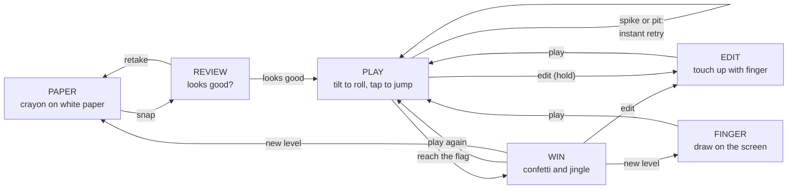

# Scribble Run — Game Design

> **Status:** design draft for review · **Target:** M5Stack **CoreS3** (320×240 touch screen, camera, tilt sensor, speaker) · **License:** MIT
>
> Companion docs: [screens.md](screens.md) · [system-design.md](system-design.md) · [build-plan.md](build-plan.md)

## 1. The one-sentence game

**Draw a level with a crayon on paper and snap it with the camera (or draw it with your finger), press Play, then tilt the device to roll a ball through your drawing to the flag. Tap to jump.**

### What the CoreS3 means for the design

| CoreS3 has | We use it for |
|------------|---------------|
| 2.0″ 320×240 capacitive touch screen | All controls (there are **no hardware buttons**), finger drawing |
| GC0308 camera (0.3 MP, below the screen, faces the **same way as the screen**) | **Paper mode**: photograph a crayon drawing on a printed template and turn it into a level. Because nobody holding the paper can see the preview, the device **stands up** and counts down aloud |
| BMI270 6-axis IMU | Tilt to roll the ball |
| 1 W speaker + amp | All feedback is **sound + screen effects** |
| 16 MB flash, 8 MB PSRAM, microSD | Levels in flash (LittleFS), optional export to microSD |
| 500 mAh battery | A play session; see §9.2 |
| Body **54 × 54 × 16 mm, 73 g** (from the product spec) | A small, light device: a child's thumbs rest on the screen edges, which is why Play uses holds and an edge-touch margin (§5.3) |
| **No** vibration motor, **no** A/B/C touch buttons | Nothing buzzes; every control is an on-screen target |

### Design pillars

| # | Pillar | What it means in practice |
|---|--------|---------------------------|
| 1 | **Fun in 10 seconds** | First launch drops you into a half-made level with a visible gap and a ghost finger drawing a bridge. A paper level is two taps from the Title screen. |
| 2 | **No reading** | Every action is an icon, a colour, or a sound. Numbers 1–10 and the words "You win!" are the only text. |
| 3 | **Nothing feels like failing** | No lives, no game-over. A spike is a funny *pop* and the ball is back at the start in half a second. A bad photo is "try again", never an error. |
| 4 | **The drawing is the game** | Winning is the cue to *change the level*. Draw → snap → play → tweak. |
| 5 | **Can't be broken** | Auto-save, undo, and a hold to confirm anything destructive. |

---

## 2. Core loop



### The first 10 seconds (the script we design to)

**Paper path** (the headline). The first time needs the **printed template** and a parent to set things up (about a minute); once it is a habit it takes about **20 seconds**. The "fun in 10 seconds" promise belongs to the finger path below.

| Time | What happens | Why |
|------|--------------|-----|
| 0 s | Title → **Paper**. First time only: the **Stand-up guide** shows three pictures (device standing, paper facing it, 3-2-1). Tap **Ready**. | Teaches the unusual part without words. |
| 3 s | **Camera check**: the device stands on its base; a parent holds the drawn sheet about 40 cm away (or leans it on a book or clipboard). Four lights go green: distance, sharp, light, level. | Live framing and focus quality, since the holder can't see the preview. |
| 8 s | Taps the big **GO**. A voice counts **"3, 2, 1, snap!"** with giant digits, so there is time to step away. | The device stays still; the picture is sharp. |
| 12 s | Shutter click, white flash, half a second of sparkle. | Physical and playful. |
| 13 s | **Review**: his drawing, straightened and recoloured (black ground, red spikes, blue bouncy), with a Start ball and a Flag placed. | "It understood my drawing!" |
| 15 s | **Looks good** → the ball drops and he tilts. | One obvious next step. |

**Finger path** (no paper handy, and first launch): Title → **Play** opens the **starter level** in Draw mode: Start and Flag on two ledges with a wide gap between. After 3 s of no touching, a ghost finger draws a bridge. He draws, presses the green **Play** button, tilts, and wins.

### Built-in "lesson" levels

Slots 1–3 ship pre-filled. They teach one material each by playing, with no text:

| Slot | Teaches | Layout idea |
|------|---------|-------------|
| 1 | **Ground** | The starter level (gap to bridge). |
| 2 | **Spike** | A hill with a red patch on top; draw a bridge or go around. |
| 3 | **Bouncy** | Flag on a high ledge that a jump can't reach; a blue pad below it. |

They are normal, editable levels.

---

## 3. Ways to make a level

### 3.1 Paper mode (the headline feature)

**What he does:** draws on the **printed A4 level template** with a fat **black** marker or crayon (ground), **red** (spikes) and **blue** (bouncy). The template ([assets/scribble-run-level-template-a4.pdf](assets/scribble-run-level-template-a4.pdf), made by `tools/template/make_template.py`) has **four corner marks**: three dots and a ring at the top-left. The camera finds the marks, **straightens the page** even if it is tilted, and turns the drawing into a level ([system-design §5](system-design.md#5-the-vision-pipeline-paper-mode)).

**How the capture works** (details in [screens.md §4](screens.md#4-camera-stand-it-up-three-screens)):

1. **Stand the device up** on its base. The camera faces the same way as the screen, so whoever holds the paper can't see the preview.
2. **Camera check:** place the sheet about **40 cm** away. Four lights show distance, sharpness, light and tilt.
3. Tap **GO**: a spoken **"3, 2, 1, snap!"** gives time to settle.
4. **Review:** "Looks good?" or **Retake**.

**Design target:** A4 **landscape**, **35–45 cm** from the camera (sweet spot 40 cm), lines **≥ 3 mm** thick. At 40 cm the camera sees about 34 × 25 cm, so the sheet fills about 87 % of the frame width. The drawing area on the sheet is **248 × 149 mm = 320 × 192 level pixels** (0.78 mm per pixel), so a 3 mm line is about 4 pixels and is thickened to the 8 px minimum.

**The crayon guide** (printed on the template's footer, and stuck near the device):

| Do | Don't |
|----|-------|
| Print the template at **100 %**, check the 10 cm line | "Fit to page" (the distance light would lie) |
| **Fat** black marker or crayon, press hard (lines ≥ 3 mm) | Pencil or thin pens (they vanish at 0.3 MP) |
| Draw inside the dashed box; don't cover the four corner marks | Drawing over or outside the marks |
| Bright, even light from the front; no shadow of a hand or the device on the sheet | One bright lamp at an angle (hard shadows and glare) |
| White paper, flat (a clipboard or book helps) | Crumpled or coloured paper |
| Wipe the lens if the **Sharp** light is yellow or red (fingerprints!) | |

**Honest limits** ([system-design §5.8](system-design.md#58-limits-and-fallbacks)): the camera is only 0.3 MP; pale colours (yellow, light blue) aren't detected; glare and hard shadows hurt; the *fixed* focus is sharp from about 30 cm, which is why the paper stays at 35–45 cm; the camera facts (field of view, focus range) are **confirmed on the device in build Step 6**. That's why there is always a Review screen, one-tap Retake, "thinner/thicker ink", and finger **Edit** to fix mistakes. It also needs a **printed sheet and a grown-up for setup**, so finger mode remains the instant path.

**No printer?** Finger mode works without anything. A hand-drawn sheet *without* the four marks still works in a fallback: the whole camera frame is centre-cropped (less accurate; the Review screen says so).

### 3.2 Finger mode

Draw and erase directly on the screen with a toolbar of **Ground, Spike, Bouncy, Eraser, Undo, Play**. **Start** and **Flag** are pins you drag. **Clear** is in the menu (hold to confirm).

### 3.3 Edit mode

The same screen as finger mode, opened on an existing level or right after a paper capture, so he can touch up what the camera got wrong (fill a gap, erase a smudge, move the flag).

---

## 4. The world

### 4.1 Playfield

* **320 × 192 px** logical world, 1 world pixel = 1 screen pixel. It occupies the top 192 px of the screen; the lowest **48 px** is the *bottom bar* (tools or actions; see [screens.md](screens.md)).
* **Why 192 (5 : 3) and not the full 240?** The bottom bar needs ≥ 44 px for touch targets. The paper template's drawing area is also 5 : 3 (248 × 149 mm), so a straightened photo maps onto the level exactly, with no cropping.
* Coordinates: `x` right, `y` down, origin top-left; velocities in **px/s**, accelerations in **px/s²**.
* **Edges:** left and right edges are solid invisible walls. The top is open. The bottom is a **pit**: when the ball centre falls below `y = 192 + 3·radius`, it respawns (§9).

### 4.2 Materials and objects

| Thing | Colour on screen | Colour on paper | Behaviour |
|-------|------------------|-----------------|-----------|
| **Ground** | Black | Black crayon/marker | Solid. The ball rolls and stands on it. Low bounce. |
| **Spike** | Red + diagonal ticks | Red crayon | **Not solid.** Touching it with the ball's inner hit-circle (75 % of the ball size, deliberately forgiving) pops the ball → back at Start. |
| **Bouncy** | Blue + dot texture | Blue crayon | Solid. Launches the ball **along the surface normal at 480 px/s** (≈ 2.5× a jump). |
| **Start** | Green ring around the ball | — (auto-placed) | Where the ball (re)appears. Exactly one. |
| **Flag** | Green flag on a pole | — (auto-placed) | Touching it (16 px radius) wins. Exactly one. |
| **Eraser** | — | — | Removes all three materials (finger mode only). |

Every material has a **texture as well as a colour** so the game works for colour-blind players (about 1 in 12 boys); see [screens.md §Visual style](screens.md#visual-style).

### 4.3 Drawing rules (finger mode and Edit)

* **Brush:** round, **8 px** diameter. **Eraser:** **20 px**.
* The brush stamps discs along the segment between successive touch samples (≤ 2 px apart) so fast strokes leave no gaps.
* **Materials are exclusive:** painting one clears the other two at those pixels.
* **Minimum thickness is 8 px** (paper mode enforces this by thickening), which lets the physics prevent tunnelling.
* **Pins** (Start, Flag): drag within a 24 px grab radius. On drop, all material within 12 px (Start) / 14 px (Flag) is cleared so a pin is never buried.
* **Undo:** 8 levels. **Clear** (menu) needs a hold and is undoable. **Auto-save** when leaving Draw/Edit and after 5 s idle.

### 4.4 The starter level

| Item | Value (world px) |
|------|-------------------|
| Start (ball centre) | (40, 104), resting on the left ledge |
| Flag base | (280, 112), pole on the right ledge |
| Left ledge (Ground) | x 16 – 72, y 112 – 120 |
| Right ledge (Ground) | x 248 – 304, y 112 – 120 |
| Gap | 176 px: too wide to jump (max jump ≈ 100 px), so he *must* draw. |

---

## 5. Controls (all on-screen)

### 5.1 Touch targets

* Every target is **≥ 44 × 44 px**; our standard is **≥ 48 px**; primary buttons are 80 px or wider.
* ⚠️ **Physical size:** the screen is 2.0″ ≈ **7.9 px/mm**, so 44 px ≈ **5.6 mm**, smaller than a child's fingertip (≈ 8–10 mm). So: 48 px hit areas everywhere, forgiving hit-testing (nearest target within 6 px wins), and the most-used actions get the biggest buttons.
* Single touch only. A second finger is ignored.

### 5.2 The top-bar pattern (same on every screen)

* **← Back is always top-left. ☰ Menu is always top-right.** Both have 48 × 48 px hit areas.
* On list-style screens (Level picker, New level) they sit in a full-width 48 px **top bar**.
* On screens that show the level or the camera (Draw, Play, Camera check, Review) they float as small translucent **corner chips** over the playfield, so the canvas keeps its full size.
* What **←** does: *go up one step, saving first.* In Draw → Level picker. In Camera/Review → previous step. In Play → **Edit** (back to Draw), see the hold rule below.
* The Title screen has no ← (nothing above it); the Win screen has no top bar (three big buttons only).

### 5.3 Controls by mode

| Mode | Touch | Tilt |
|------|-------|------|
| **Title** | Tap **Levels**, **Paper**, **Play** (green, biggest) or **Draw** (bottom tiles); tap 🔊 (top-right) to cycle sound | — |
| **Level picker** | Tap a filled slot → Play it; tap an empty slot → **New level** chooser; **←** Title; 🗑 toggles delete mode | — |
| **New level** | Big **Paper** or **Draw** buttons; ← back | — |
| **Stand-up guide** | **Ready** (big green) · ← back | — |
| **Camera check** | Watch the four lights (**distance, sharp, light, level**) · **GO** (big, green when all lights are green) · **?** help · ← back | — |
| **Countdown** | Nothing to do: a voice says "3, 2, 1, snap!" · ← **Stop** | — |
| **Review** | **Looks good** (green) · **Retake** · **− ink / + ink** · drag the Start/Flag pins · ← retake | — |
| **Draw / Edit** | Drag = paint with the selected tool · drag a pin to move it · bottom toolbar: **Ground, Spike, Bouncy, Eraser, Undo, ▶ Play** · ← Levels · ☰ menu | — |
| **Play** | **Tap anywhere = jump** · big **Jump** pad (bottom) · **Restart** (hold 0.4 s) · **←** Edit (hold 0.4 s) · ☰ menu | **Roll** left / right |
| **Win** | **Edit** · **Play again** (green) · **New level** | — |
| **Menu** | Tap a big button, or ← / tap outside to close | — |

> **Two deliberate differences from the brief's toolbar list.** Eight toolbar items (Ground, Spike, Bouncy, Start, Flag, Eraser, Clear, Play) would each be only 40 px wide, below the 44 px minimum. So **Start and Flag are draggable pins** (no tool needed) and **Clear moves to the menu** (hold to confirm). That leaves six 53 px toolbar buttons, including **Undo**. Open question 1 asks whether you'd rather keep them as tools.

* **Why hold for Edit / Restart in Play?** On a small device a child's thumbs rest on the screen edges and bottom corners, exactly where those buttons are. A 0.4 s hold (with a ring that fills) prevents accidental exits. **Jump is instant.**
* **Grip-safe jump:** a touch that *begins* within 12 px of the left or right screen edge doesn't count as a jump (it's a thumb holding the device). The margin is a constant to tune on the device.
* **Jump only from the ground**, with a little forgiveness: a tap up to 0.10 s after rolling off a ledge still jumps, and a tap up to 0.12 s before landing is remembered.

### 5.4 Tilt mapping

* Only **left–right tilt** from the BMI270, as a fraction of gravity `ax` (≈ sin of the tilt angle).
* **Dead-zone** 0.06 g (≈ 3.5°). **Full speed at 0.40 g (≈ 24°).** Linear in between. Light low-pass filter (α = 0.25 per tick).
* Holding the device pitched back doesn't matter: roll is measured on a different axis.
* Axis and sign are confirmed on the real hardware ([build-plan.md Step 2](build-plan.md#step-2--tilt-sensor)).

---

## 6. Physics feel

One shared constants file feeds both the simulator and the firmware ([system-design.md §9](system-design.md#9-code-sharing-between-simulator-and-firmware)). **Starting values** (tune by playing):

| Constant | Start value | Unit | What it feels like |
|----------|------------:|------|--------------------|
| `BALL_RADIUS` | **8** | px | 16 px across; the screen is 20 ball-widths wide. |
| `GRAVITY` | **900** | px/s² | A 100 px drop takes 0.47 s. Snappy. |
| `JUMP_SPEED` | **300** | px/s | Apex = v²/2g = **50 px**, 0.67 s in the air. |
| `BOUNCY_SPEED` | **480** | px/s | Apex = **128 px** (≈ 2.5× a jump), 1.07 s in the air. |
| `MAX_SPEED` | **520** | px/s | Terminal velocity (also bounds tunnelling risk). |
| `MAX_ROLL_SPEED` | **150** | px/s | Across the screen in ~2 s at full tilt. |
| `ROLL_ACCEL` | **700** | px/s² | Full roll speed in 0.21 s. |
| `AIR_CONTROL` | **0.5** | × | Tilt steers at half strength in the air. |
| `GROUND_FRICTION` | **500** | px/s² | With no tilt, stops from full speed in 0.3 s. Ball sticks on gentle slopes (< ~30°). |
| `RESTITUTION` | **0.25** | — | Small bounce on landing. |
| `BOUNCE_MIN_SPEED` | **60** | px/s | Slower impacts don't bounce. |
| `COYOTE_TIME` / `JUMP_BUFFER` | **0.10 / 0.12** | s | Jump forgiveness. |
| `TILT_DEADZONE` / `TILT_FULL` | **0.06 / 0.40** | g | See §5.4. |
| `SPIKE_HIT_SCALE` | **0.75** | × radius | Forgiving spike hitbox. |
| `FLAG_HIT_RADIUS` | **16** | px | Generous goal. |
| `RESPAWN_DELAY` | **0.5** | s | Pop → back at Start. |

**Derived checks:** a full-speed jump travels `150 × 0.67 ≈ 100 px`, so gaps up to ~100 px are jumpable and the starter's 176 px gap is not. To change gravity but keep jump height `h`, set `JUMP_SPEED = √(2·GRAVITY·h)`.

**Rolling model (simple and forgiving)**

```
target_vx = tilt × MAX_ROLL_SPEED
rate      = grounded ? ROLL_ACCEL : ROLL_ACCEL × AIR_CONTROL
if grounded or tilt ≠ 0:  vx moves toward target_vx by at most rate × dt
(no tilt, grounded)       →  rate = GROUND_FRICTION  (the ball settles)
(no tilt, airborne)       →  vx unchanged (momentum is kept)
```

**Paper levels and physics:** a paper level can be much more detailed than a finger-drawn one (ink thicker than 8 px, odd angles). Collision uses the same 1-bit maps either way, so nothing special is needed; the thickening step in the vision pipeline guarantees the minimum thickness.

---

## 7. Feedback: win, lose, and everything in between (no vibration)

The CoreS3 has **no vibration motor**, so every event is **sound + a screen effect**. Sounds are synthesised tones (no audio files in v1). The 1 W speaker is louder than a typical Core2, so the default volume is **Low**.

| Event | Sound | Screen effect |
|-------|-------|---------------|
| Pen down / drawing | Very quiet 12 ms tick every ~24 px; pitch by material (Ground 220 Hz · Spike 880 Hz · Bouncy 440 Hz) | Ink appears instantly under the finger. |
| Button press | 1 kHz tick, 15 ms | Button depresses (shadow 4 px → 1 px). |
| **Countdown** | A voice says **"three", "two", "one", "snap!"** one second apart (always at least at Low volume when sound is on) | Giant digits bounce in; the ball bounces on each beat. |
| **Snap (camera)** | Shutter "click" (two quick ticks) | The frame is taken *first*, then a white flash 80 ms, then a sparkle while it processes. |
| **Review ready** | Rising "ta-da" (C5 → G5) | Detected materials pop in colour, one material at a time (0.4 s). |
| **Detection looks poor** | Soft low two-note "hmm" (never a harsh buzz) | Friendly paper-with-question-mark icon; **Retake** pulses. No red crosses, no error text. |
| **Jump** | Rising chirp 400 → 700 Hz, 80 ms | Ball stretches tall (1.25×) for 0.1 s. |
| **Land** (fall > 150 px/s) | Soft thump 150 Hz, 30 ms | Ball squashes flat 0.08 s, dust puff. |
| **Bouncy launch** | "Boing" 300 → 900 Hz, 140 ms | Pad squishes; ball stretches; 4 blue sparkles. |
| **Spike → pop** | Pop + falling 700 → 150 Hz, 160 ms | 8 red/white particles; **2 px screen shake** for 150 ms; red edge flash 100 ms; faint grey **oops puff** stays until the level is edited. |
| **Fell in the pit** | Soft "whoosh" 500 → 200 Hz, 80 ms | Ball fades out (no burst; it's not a punishment). |
| **Respawn** | Tiny "bloop" 300 → 500 Hz | Ball grows from nothing at Start with an expanding ring (0.2 s). |
| **Flag reached (win)** | Jingle C5-E5-G5-C6 (523 · 659 · 784 · 1047 Hz, 90 ms each) | **Full-screen green-white flash 120 ms**, flag waves, ring burst, ball hops, 24 confetti pieces, 0.3 s slow-motion, then the **"You win!"** screen. |
| **Win screen** | Last note held, then silence | Big star bounces in; confetti keeps falling. |
| Sound **Off / Low / Med** | Cycle on the Title and menu 🔊 button | Speaker icon with 0 / 1 / 2 arcs. |

---

## 8. Respawn rules (instant retry)

* **Spike:** pop at once; the ball reappears at Start after **0.5 s**. No input needed.
* **Pit:** the ball fades and reappears (0.4 s).
* **Stuck inside ground** (rare): the physics pushes the ball out; if it can't, it quietly respawns.
* **No counter, no lives, no timer** in v1. Deaths are never shown as a number.
* **Oops puffs** mark the last 5 death places so he can see *where* to fix the level.

---

## 9. Fun for a 7-year-old, and what could go wrong

### 9.1 Why this should work

* **Real crayons become a game.** The leap from paper to playing is the wow moment. Nothing else like it in a kid's hands.
* **Authorship:** he made the level, so winning is *his* win.
* **Immediate feedback:** ink under the finger, the ball moving the instant he tilts, a sound and an effect for every event.
* **Two-player-ish:** "draw me a level I can't beat" is a built-in game with Dad.
* **Discovery:** a blue ramp flings the ball sideways, a red patch under a bridge is a trap. He'll find combinations we didn't design.

### 9.2 Frustration risks and mitigations

| Risk | Why a 7-year-old would hate it | Mitigation |
|------|-------------------------------|------------|
| **Magic fails** | He draws something lovely, the camera mangles it. | The **Review** screen *always* shows what was understood; **Retake** is one tap; **thinner/thicker ink** fixes dark/light photos; **Edit** lets him repair with a finger; failure messages are friendly pictures, not errors. |
| **Can't see the preview while holding the paper** | The camera faces the same way as the screen. | The **stand-up flow**: the device stands, the **Camera check** lights tell a parent when it's right, and a **spoken 3-2-1-snap** gives time to step away. |
| **Bad light / shadows / tilted page** | The result is garbage and he can't tell why. | The **Light** and **Level** lights; the four corner marks let the vision step **straighten a tilted page**; honest limits documented. |
| **Pencil / thin lines vanish** | His careful pencil drawing produces an empty level. | The crayon guide; "too little ink" detection shows "draw bigger and darker" as a picture; he keeps the photo preview to compare. |
| **Fat finger, tiny screen** | Can't hit small buttons. | ≥ 48 px targets, forgiving hit-testing, a 8 px brush, ink exactly under the touch point. |
| **Spikes feel punishing** | Dying repeatedly. | Instant 0.5 s retry, forgiving 75 % hit-circle, no counters, a funny pop, oops puffs. |
| **Too hard to control** | Ball is twitchy or sluggish. | Gentle tilt (24° = full speed), dead-zone, smoothing, sticky friction, jump forgiveness. Tune together with him. |
| **Impossible level** | He draws one he can't win. | Pit respawn is non-punishing; Edit is one tap away; undo; no "failed" state. |
| **Lost work** | Accidentally erases or exits. | Auto-save, 8-level undo, Clear needs a hold and is undoable, delete needs a hold. |
| **Thumbs trigger buttons** | Gets thrown out of Play. | Edit/Restart need a 0.4 s hold; edge-touch rejection for jumps; test with his real grip. |
| **Needs a printout and a grown-up** | Paper mode isn't instant. | Print a stack of templates once; finger mode is always one tap away; after the first time the paper path takes ≈ 20 s. |
| **Fingerprints on the lens** | A smudged lens makes everything soft. | The **Sharp** light goes yellow/red and shows a wipe-the-lens picture. |
| **Reading** | Can't read menus yet. | Icons and colours; only "You win!" and 1–10. |
| **Sound is annoying** | A 1 W speaker is loud. | Default Low, one-tap mute, short tones. |
| **Battery dies** | Tears. | 500 mAh is modest and the camera + screen are thirsty: auto-save everywhere, a battery icon below 20 %, screen dims after 60 s idle. |

---

## 10. Open questions for review

1. **Start/Flag as pins, Clear in the menu** (because 8 toolbar buttons would be 40 px). Okay? Alternative: a two-row toolbar that costs 44 px of canvas.
2. **Where does the device stand?** On its DinBase, or on a small phone stand? The camera needs to look level at the paper; the **Level** light and the accelerometer will tell us. We test it in Step 6.
3. **Where does the paper go?** Held by a parent, leaned on a clipboard against a stack of books, or taped to a wall at 40 cm. Which feels natural for you two?
4. **Hold-to-activate** for Edit and Restart in Play (0.4 s). Okay?
5. **Reset lessons** (restore slots 1–3) is deferred to later.

---

## 11. Stretch ideas (not in v1; the data format reserves room)

| Idea | Design | Hooks already in the design |
|------|--------|-----------------------------|
| **⭐ Stars to collect** | Up to 3 stars per level; winning with 0–3 stars is shown on the thumbnail. In paper mode, a **yellow** crayon dot could be a star. | `extras` chunk in the level file (`type = 1`, x, y; max 8). |
| **⏱ Timer / best time** | Shown only on the Win screen; none during play (no pressure). | `settings.bin` stores `bestTimeMs[10]`. |
| **👻 Ghost race** | The device records your best run (tilt + jump per tick ≈ 1 byte/tick) and replays it as a faint ball. Needs deterministic physics, which the fixed 60 Hz step gives. | Fixed timestep; no `random()` in physics. |
| **👨 Dad's challenge** | Slot 10 gets a gold border. Dad draws a nasty level and plays it once (his ghost is saved); the child tries to beat Dad's ghost. | Ghost race + a flag bit in the level header. |
| **📷 Scan a shared level** | **The CoreS3 camera can scan a QR code** shown on another device, so levels can be shared without Wi-Fi. Showing a QR needs the level compressed to ≲ 1 KB, so the *scanning* side is easier than the *showing* side; see [system-design.md §10.2](system-design.md#102-sharing-without-wi-fi). | `encoding = 1` (RLE) reserved in the header. |
| **💾 microSD export / import** | Copy `.scrb` files to/from a microSD card; the simulator's "Download level" makes the same file. | Same file format everywhere. |
| **🎙 Your own voice for the countdown** | Record "3, 2, 1, snap!" with the two built-in microphones; the clips replace the defaults. A fun five-minute job with the kids. | Countdown clips are small files in flash (§ audio assets in the system design). |
| **📄 Template-free paper mode** | Find a plain sheet by its edges, with no corner marks. | The page-finding stage is replaceable. |
| **🎨 Colours for new things** | Green crayon = a moving platform, yellow = a star. | Extra hue ranges in the vision config. |
