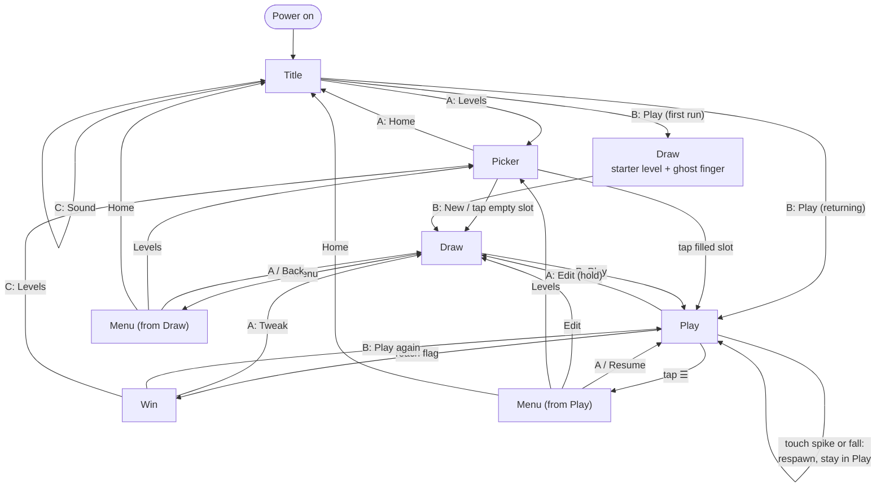

# Scribble Run — Screens

> Companion docs: [game-design.md](game-design.md) · [system-design.md](system-design.md) · [build-plan.md](build-plan.md)

## 0. How to read the wireframes

* The device screen is **320 × 240 px**. Each wireframe is **80 × 30 characters**, so **1 character = 4 px wide × 8 px tall** (monospace characters are about 1 : 2, so proportions look right).
* The outer box is the screen. The **three-cell strip under it** is *not* screen: it is the physical **A / B / C** touch zone of the Core2 (≈ 107 × 40 px each — to be verified on the device, see [build-plan Step 1](build-plan.md)).
* **Bottom bar:** the lowest **48 px** of the screen (rows 24–29, y 192–239) is always reserved for either the toolbar (Draw) or three tabs that sit directly **above A, B and C** (everything else). Tapping a tab does the same as pressing its physical button, except in Play where A/C need a hold (see below).
* **Playfield:** the upper **320 × 192 px** (rows 0–23) is the level canvas.
* Tab / button geometry (identical on every screen so thumbs learn it):

| Zone | x range (px) | Used by |
|------|--------------|---------|
| Tab **A** / button A | 0 – 105 | left action |
| Tab **B** / button B | 108 – 211 | main action (always the *big green one* when there is one) |
| Tab **C** / button C | 214 – 319 | right action |

* Every on-screen target is **≥ 48 px** tall; tabs are 106 × 48; toolbar tools are 80 × 48.
* ASCII legend: `#` ground (black) · `^` spike (red) · `O` bouncy (blue) · `(o)` ball · `(S)` start pin · `\|>` flag · `*` highlight/star.

---

## 1. Title screen

{{WF:TITLE}}

| Element | Position (px) | Notes |
|---------|---------------|-------|
| Logo "SCRIBBLE RUN" | y 16 – 100 | Hand-drawn wobbly letters in ink with yellow highlight; slightly alive (wiggles every 2 s). |
| Demo scene | y 112 – 176 | A ball rolls up a hill, jumps a gap, reaches a flag, loops. Pure decoration; proves the game in one glance. |
| Tab A — Levels | 0,192 · 106×48 | Grid icon. Opens the Level picker. |
| Tab B — Play | 108,192 · 104×48 | **Green, biggest icon (▶).** Opens the last-used level in **Play**. On first run (no saved progress) opens the **starter level in Draw** with the ghost-finger hint. |
| Tab C — Sound | 214,192 · 106×48 | Speaker icon with 0 / 1 / 2 arcs; each press cycles Off → Low → Med. |
| Battery | top-right, 24×12 | Only shown when < 20 %. |

| Button | Action |
|--------|--------|
| **A** | Levels |
| **B** | Play (last level) |
| **C** | Sound off / low / med |

Tapping anywhere above the tab bar is the same as **B**.

---

## 2. Level picker (10 slots)

{{WF:PICKER}}

| Element | Position (px) | Notes |
|---------|---------------|-------|
| Slot grid | 5 × 2 cells, each **64 × 96**, y 0 – 191 | Thumbnail **60 × 36** (the level at 1 : 5.33), big slot number below (20 px digits). |
| Empty slot | dashed box with **＋** | Tap to start a *new blank level* in Draw (the blank has Start/Flag pins and a floor so Play works at once). |
| Last-played slot | thick yellow border | Where you "were". |
| **v** tick | bottom-right of the cell | Level has been beaten at least once. |
| Delete mode | red **✕** on each filled thumbnail | Tapping ✕ shows a *hold-to-delete* ring (1.5 s). Prevents accidents. |

| Button | Action |
|--------|--------|
| **A** | Home (Title) |
| **B** | **New** — creates a level in the first empty slot and opens Draw |
| **C** | Toggle delete mode |

Tap a **filled** slot → opens it in **Play**. Tap an **empty** slot → opens it in **Draw**.
(Thumbnails are generated on save; see [system-design §4.6](system-design.md#46-thumbnails).)

---

## 3. Draw mode

{{WF:DRAW}}

| Element | Position (px) | Notes |
|---------|---------------|-------|
| Canvas | 0,0 – 319,191 (320×192) | Drag = paint with the selected tool. The finger is always the brush centre; ink appears instantly. |
| Start pin `(S)` | draggable | A ball outline with a downward arrow ("it will drop"). 24 px grab radius. |
| Flag pin `\|>` | draggable | Green flag. 24 px grab radius. |
| Ghost finger | animated | After 3 s idle (only while the level has no player strokes yet) a translucent finger draws a black line across the gap. Stops on first touch. |
| Tool: **Ground** | 0,192 · 80×48 | Black swatch + solid bar icon. |
| Tool: **Spike** | 80,192 · 80×48 | Red swatch + saw-tooth icon. |
| Tool: **Bouncy** | 160,192 · 80×48 | Blue swatch + spring icon. |
| Tool: **Eraser** | 240,192 · 80×48 | White-and-grey eraser block; brush ring shown at 20 px. |
| Active tool | yellow halo + button pushed in | Exactly one tool is always active; default **Ground**. |

| Button | Action |
|--------|--------|
| **A — Undo** | Undo last stroke / pin move (8 levels). Greyed when nothing to undo. |
| **B — Play ▶** | Auto-saves, then switches to Play. *This is the one big green action.* |
| **C — Menu ☰** | Opens the menu overlay (Back, Clear, Levels, Sound, Home). |

> **Labelling A/B/C in Draw.** The toolbar fills the bottom bar, so A/B/C can't be labelled on screen here. We put **coloured stickers** on the device (blue pencil-arrow, green ▶, grey ☰) and, until the first Play, pulse three small hint icons at the very bottom edge of the canvas. See open question 1 in [game-design.md](game-design.md#9-open-questions-for-review).

---

## 4. Play mode

{{WF:PLAY}}

| Element | Position (px) | Notes |
|---------|---------------|-------|
| Playfield | 0,0 – 319,191 | The level exactly as drawn (same pixels as in Draw). |
| ☰ pause target | top-right, **48×48** (x 272–319, y 0–47) | Only a 24 px ghosted icon is drawn; the whole 48×48 is the hit area. Tap → Pause menu. Taps here never jump. |
| Jump | **anywhere else on the playfield** | Fires on touch-down. Touches starting within 12 px of the left/right edge are ignored (grip). |
| Bottom hint strip | y 192–239 | Three tabs *above A, B, C* acting as hints. **A and C are hold-to-activate** (0.4 s; a ring fills around the icon). **B jumps instantly.** |
| Tilt hint | first Play only | Animated arrows `← tilt →` next to the ball for 3 s. |
| Oops puffs | where recent pops happened | Faint grey clouds; cleared on edit. |

| Button | Action |
|--------|--------|
| **A — Edit** (hold 0.4 s) | Back to Draw, level exactly as it was. |
| **B — Jump** | Jump. Same as tapping the screen. |
| **C — Restart** (hold 0.4 s) | Ball back to Start. |

Playing has *no* HUD: no score, no timer, no lives.

---

## 5. Win screen

{{WF:WIN}}

Shown about 1.2 s after the flag is touched (the in-level celebration plays first; see [game-design §6](game-design.md#6-feedback-win-lose-and-everything-in-between)).

| Element | Notes |
|---------|-------|
| Background | Paper with a green burst; confetti continues falling for 4 s. |
| Big star | Bounces in (overshoot easing, 0.4 s). Later: shows earned stars (stretch). |
| Ball | Happy face (eyes squint, big smile). |
| Tab A — Tweak | Pencil icon → back to **Draw** on this level. *The tweak loop is the point of the game.* |
| Tab B — Again | **Green ▶** → replay the level. |
| Tab C — Levels | Grid icon → Level picker. |

| Button | Action |
|--------|--------|
| **A** | Tweak (Draw) |
| **B** | Play again |
| **C** | Levels |

(Tabs on the Win screen are *instant* — there's no tilting happening, so no accidental-press risk.)

---

## 6. Pause / menu

Opened from Play (☰ tap) or Draw (**C**). It's an overlay: the scene behind is dimmed and frozen. Six big buttons, each **96 × 80 px** (3 × 2 grid, 288 × 160 px panel at x 16, y 16). Icons only.

**From Play:**

{{WF:MENU_PLAY}}

**From Draw:**

{{WF:MENU_DRAW}}

| Cell | Play menu | Draw menu |
|------|-----------|-----------|
| 1 | **Resume** (green ▶) | **Back** (green ▶, returns to drawing) |
| 2 | **Edit** (pencil) → Draw | **Clear** (trash can, *hold 0.8 s*; undoable) |
| 3 | **Levels** → picker | **Levels** → picker (auto-saves first) |
| 4 | **Restart** | **Sound** |
| 5 | **Sound** | **Home** → Title |
| 6 | **Home** → Title | — |

| Button | Action |
|--------|--------|
| **A** | Close menu (same as Resume / Back) |
| **B**, **C** | Unused in menus |

Tapping the dimmed area outside the panel also closes it.

---

## 7. Button summary (A / B / C on every screen)

| Screen | **A** | **B** | **C** |
|--------|-------|-------|-------|
| Title | Levels | **Play** | Sound |
| Level picker | Home | **New** | Delete mode |
| Draw | Undo | **▶ Play** | Menu |
| Play | Edit *(hold)* | **Jump** | Restart *(hold)* |
| Win | Tweak | **Play again** | Levels |
| Menu | Close | — | — |

**Rule of thumb for the whole UI:** **B (middle) is always the big green "go" action.** A is "go back / change something". C is "more".

---

## 8. Screen flow

The same flow as a state machine, with the events that drive it, is in [system-design.md §3](system-design.md#3-state-machine).

---

## Visual style

### Principles

1. **Sketchbook feel.** Warm cream paper, ink-black lines, bright marker colours. Looks hand-made, reads at a glance.
2. **Few colours, always the same meaning.** One colour → one idea (red = danger, blue = bounce, green = go, yellow = you/special).
3. **Chunky.** Strokes ≥ 4 px, icons 32 × 32 px drawn with ≥ 4 px strokes, 3 px ink outlines, rounded caps. Fine detail disappears on a 2″ screen.
4. **Readable at 2 inches.** Viewing distance ≈ 30 cm. The screen is only ≈ 41 × 31 mm: anything under 12 px tall is unreadable, so UI text is ≥ 20 px or absent.
5. **Never colour alone** (see below).

### Palette (9 colours, RGB565 for the firmware)

| Name | Hex | RGB565 | Used for |
|------|-----|--------|----------|
| **Paper** | `#FFF4D6` | `0xFFBA` | Background of the playfield and screens |
| Paper dot | `#EADFB8` | `0xEEF7` | Faint 16 px dot-grid on the playfield |
| **Ink** | `#1C1C24` | `0x18E4` | **Ground**, outlines, text |
| **Red** | `#F03A2E` | `0xF1C5` | **Spike**, pop particles |
| **Blue** | `#2F7DF6` | `0x2BFE` | **Bouncy**, sparkles |
| **Green** | `#25C26E` | `0x260D` | **Flag, Start, the big ▶ / "go" actions** |
| **Yellow** | `#FFD23F` | `0xFE87` | **Ball**, stars, selected-tool halo, last-played border |
| White | `#FFFFFF` | `0xFFFF` | Highlights, icon glyphs on colour, ball eyes |
| Grey | `#B9B3A0` | `0xBD94` | Disabled buttons, oops puffs, dimmed overlay tint |

(RGB565 = `(R & 0xF8) << 8 | (G & 0xFC) << 3 | B >> 3`.) All values live in the shared constants file ([system-design §9](system-design.md#9-code-sharing-between-simulator-and-firmware)).

### Colour-blind safety: materials also have a texture

| Material | Colour | Texture painted by the renderer (per pixel, no assets) |
|----------|--------|--------------------------------------------------------|
| Ground | Ink | Solid |
| Spike | Red | Diagonal white-ish tick every 4 px (`(x + y) & 3 == 0` drawn as light red) → looks "spiky" |
| Bouncy | Blue | White dot on a 4 × 4 lattice (`x & 3 == 0 && y & 3 == 0`) → looks "springy/bubbly" |

Toolbar icons use shape too: Ground = flat bar, Spike = saw-tooth, Bouncy = spring coil, Eraser = tilted block with a grey band.

### Buttons and icons

* **Buttons:** rounded rectangles (radius 8), 3 px ink outline, a 4 px offset "shadow". Pressed = shadow 1 px and the button moves down 3 px (it *looks* pressed).
* **Icons** are drawn with primitives (`fillTriangle`, `fillRoundRect`, `fillCircle`, thick lines) in code, not bitmaps — no asset pipeline, crisp at any size, colours stay in the palette.
* **Primary action** is always green with an **ink** glyph (white on this green is only 2.2 : 1 contrast; ink is about 7 : 1). **Secondary** is white or paper with an ink glyph. **Destructive** (delete, clear) is red with an ink glyph and needs a hold.

| Icon | Shape | Where |
|------|-------|-------|
| ▶ Play | right-pointing triangle | Title B, Draw B, Win B, menus |
| ✏ Edit / Tweak | slanted pencil | Play A, Win A, Play menu |
| ↶ Undo | curved arrow left | Draw A |
| ☰ Menu | three bars | Draw C, Play top-right |
| ↻ Restart | circular arrow | Play C, Play menu |
| ▦ Levels | 2 × 2 grid | Title A, Win C, menus |
| ⌂ Home | house | Level picker A, menus |
| ＋ New | plus | Level picker B, empty slots |
| 🗑 Delete / Clear | trash can | Level picker C, Draw menu |
| 🔊 Sound | speaker with 0 / 1 / 2 arcs | Title C, menus |

### Typography

* Only two sizes of one bold, rounded sans font (M5GFX's built-in `FreeSansBold12pt7b` for the slot numbers and `FreeSansBold18pt7b` for the logo fall-back): **numbers 1–10** and the **logo**. Everything else is icons.
* The logo is drawn as 12 stroke-built letters (not a font) for a hand-drawn look.

### Motion

* Everything that appears **bounces slightly** (overshoot easing 0.2 – 0.4 s).
* Screen changes are a quick **paper-wipe** (≈ 150 ms) — fast enough that it never feels like waiting.
* Particles are a fixed pool (max 32), drawn as 2–4 px squares/circles in palette colours.
