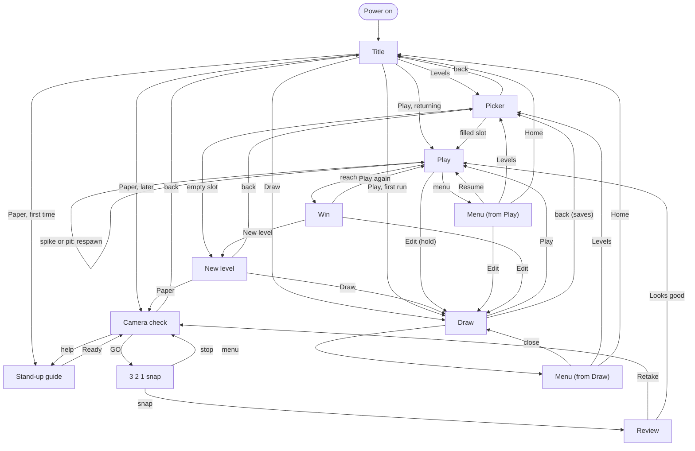

# Scribble Run — Screens

> Target device: **M5Stack CoreS3** — touch screen only: **no hardware A/B/C buttons**, so every control is on screen.
> Companion docs: [game-design.md](game-design.md) · [system-design.md](system-design.md) · [build-plan.md](build-plan.md)

## 0. How to read the wireframes

* The screen is **320 × 240 px**. Each wireframe is **80 × 30 characters**: **1 character = 4 px wide × 8 px tall** (monospace characters are about 1 : 2, so proportions look right). The outer box is the screen.
* ASCII legend: `#` ground (black) · `^` spike (red) · `O` bouncy (blue) · `(o)` ball · `(S)` start pin · `|>` flag · `*` highlight · `.` dim / camera noise.
* **Every target is ≥ 48 × 48 px** (the brief's minimum is 44 px; see the size note in [game-design §5.1](game-design.md#51-touch-targets)).

### 0.1 Screen geometry (the same everywhere so thumbs learn it)

```text
 Screens that show a level           List-style screens
 (Draw, Play, Camera, Review)        (Level picker, New level)
 +------------------------------+    +------------------------------+
 | [<-]  corner chips     [=]   |    | [<-]   title            [x]  |  <- top bar  48 px
 |        playfield 320x192     |    +------------------------------+
 |                              |    |                              |
 |                              |    |       content 320x192        |
 +------------------------------+    |                              |
 |   bottom bar  320x48         |    |                              |
 +------------------------------+    +------------------------------+
```

| Region | Size (px) | Used for |
|--------|-----------|----------|
| **Playfield** | 320 × 192 at y 0 | The level (Draw, Play, Review) or the camera preview (Camera) |
| **Bottom bar** | 320 × 48 at y 192 | Tools (Draw), actions (Play, Camera, Review, Win), tiles (Title) |
| **Top bar** (list screens) | 320 × 48 at y 0 | ← Back, title icon, one extra action |
| **Corner chips** (level screens) | 48 × 48 hit area each, 40 × 40 drawn, translucent | ← Back (top-left), ☰ Menu (top-right) |

### 0.2 The navigation rule (no hardware buttons)

* **← Back is always top-left. ☰ Menu is always top-right.** (On list screens the right slot holds that screen's one extra action instead, e.g. the bin.)
* **← means "go up one step, saving first."** It never discards work.
* **The big green button is always the "go" action** and sits in the same place: the biggest slot of the bottom bar.
* In **Play**, ← (**Edit**) and **Restart** need a **0.4 s hold** (a ring fills around the icon). Thumbs rest near the edges; a hold prevents accidental exits. Jump is instant.

---

## 1. Title

```text
+--------------------------------------------------------------------------------+
|                                                                    +----------+|
|                                                                    |          ||
|                                                                    |    ((    ||
|                 ####  #### ####  ##### ####  ####  #     #####     |   SND    ||
|                #     #     #   #   #   #   # #   # #     #         |          ||
|                 ###  #     ####    #   ####  ####  #     ####      +----------+|
|                    # #     #  #    #   #   # #   # #     #                     |
|                ####   #### #   # ##### ####  ####  ##### #####                 |
|                                                                                |
|                                                                                |
|                               ####  #   # #   #                                |
|                               #   # #   # ##  #                                |
|                               ####  #   # # # #                                |
|                               #  #  #   # #  ##                                |
|                               #   #  ###  #   #                                |
|                                                                                |
|                        ~~>                                                     |
|                    (o)       #######                                           |
|                           ###       ###                              |>        |
|                        ###             ###                           |         |
|                     ###                   ###                        |         |
|#####################                         ##################################|
|                                                                                |
|                                                                                |
|================================================================================|
|       [::]       |       [O]         |         |\          |        /          |
|       [::]       |       (_)         |         | >         |       /_/         |
|                  |                   |         |/          |                   |
|      LEVELS      |      PAPER        |        PLAY         |       DRAW        |
|                  |                   |                     |                   |
+--------------------------------------------------------------------------------+
```

| Element | Position (px) | Notes |
|---------|---------------|-------|
| Logo "SCRIBBLE RUN" | y 16 – 100 | Hand-drawn wobbly letters; wiggles every 2 s. |
| Demo scene | y 112 – 176 | A ball rolls up a hill, jumps a gap, reaches a flag, loops. |
| 🔊 chip | top-right, 48×48 | Cycles Off → Low → Med. Also shows a battery icon next to it when < 20 %. |
| **Levels** tile | x 0–71, y 192 | 2×2 grid icon → Level picker. |
| **Paper** tile | x 72–151 | Camera icon → paper mode: the **Stand-up guide** the first time, the **Camera check** after that (§4). |
| **Play** tile (green, biggest) | x 152–239 | Continues the last level in Play. First run (no saved progress): opens the **starter level in Draw** with the ghost finger. |
| **Draw** tile | x 240–319 | Pencil icon → a new blank level in the first empty slot, in Draw. |

---

## 2. Level picker (10 slots)

```text
+--------------------------------------------------------------------------------+
|+----------+                                                        +----------+|
||          |                                                        |          ||
||    <-    |                   [:: ::]  MY LEVELS                   |   [T]    ||
||   HOME   |                                                        |   BIN    ||
||          |                                                        |          ||
|+----------+========================================================+----------+|
|+--------------++##############++--------------++--------------++--------------+|
||+------------+|#+------------+#|+------------+||+------------+||+------------+||
|||            ||#|            |#||          P ||||            ||||            |||
|||            ||#|            |#||       ###  ||||            ||||            |||
||| o        P ||#| o        P |#|| o          |||| o        P |||| o        P |||
|||###      ###||#|###^^^###   |#||##OO        ||||#/\/\/#     ||||#/\/\/#     |||
||+------------+|#+------------+#|+------------+||+------------+||+------------+||
||              |#              #|              ||              ||              ||
||              |#              #|              ||              ||              ||
||      1    v  |#      2       #|      3    v  ||      4       ||      5       ||
||              |#              #|              ||              ||              ||
|+--------------++##############++--------------++--------------++--------------+|
|+--------------++--------------++--------------++--------------++--------------+|
||+............+||+............+||+............+||+............+||+............+||
||:            :||:            :||:            :||:            :||:            :||
||:     +      :||:     +      :||:     +      :||:     +      :||:     +      :||
||:            :||:            :||:            :||:            :||:            :||
||:            :||:            :||:            :||:            :||:            :||
||+............+||+............+||+............+||+............+||+............+||
||              ||              ||              ||              ||              ||
||              ||              ||              ||              ||              ||
||      6       ||      7       ||      8       ||      9       ||      10      ||
||              ||              ||              ||              ||              ||
|+--------------++--------------++--------------++--------------++--------------+|
+--------------------------------------------------------------------------------+
```

| Element | Position (px) | Notes |
|---------|---------------|-------|
| Top bar | y 0 – 47 | **←** Home (Title) · centre: grid icon · right: **🗑** toggles delete mode. |
| Slot grid | 5 × 2 cells, each **64 × 96**, y 48 – 239 | Thumbnail **60 × 36** (the level at 1 : 5.33), big slot number below (20 px digits). |
| Empty slot | dashed box with **＋** | Tap → **New level** chooser (§3). |
| Last-played slot | thick yellow border | Where he was. |
| **v** tick | bottom-right of a cell | Beaten at least once. |
| Delete mode | red ✕ on each thumbnail | Tap ✕, then **hold 1.5 s** (a ring fills) to delete. |

Tap a **filled** slot → opens it in **Play**. Thumbnails come from the level file's optional thumbnail chunk ([system-design §4.5](system-design.md#45-thumbnails)).

---

## 3. New level (chooser)

```text
+--------------------------------------------------------------------------------+
|+----------+                                                                    |
||          |                                                                    |
||    <-    |                       NEW LEVEL                                    |
||   BACK   |                                                                    |
||          |                                                                    |
|+----------+====================================================================|
|                                                                                |
|                                                                                |
|                                                                                |
|    +--------------------------------+    +--------------------------------+    |
|    |                                |    |                                |    |
|    |                                |    |                                |    |
|    |                                |    |                                |    |
|    |              [O]               |    |               /                |    |
|    |              (_)               |    |              /_/               |    |
|    |                                |    |                                |    |
|    |                                |    |                                |    |
|    |                                |    |                                |    |
|    |                                |    |                                |    |
|    |                                |    |                                |    |
|    |                                |    |                                |    |
|    |        PAPER  (camera)         |    |         DRAW  (finger)         |    |
|    |                                |    |                                |    |
|    |                                |    |                                |    |
|    |                                |    |                                |    |
|    +--------------------------------+    +--------------------------------+    |
|                                                                                |
|                                                                                |
|                                                                                |
|                                                                                |
+--------------------------------------------------------------------------------+
```

Shown when he taps an empty slot, or **New level** on the Win screen. Two huge buttons, each 136 × 136 px: **Paper** (sheet + camera icon → §4) and **Draw** (pencil + finger icon). Top bar: **←** back, no right-hand action.

---

## 4. Camera: "stand it up" (three screens)

**Why a different flow.** The CoreS3's camera faces the **same way as the screen**, so whoever holds the paper **cannot see the preview**. So paper mode is built around a **standing device**: the device stands upright on its base, the paper (the printed A4 template, drawn on) faces it about **40 cm** away, and a tap starts a **spoken "3, 2, 1, snap!" countdown**. The four corner marks on the template let the camera find the page and straighten it ([system-design §5](system-design.md#5-the-vision-pipeline-paper-mode)). The template PDF is [assets/scribble-run-level-template-a4.pdf](assets/scribble-run-level-template-a4.pdf).

**Design target** (camera facts to be confirmed on the device): GC0308, fixed focus, sharp from ≈ 30 cm to 5 m, field of view ≈ 46° × 35° (58° diagonal). An **A4 sheet in landscape at 35–45 cm** (sweet spot **40 cm**), lines **≥ 3 mm** thick.

### 4.1 Stand-up guide (first time, or via the ? chip)

```text
+--------------------------------------------------------------------------------+
|+----------+                                                                    |
||          |                                                                    |
||    <-    |                      HOW TO SNAP                                   |
||   BACK   |                                                                    |
||          |                                                                    |
|+----------+====================================================================|
|                                                                                |
|                                                                                |
|  +-----------------------+ +-----------------------+ +-----------------------+ |
|  |    1  STAND IT UP     | |   2  PAPER FACES IT   | |       3  TAP GO       | |
|  |                       | |                    A4 | |                       | |
|  |                       | |                     | | |                       | |
|  |       +------+        | | +--+                | | | ####   ####     #     | |
|  |       |      |        | | |  |                | | |     #      #   ##     | |
|  |       | [..] |        | | |()|  <-- 40 cm --> | | |  ###    ###     #     | |
|  |       +--()--+        | | +--+                | | |     #  #        #     | |
|  |       /______\        | |/____\               | | | ####   #####   ###    | |
|  |                       | |                     | | |                       | |
|  |     (o) = camera      | |                       | |                       | |
|  |                       | |paper in front, drawing| |  say 3, 2, 1, SNAP!   | |
|  |                       | |   facing the device   | |                       | |
|  |                       | |                       | |                       | |
|  +-----------------------+ +-----------------------+ +-----------------------+ |
|                                                                                |
|================================================================================|
|                                        |\                                      |
|                                       | >                                      |
|                                        |/                                      |
|                                     READY                                      |
|                                                                                |
+--------------------------------------------------------------------------------+
```

Three pictures, no words: **1** the device standing on its base (the small lens dot is the camera); **2** the paper facing it, a ruler arrow marked "40 cm" (about one and a half sheets' length away); **3** the big numbers 3-2-1. One big green **Ready** button leads to the Camera check. ← goes back. Shown automatically the first time; afterwards only through **?** on the Camera check.

### 4.2 Camera check (the calibration screen)

```text
+--------------------------------------------------------------------------------+
|+----------+          .          .          .          .          . +----------+|
||      |   | .          .          .          .          .          |   |      ||
||    <-|   |   .          .          .          .          .        | . |?     ||
||   BACK   |     .          .          .          .          .      |   HELP   ||
||      |.  |  +(0):::::::::::::::::::::::::::::::::::::::::::(O):+  |   |      ||
|+----------+  : |---------------------------------------------|  :  +----------+|
|       |    . : |      .          .          .          .     |  : .    |       |
|       |      : |        .          .          .          .   |  :   .  |       |
|       |      : |          .###  ^^^  OO         .          . |  :     .|       |
|       |      : | .          .          .          .          |  :      |       |
|       | .    : |   .          .          .          .        | .:      |       |
|       |   .  : |     .      line the four dots up     .      |  :.     |       |
|       |     .: |       .          .          .          .    |  :  .   |       |
|       |      :.|         .          .          .          .  |  :    . |       |
|       |      : |.          .          .          .          .|  :      |       |
|       |.     : |  .          .          .          .         |. :      |       |
|       |  .   : |    .          .          .          .       |  :      |       |
|       |    . : |      .          .          .          .     |  : .    |       |
|       |      :(O)-------------------------------------------(O) :   .  |       |
|       |      +::::::::::::::::::::::::::::::::::::::::::::::::::+     .|       |
|       |          .          .          .          .          .         |       |
|       | .          .          .          .          .          .       |       |
|       |   .          .          .          .          .          .     |       |
|       |     .          .          .          .          .          .   |       |
|================================================================================|
|    <->    |   [+]    |   (*)    |   ~o~    |                |\                 |
|     v     |    v     |    v     |    !     |                | >                |
|           |          |          |          |                |/                 |
|   DIST    |  SHARP   |  LIGHT   |  LEVEL   |                GO                 |
|           |          |          |          |                                   |
+--------------------------------------------------------------------------------+
```

Live preview of what the camera sees, with **live framing and focus quality**, so a parent can place the paper (or lean it on something) until everything is green.

| Element | Position (px) | Notes |
|---------|---------------|-------|
| Live preview | 256 × 192, centred (x 32–287, y 0–191) | The whole 4:3 camera frame at 0.8×, **not mirrored**. |
| **Target frame** | dashed white rectangle, ink-outlined | Where the four corner dots should sit; its size is the "right distance" (≈ 254 px wide in the 320×240 frame = 40 cm). |
| **Detected page** | green outline + four circles | Appears as soon as the four marks are found; circles turn green when seen. The top-left one is a ring. |
| **Cue arrows** | on the preview | "Closer" / "back" / "tilt" arrows when something is off. |
| ← chip | top-left | Back. |
| **?** chip | top-right | Opens the Stand-up guide. **Hold 2 s** shows the numbers overlay (distance in cm, edge width in px, brightness, tilt, FPS) used for calibration (Step 6). |
| 4 status lights | bottom bar, 44 × 48 each | **Distance** (ruler with arrows), **Sharp** (focus brackets), **Light** (bulb), **Level** (tilt bubble). Each is green, yellow or red. Display only. |
| **GO** | x 176–319, y 192 | Starts the countdown. Always enabled; **green and pulsing when all four lights are green**, otherwise yellow. |

**What each light measures** (all from the four corner marks, so it needs no extra hardware; thresholds are starting values to tune in Step 6):

| Light | Measured as | Green | Yellow / red cue |
|-------|-------------|-------|------------------|
| **Distance** | Width of the dot rectangle in the 320×240 frame: 270 mm ÷ (width ÷ focal length) | 226–291 px ≈ **45–35 cm** | Smaller: "move closer" arrow. Larger or dots near the frame edge: "move back" arrow |
| **Sharp** | Edge sharpness of the dots: 10–90 % edge width in px | ≤ 2.0 px | 2–3 px yellow, > 3 px red: "wipe the lens" (fingerprints!) or paper moving |
| **Light** | Mean paper brightness inside the page, share of clipped pixels, black-dot contrast | brightness 140–245, clipping < 3 %, contrast ≥ 100 | Lamp icon "more light" / "less glare" |
| **Level** | Ratio of opposite sides of the page quad (perspective), and the device's own tilt from the accelerometer | side ratio 0.84–1.19 (≈ ±15°) and the device is upright | Tilt arrow; a "stand me up" picture if the device is lying flat |

If the four marks are **not found**, the page outline is absent, the lights are grey, and a friendly "where's my paper?" picture shows. **GO still works** (the capture falls back to the whole frame centre-cropped, flagged on the Review screen).

### 4.3 Countdown and snap

```text
+--------------------------------------------------------------------------------+
|+----------+.  .  .  .  .  .  .  .  .  .  .  .  .  .  .  .  .  .  .  .  .  .  . |
|| .  .  .  |  .  .  .  .  .  .  .  .  .  .  .  .  .  .  .  .  .  .  .  .  .  .  |
||.  .<-.  .| .  .  .  .  .  .  .  .  .  .  .  .  .  .  .  .  .  .  .  .  .  .  .|
||  .STOP . |.  .  .  .  .  .  .  .  .  .  .  .  .  .  .  .  .  .  .  .  .  .  . |
|| .  .  .  |  .  .  .  .  .  .  .  .  .  .  .  .  .  .  .  .  .  .  .  .  .  .  |
|+----------+ .  .  .  .  .  .  .  .  .  .  .  .  .  .  .  .  .  .  .  .  .  .  .|
|.  .  .  .  .  .  .  .  .  .  ################  .  .  .  .  .  .  .  .  .  .  . |
|  .  .  .  .  .  .  .  .  .  .################ .  .  .  .  .  .  .  .  .  .  .  |
| .  .  .  .  .  .  .  .  .  .  .  .  .  .  .  ####  .  .  .  .  .  .  .  .  .  .|
|.  .  .  .  .  .  .  .  .  .  .  .  .  .  .  .#### .  .  .  .  .  .  .  .  .  . |
|  .  .  .  .  .  .  .  .  .  .  . ############ .  .  .  .  .  .  .  .  .  .  .  |
| .  .  .  .  .  .  .  .  .  .  .  ############.  .  .  .  .  .  .  .  .  .  .  .|
|.  .  .  .  .  .  .  .  .  .  ####  .  .  .  .  .  .  .  .  .  .  .  .  .  .  . |
|  .  .  .  .  .  .  .  .  .  .#### .  .  .  .  .  .  .  .  .  .  .  .  .  .  .  |
| .  .  .  .  .  .  .  .  .  . ####################  .  .  .  .  .  .  .  .  .  .|
|.  .  .  .  .  .  .  .  .  .  #################### .  .  .  .  .  .  .  .  .  . |
|  .  .  .  .  .  .  .  .  .  .  .  .  .  .  .  .  .  .  .  .  .  .  .  .  .  .  |
| .  .  .  .  .  .  .  .  .  .  .  .  .  .  .  .  .  .  .  .  .  .  .  .  .  .  .|
|.  .  .  .  .  .  .  .  .  .  .  .  .  (o).  .  .  .  .  .  .  .  .  .  .  .  . |
|  .  .  .  .  .  .  .  .  .  .  .  .  .  .  .  .  .  .  .  .  .  .  .  .  .  .  |
| .  .  .  .  .  .  .  .  .  .  .  .  o  o  o  .  .  .  .  .  .  .  .  .  .  .  .|
|.  .  .  .  .  .  .  .  .  .  .  3  2  1  SNAP! .  .  .  .  .  .  .  .  .  .  . |
|  .  .  .  .  .  .  .  .  .  .  .  .  .  .  .  .  .  .  .  .  .  .  .  .  .  .  |
| .  .  .  .  .  .  .  .  .  .  .  .  .  .  .  .  .  .  .  .  .  .  .  .  .  .  .|
|================================================================================|
|                        [picture: paper up, hands away]                         |
|                                                                                |
|                                                                                |
|                                                                                |
|                                                                                |
+--------------------------------------------------------------------------------+
```

| Element | Notes |
|---------|-------|
| Giant digit **3 → 2 → 1** | One per second, each spoken (**"three", "two", "one"**), then **"snap!"**. The ball bounces on each beat. The preview is dimmed behind. |
| Exposure and white balance | **Locked** when the countdown starts, so the capture matches the check. |
| ← **Stop** chip | Cancels and returns to the Camera check. |
| **Snap** | At "snap!" the camera averages 3 frames (the device is standing still), a shutter click sounds, the screen flashes white *after* the frame is taken, then the Review screen appears (≈ 0.5 s of "processing" sparkle in between). |
| Sound off | The countdown is still shown (digits, flash); only the voice is silent. |

If the page can't be found at the moment of capture, the Review screen shows the centre-cropped result with a friendly "paper not found" picture and **Retake** pulses (never an error message).

---

## 5. Capture review

```text
+--------------------------------------------------------------------------------+
|+----------+      .        .  +------------------+    .        .        .       |
||      .   |    .        .    |   .        .     |  .        .        .        .|
||    <-    |  .        .      | SEE THE COLOURS? |.        .        .        .  |
||  RETAKE  |.        .        |      # ^ O      .|       .        .        .    |
||.        .|       .        . |      .        .  |     .        .        .      |
|+----------+     .        .   +------------------+   .        .        .        |
|      .        .        .        .        .        .        .        .        . |
|    .        .        .        .        .        .        .        .        .   |
|  .        .        .        .        .        .        .        .        .     |
|.        .        .        .        .        .        .        .        .       |
|       .        .        .        .        .        .        .        .        .|
|     .        .        .        .        .        .        .        .        .  |
|   .    (S) .        .        .        .^^^^^   .        .        .   |>   .    |
| .        .        .        .        .        .        .        .     |  .      |
|        .        .        .        .        .        .        .       |.        |
|    #####################        .        .        .      ################### . |
|    #####################      .        ################# ###################   |
|  .        .        .   #################      .        .        .        .     |
|.        .        .        .        .        .        .        .        .       |
|       .        .        .        .        .        .        .        .        .|
|     .        .        .      OOOOOOO    .        .        .        .        .  |
|   .        .        .        .        .        .        .        .        .    |
| .        .        .        .        .        .        .        .        .      |
|        .        .        .        .        .        .        .        .        |
|================================================================================|
|      (@)       |     [-]       |     [+]       |               \/              |
|                |               |               |               /\              |
|                |               |               |                               |
|     RETAKE     |   LESS INK    |   MORE INK    |          LOOKS GOOD           |
|                |               |               |                               |
+--------------------------------------------------------------------------------+
```

| Element | Position (px) | Notes |
|---------|---------------|-------|
| Playfield | 0,0 – 319,191 | The **straightened page** (the area inside the dashed box, warped to 320×192) **dimmed to ~35 %**, with the detected materials drawn on top in their real colours and textures: **black** ground, **red** spikes, **blue** bouncy. |
| Pins | on the playfield | **Start** (ball with ring) and **Flag**, auto-placed; drag to move. |
| Legend chip | top-centre | Three swatches (black / red / blue) so he can compare with what he drew. |
| ← chip | top-left | Same as **Retake**. |
| **Retake** | x 0–63, y 192 | Back to the **Camera check**. |
| **− ink / + ink** | x 64–191 | Less / more ink detected (re-runs the threshold on the stored photo, < 0.3 s). Icons: a thinner/thicker pen. |
| **Looks good** (green) | x 192–319 | Saves the level (thumbnail included) and goes to **Play**. |

If detection looks poor (or the corner marks were not found, so the capture was only centre-cropped), **Retake** pulses and a gentle paper-with-question icon appears; **Looks good** is still allowed (he can always fix it in Edit). The fallback rules are in [system-design §5.8](system-design.md#58-limits-and-fallbacks).

---

## 6. Draw / Edit

```text
+--------------------------------------------------------------------------------+
|+----------+                                                        +----------+|
||          |                                                        |          ||
||    <-    |                                                        |   ===    ||
||   BACK   |                                                        |   MENU   ||
||          |                                                        |          ||
|+----------+                                                        +----------+|
|                                                                                |
|                                                                                |
|                                                                                |
|                              . . . . . .                                       |
|                                                                                |
|                                                                                |
|        (o)                                                           |>        |
|        v                                                             |         |
|                                                                      |         |
|    #####################                                 ###################   |
|    #####################                                 ###################   |
|                                                                                |
|                                                                                |
|                                                                                |
|                                                                                |
|                                                                                |
|                                 ^^^^^^     OOOOOOOOO                           |
|                                                                                |
|+***********+===================================================================|
|*   ####    *|    /\/\     |   (OO)     |   [~~]     |    <-'      |     |\     |
|*           *|             |            |            |             |    | >     |
|*           *|             |            |            |             |     |/     |
|*  GROUND   *|   SPIKE     |  BOUNCY    |   ERASE    |    UNDO     |   PLAY     |
|+***********+|             |            |            |             |            |
+--------------------------------------------------------------------------------+
```

| Element | Position (px) | Notes |
|---------|---------------|-------|
| Canvas | 0,0 – 319,191 | Drag = paint with the selected tool; the finger is the brush centre; ink appears instantly. |
| ← chip | top-left | Saves, then goes to the Level picker. |
| ☰ chip | top-right | Opens the menu (Back, **Clear** with hold, Levels, Sound, Home). |
| Start pin `(S)` | draggable | Ball with a down arrow. 24 px grab radius. |
| Flag pin `\|>` | draggable | 24 px grab radius. |
| Ghost finger | animated | After 3 s idle, only on a fresh starter level: a translucent finger draws a bridge. Stops on first touch. |
| **Ground** | x 0–51 | Black swatch. Default tool. |
| **Spike** | x 52–107 | Red swatch with saw-tooth icon. |
| **Bouncy** | x 108–159 | Blue swatch with spring icon. |
| **Eraser** | x 160–211 | White-and-grey eraser block; brush ring is 20 px. |
| **Undo** | x 212–267 | Up to 8 steps; greyed when nothing to undo. |
| **▶ Play** (green) | x 268–319 | Saves and starts Play. |
| Active tool | yellow halo + pushed-in button | Exactly one tool is always active. |

The same screen is used for **Edit** (an existing level, or after a paper capture).

---

## 7. Play

```text
+--------------------------------------------------------------------------------+
|+----------+                                                        +----------+|
||          |                                                        |          ||
||    <-    |                                                        |   ===    ||
||   EDIT   |                       <- tilt ->                       |   MENU   ||
||          |                                                        |          ||
|+----------+                                                        +----------+|
|                                                                                |
|                            (o)                                                 |
|                    . . .                                                       |
|                                                                                |
|                                                                                |
|                                                                                |
|                                                                      |>        |
|                                                                      |         |
|                                                                      |         |
|    #####################                                 ###################   |
|    #####################                                 ###################   |
|                                                                                |
|                                                                                |
|                                                                                |
|                                                                                |
|                                                                                |
|                                 ^^^^^^     OOOOOOOOO                           |
|                                                                                |
|================================================================================|
|             (@)              |                       ^                         |
|                              |                                                 |
|                              |                                                 |
|       RESTART  (hold)        |                      JUMP                       |
|                              |                                                 |
+--------------------------------------------------------------------------------+
```

| Element | Position (px) | Notes |
|---------|---------------|-------|
| Playfield | 0,0 – 319,191 | The level exactly as drawn. |
| ← chip **Edit** | top-left | **Hold 0.4 s** → Draw. A ring fills; releasing early does nothing. |
| ☰ chip | top-right | Tap → pause menu. Taps here never jump. |
| Jump | **anywhere else on the playfield** | On touch-down. Touches beginning within 12 px of the left/right screen edge are ignored (grip). |
| **Restart** | x 0–119, y 192 | **Hold 0.4 s**; ball back to Start. |
| **Jump** (green, big) | x 120–319, y 192 | Instant. A big thumb target; the same as tapping the field. |
| Tilt hint | first Play only | Animated arrows `← tilt →` near the ball for 3 s. |
| Oops puffs | where recent pops happened | Faint grey clouds; cleared on edit. |

No score, timer or lives on screen.

---

## 8. Pause / menu

An overlay: the scene behind is dimmed and frozen. A 3 × 2 grid of big buttons (each 96 × 80 px; a 288 × 160 panel at x 16, y 16). Icons only. **←** (top-left chip) or a tap outside the panel closes it.

**From Play:**

```text
+--------------------------------------------------------------------------------+
|. . . . . . . . . . . . . . . . . . . . . . . . . . . . . . . . . . . . . . . . |
| . . . . . . . . . . . . . . . . . . . . . . . . . . . . . . . . . . . . . . . .|
|. . +-----------------------+-----------------------+-----------------------+ . |
| . .|                       |                       |                       |. .|
|. . |                       |                       |                       | . |
| . .|                       |                       |                       |. .|
|. . |          |>           |           /           |         [::]          | . |
| . .|                       |                       |                       |. .|
|. . |                       |                       |                       | . |
| . .|        RESUME         |         EDIT          |        LEVELS         |. .|
|. . |                       |                       |                       | . |
| . .|                       |                       |                       |. .|
|. . +-----------------------+-----------------------+-----------------------+ . |
| . .|                       |                       |                       |. .|
|. . |                       |                       |                       | . |
| . .|                       |                       |                       |. .|
|. . |          (@)          |          ((           |          /\           | . |
| . .|                       |                       |                       |. .|
|. . |                       |                       |                       | . |
| . .|        RESTART        |         SOUND         |         HOME          |. .|
|. . |                       |                       |                       | . |
| . .|                       |                       |                       |. .|
|. . +-----------------------+-----------------------+-----------------------+ . |
| . . . . . . . . . . . . . . . . . . . . . . . . . . . . . . . . . . . . . . . .|
|                                                                                |
|                                                                                |
|                                                                                |
|                                                                                |
|                                                                                |
|                                                                                |
+--------------------------------------------------------------------------------+
```

**From Draw / Edit:**

```text
+--------------------------------------------------------------------------------+
|. . . . . . . . . . . . . . . . . . . . . . . . . . . . . . . . . . . . . . . . |
| . . . . . . . . . . . . . . . . . . . . . . . . . . . . . . . . . . . . . . . .|
|. . +-----------------------+-----------------------+-----------------------+ . |
| . .|                       |                       |                       |. .|
|. . |                       |                       |                       | . |
| . .|                       |                       |                       |. .|
|. . |          |>           |          [T]          |         [::]          | . |
| . .|                       |                       |                       |. .|
|. . |                       |                       |                       | . |
| . .|         BACK          |     CLEAR (hold)      |        LEVELS         |. .|
|. . |                       |                       |                       | . |
| . .|                       |                       |                       |. .|
|. . +-----------------------+-----------------------+-----------------------+ . |
| . .|                       |                       |                       |. .|
|. . |                       |                       |                       | . |
| . .|                       |                       |                       |. .|
|. . |          ((           |          /\           |                       | . |
| . .|                       |                       |                       |. .|
|. . |                       |                       |                       | . |
| . .|         SOUND         |         HOME          |                       |. .|
|. . |                       |                       |                       | . |
| . .|                       |                       |                       |. .|
|. . +-----------------------+-----------------------+-----------------------+ . |
| . . . . . . . . . . . . . . . . . . . . . . . . . . . . . . . . . . . . . . . .|
|                                                                                |
|                                                                                |
|                                                                                |
|                                                                                |
|                                                                                |
|                                                                                |
+--------------------------------------------------------------------------------+
```

| Cell | Play menu | Draw menu |
|------|-----------|-----------|
| 1 | **Resume** (green ▶) | **Back** (green ▶) |
| 2 | **Edit** (pencil) → Draw | **Clear** (trash, **hold 0.8 s**; undoable) |
| 3 | **Levels** → picker | **Levels** → picker (saves first) |
| 4 | **Restart** | **Sound** |
| 5 | **Sound** | **Home** → Title |
| 6 | **Home** → Title | — |

---

## 9. Win

```text
+--------------------------------------------------------------------------------+
|                                                                                |
|                                                                                |
|                      *                                                         |
|      *                          Y O U   W I N !            *                   |
|                                                                          *     |
|                          ~                                                     |
|    /                                  /\                                       |
|                                   ---'  `---                                   |
|              *                    \   BIG   /                                  |
|                                    >  STAR  <                        *         |
|                                   /  .--.  \                                   |
|                                                                                |
|                  \                                 *                           |
|                                                                                |
|                              *                                         \       |
|                                                  |>      ~                     |
|          *                          (^_^)        |                             |
|                                                  |               *             |
|                            #########################                           |
|                                                                                |
|                                                                                |
|                                                                                |
|                                                                                |
|                                                                                |
|================================================================================|
|            /             |            |\             |           +             |
|           /_/            |            | >            |          +++            |
|                          |            |/             |                         |
|           EDIT           |        PLAY AGAIN         |       NEW LEVEL         |
|                          |                           |                         |
+--------------------------------------------------------------------------------+
```

Shown about 1.2 s after the flag is touched, once the in-level celebration has played ([game-design §7](game-design.md#7-feedback-win-lose-and-everything-in-between-no-vibration)).

| Element | Notes |
|---------|-------|
| "YOU WIN!" | The one piece of text; hand-drawn, bounces in. |
| Big star + ball | Star bounces in (0.4 s overshoot); ball with a happy face; confetti for 4 s. |
| **Edit** (pencil) | x 0–103 → Draw on this level. *Tweaking is the point of the game.* |
| **Play again** (green) | x 104–215 → replay. |
| **New level** (＋) | x 216–319 → the New level chooser (Paper / Draw). |

No top bar here (nobody is tilting, so accidental presses are not a concern; all three buttons are instant).

---

## 10. Navigation summary

| Screen | ← (top-left) | ☰ / extra (top-right) | Bottom bar, left → right (green = primary) |
|--------|--------------|-----------------------|---------------------------------------------|
| Title | — | 🔊 sound | Levels · Paper · **Play** · Draw |
| Level picker | Title | 🗑 delete mode | — (grid fills the screen) |
| New level | Level picker | — | — (two big buttons) |
| Stand-up guide | Title / chooser | — | **Ready** |
| Camera check | Title / chooser | ? help (hold: numbers) | Distance · Sharp · Light · Level (lights) · **GO** |
| Countdown | Stop (to Camera check) | — | — |
| Review | Retake | — | Retake · − ink · + ink · **Looks good** |
| Draw / Edit | Level picker (saves) | ☰ menu | Ground · Spike · Bouncy · Eraser · Undo · **▶ Play** |
| Play | **Edit** (hold) | ☰ menu | Restart (hold) · **Jump** |
| Menu | close | — | — |
| Win | — | — | Edit · **Play again** · New level |

---

## 11. Screen flow



The same flow as a state machine with its events is in [system-design.md §3](system-design.md#3-state-machine).

---

## Visual style

### Principles

1. **Sketchbook feel.** Warm cream paper, ink-black lines, bright marker colours. It looks like the paper he draws on, so the camera result feels like the same world.
2. **Few colours, always the same meaning.** One colour → one idea (red = danger, blue = bounce, green = go, yellow = you/special).
3. **Chunky.** Strokes ≥ 4 px, icons 32 × 32 px with ≥ 4 px strokes, 3 px ink outlines, rounded caps. Fine detail disappears on a 2″ screen.
4. **Readable at 2 inches** (viewing distance ≈ 30 cm; the screen is ≈ 41 × 31 mm): anything under 12 px tall is unreadable, so UI text is ≥ 20 px or absent.
5. **Never colour alone** (see below).

### Palette (9 colours, RGB565 for the firmware)

| Name | Hex | RGB565 | Used for |
|------|-----|--------|----------|
| **Paper** | `#FFF4D6` | `0xFFBA` | Backgrounds |
| Paper dot | `#EADFB8` | `0xEEF7` | Faint 16 px dot-grid on the playfield |
| **Ink** | `#1C1C24` | `0x18E4` | **Ground**, outlines, text |
| **Red** | `#F03A2E` | `0xF1C5` | **Spike**, pop particles |
| **Blue** | `#2F7DF6` | `0x2BFE` | **Bouncy**, sparkles |
| **Green** | `#25C26E` | `0x260D` | **Flag, Start, the big "go" buttons** |
| **Yellow** | `#FFD23F` | `0xFE87` | **Ball**, stars, selected-tool halo |
| White | `#FFFFFF` | `0xFFFF` | Highlights, camera guide |
| Grey | `#B9B3A0` | `0xBD94` | Disabled buttons, oops puffs, dim overlay |

(RGB565 = `(R & 0xF8) << 8 | (G & 0xFC) << 3 | B >> 3`.) The same values live in the shared constants file ([system-design §9](system-design.md#9-code-sharing-between-simulator-and-firmware)). The red and blue are also the **target colours on paper**: the vision pipeline's hue ranges are tuned around ordinary red and blue crayons, which differ from these screen colours.

### Colour-blind safety: materials also have a texture

| Material | Colour | Texture painted by the renderer (per pixel, no assets) |
|----------|--------|--------------------------------------------------------|
| Ground | Ink | Solid |
| Spike | Red | Diagonal light tick every 4 px (`(x + y) & 3 == 0`) → "spiky" |
| Bouncy | Blue | White dot on a 4 × 4 lattice (`x & 3 == 0 && y & 3 == 0`) → "bubbly" |

Toolbar icons use shape too: Ground = flat bar, Spike = saw-tooth, Bouncy = spring coil, Eraser = tilted block with a grey band.

### Buttons and icons

* **Buttons:** rounded rectangles (radius 8), 3 px ink outline, 4 px offset "shadow". Pressed = shadow 1 px and the button moves down 3 px.
* **Corner chips** (← and ☰ over a level): 40 px round chips, paper colour at ~70 % opacity, ink outline, 48 px hit area.
* **Icons** are drawn with primitives (`fillTriangle`, `fillRoundRect`, `fillCircle`, thick lines) in code, not bitmaps; crisp at any size, colours stay in the palette.
* **Primary action** is always green with an **ink** glyph (white on this green is only 2.2 : 1 contrast; ink is about 7 : 1). **Secondary** is white/paper with an ink glyph. **Destructive** (delete, clear) is red with an ink glyph and needs a hold.

| Icon | Shape | Where |
|------|-------|-------|
| ▶ Play | right-pointing triangle | Title, Draw, Win, menus |
| ✏ Edit / Draw | slanted pencil | Title, Camera, Chooser, Win, Play ← chip, menus |
| 📷 Paper | camera body with a lens circle | Title, Chooser, picker thumbnails |
| ⇔ Distance | ruler with arrows at both ends | Camera check |
| ◎ Sharp | four focus brackets around a dot | Camera check |
| ⌖ Level | a bubble level | Camera check |
| ？ Help | question mark | Camera check |
| ↶ Undo | curved arrow left | Draw |
| ☰ Menu | three bars | top-right chip |
| ← Back | left arrow | top-left chip |
| ↻ Restart / Retake | circular arrow | Play, Review |
| ▦ Levels | 2 × 2 grid | Title, menus |
| ⌂ Home | house | menus |
| ＋ New | plus | empty slots, Win |
| 🗑 Delete / Clear | trash can | Picker top bar, Draw menu |
| 🔊 Sound | speaker with 0 / 1 / 2 arcs | Title, menus |
| 💡 Light | light bulb | Camera check |
| ± ink | thin / thick pen stroke | Review |
| ✓ Looks good | check mark | Review |

### Typography

* Only two sizes of one bold, rounded sans font (M5GFX's `FreeSansBold12pt7b` for slot numbers, `FreeSansBold18pt7b` for "YOU WIN!"). Everything else is icons. The logo is drawn from strokes for a hand-made look.

### Motion

* Everything that appears **bounces slightly** (overshoot easing 0.2 – 0.4 s).
* Screen changes are a quick **paper-wipe** (≈ 150 ms).
* Particles are a fixed pool (max 32), 2–4 px squares/circles in palette colours.
* Camera: the digits 3-2-1 bounce in with the voice; the white flash comes *after* the frame is captured; Review recolours materials in one at a time (ground, then spikes, then bouncy) for the "it understood me" moment.
