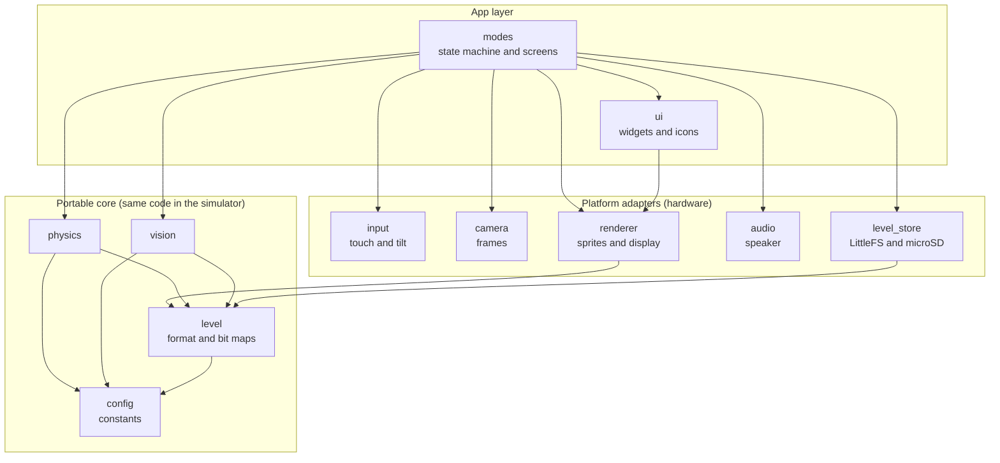
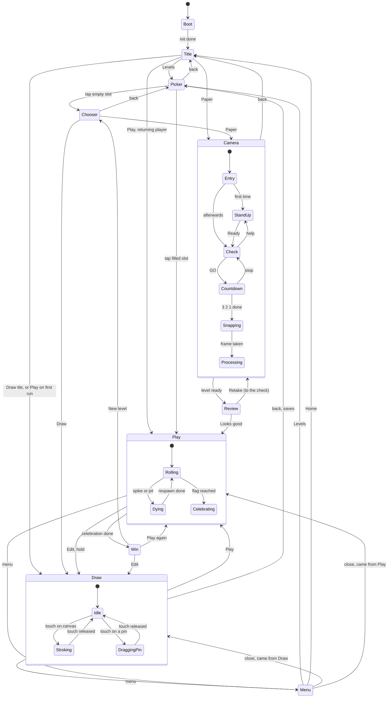
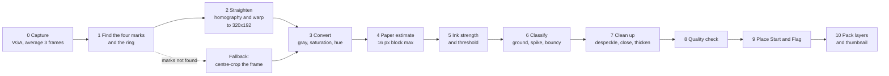

# Scribble Run — System Design

> Target: **M5Stack CoreS3** · C++ / PlatformIO (board `m5stack-cores3`) / M5Unified / M5GFX / esp32-camera · License: MIT
> Companion docs: [game-design.md](game-design.md) · [screens.md](screens.md) · [build-plan.md](build-plan.md)

## 1. Goals and constraints

### 1.1 Hardware facts we design around

| Part | Fact | Consequence |
|------|------|-------------|
| MCU | ESP32-S3, dual core, 240 MHz, single-precision FPU | `float` physics is fine; use core 0 for camera/vision, core 1 for the game loop |
| Memory | 512 KB SRAM (about 250–300 KB usable by us), **8 MB PSRAM**, **16 MB flash** | Big buffers (sprites, camera frames, vision workspace) live in PSRAM; hot data (level layers) in SRAM |
| Screen | 2.0″ IPS 320×240, ILI9342C over SPI, capacitive touch (single touch reliable) | A full-screen push is ~31 ms at 40 MHz SPI (**to be measured**), so Play repaints only changed rectangles |
| Camera | GC0308, **0.3 MP** (a retailer listing says "30 megapixels"; that is a typo for 30W = 300,000 pixels), below the screen, **faces the same way as the screen**. Fixed focus, sharp from ≈ **30 cm to 5 m**; field of view ≈ **46° × 35°** (58° diagonal) (**to be confirmed on the device**) | VGA (640×480) stills, QVGA preview; nobody holding the paper can see the preview, so the device **stands up** and counts down aloud |
| IMU | BMI270 accelerometer + gyro (+ BMM150 magnetometer, unused) | Tilt = accelerometer X axis; read through M5Unified's `M5.Imu` |
| Audio | AW88298 amplifier, 1 W speaker | Synthesised tones, no audio files in v1 |
| Storage | LittleFS in flash, optional microSD | Levels in LittleFS; microSD for export/import |
| Power | AXP2101, 500 mAh battery | Camera + screen are thirsty; auto-save everywhere |
| **Missing** | **No vibration motor. No A/B/C touch buttons.** | Feedback = sound + screen effects; every control is an on-screen target |

### 1.2 Design principles

1. **Portable core.** `physics`, `vision`, `level` and `config` have no hardware calls, no dynamic allocation, no globals. The *same* code (ported line by line) runs in the browser simulator and is unit-tested on a PC.
2. **Hardware behind thin adapters.** `input`, `camera`, `renderer`, `audio`, `level_store` are the only modules that touch M5Unified/ESP-IDF. In the simulator they are replaced by canvas/mouse/file-upload implementations.
3. **One state machine** (`modes`) owns what's on screen. Everything else is a service it calls.
4. **Never block the game loop.** Camera capture and vision run in their own task; the UI keeps animating.
5. **Fixed sizes.** Every buffer has a compile-time size listed in §8.

---

## 2. Architecture

### 2.1 Modules

| Module | Layer | Responsibility |
|--------|-------|----------------|
| **config** | core | All constants (physics, layout, palette, vision parameters) from one shared file. |
| **level** | core | The `Level` struct, 1-bit layer helpers (`getBit`, `setBit`, brush stamping), the `.scrb` encoder/decoder (bytes ↔ struct), thumbnail generation. No file I/O. |
| **physics** | core | Fixed-step ball simulation, collision, events. Pure function of `(World, Level, StepInput)`. |
| **vision** | core | Camera frame → `Level`: **find the four corner marks, straighten the page (homography)**, grayscale/HSV, background-normalised threshold, colour classification, clean-up, pin placement, quality report. Also the **live Camera check** (distance, sharpness, light, tilt). |
| **input** | platform | Reads touch and IMU, produces one `InputState` per tick (edge-detected touch, filtered tilt, grip-safe rules). |
| **camera** | platform | Starts/stops the sensor, delivers RGB565 **VGA** frames (and a down-sampled preview), **locks exposure and white balance** at the countdown, averages frames at capture. |
| **renderer** | platform | Owns the scene sprite and frame sprites, dirty rectangles, camera-preview blit, screen transitions, particles. |
| **audio** | platform | Plays synthesised tones **and small speech clips** (the spoken countdown) from a fixed queue on its own task (non-blocking). |
| **level_store** | platform | LittleFS and microSD I/O: list/load/save/delete, autosave, thumbnail cache, settings, atomic writes. |
| **ui** | app | Widgets (button, chip, tab bar, ring-fill hold button, slot grid), icon drawing, hit-testing, hold gestures. |
| **modes** | app | The state machine and per-screen logic (Title … Win). The only module that knows about all the others. |

### 2.2 Dependencies and data flow



Rule: **arrows point downwards only.** `physics` and `vision` never call `renderer`, `audio` or anything with I/O; they return data and `modes` decides what to do with it.

### 2.3 How they talk (the interfaces)

```cpp
// ---- input.h : one snapshot per 60 Hz tick -------------------------------
struct Touch  { bool down, pressed, released; int16_t x, y; uint16_t heldMs; };
struct InputState { Touch touch; float tilt /* -1..1, filtered */; };

// ---- camera.h : runs in its own task --------------------------------------
struct Frame { const uint16_t* rgb565; int w /*640*/, h /*480*/; };
bool  camera_start();             void camera_stop();
bool  camera_latest(Frame& f);    // newest frame, no copy (preview samples it down)
void  camera_lock_exposure(bool); // at countdown start
bool  camera_snap(uint16_t* dst); // averages FRAME_AVG frames into dst (640*480)

// ---- vision.h : pure, deterministic ---------------------------------------
struct VisionParams { /* thresholds, §5.3 */ };
struct VisionReport { uint8_t status; /* OK, TOO_DARK, EMPTY, TOO_MUCH_INK, NOISY */
                      float inkCover, bgMean; uint16_t blobs; };
struct LiveCheck { bool marks; float distCm, edgePx, brightness, clipFrac, sideRatioH, sideRatioV;
                   uint8_t light[4]; /* distance, sharp, light, level: 0 grey, 1 red, 2 yellow, 3 green */ };
void vision_live_check(const uint8_t* gray320x240, LiveCheck&);   // ~8 Hz on the preview
void vision_process(const uint16_t* vga565, const VisionParams&,
                    VisionWork& work, Level& out, VisionReport& rep);   // marks → warp → level
void vision_rethreshold(VisionWork& work, const VisionParams&, Level& out, VisionReport& rep);

// ---- physics.h : pure ------------------------------------------------------
struct Ball  { float x, y, vx, vy, angle; bool grounded; float coyote, jumpBuf; };
struct World { Ball ball; float time; uint8_t state; float stateTime; };
struct StepInput { float tilt; bool jumpPressed; };
enum : uint32_t { EV_JUMP=1, EV_LAND=2, EV_BOUNCE=4, EV_POP=8, EV_FELL=16, EV_RESPAWN=32, EV_WIN=64 };
uint32_t physics_step(World&, const Level&, const StepInput&);   // returns event bits

// ---- level.h ----------------------------------------------------------------
struct Level { uint8_t ground[7680], spike[7680], bouncy[7680];
               int16_t startX, startY, flagX, flagY; char name[24]; uint32_t rev; };
bool level_decode(const uint8_t* bytes, size_t n, Level&);      // validates magic, crc, size
size_t level_encode(const Level&, const Thumb*, uint8_t* out);
// ---- audio.h : audio_tone(freq, ms), audio_clip(CLIP_THREE .. CLIP_SNAP), audio_stop()
// ---- renderer.h, level_store.h : see §6, §4.7
```

**Events, not callbacks.** `physics_step` returns a bitmask; `modes` turns it into sound (`audio_play(SFX_JUMP)`), particles (`renderer_burst(...)`) and state changes. The same pattern is used by `vision` (a report struct) and `ui` (button ids returned from `ui_update`).

**Threads.**

| Task | Core | Runs | Priority |
|------|------|------|----------|
| `loop` (game) | 1 | input → modes → physics → renderer at 60 Hz | normal |
| `camera/vision` | 0 | frame grabbing and the live check in Camera check; `vision_process` after Snap | lower than `loop`, so the UI never stalls |
| `audio` | 0 | tone queue | high but tiny |

`modes` talks to the vision task through two flags (`visionRequested`, `visionDone`) and a shared `VisionWork` buffer; no locks are needed because only one side writes at a time.

### 2.4 Audio assets (the spoken countdown)

The only recorded sounds are four short speech clips for **"three", "two", "one", "snap!"**:

| Item | Value |
|------|-------|
| Format | 16 kHz, 16-bit, mono PCM, ≈ 0.5 s each (≈ 16 KB); 64 KB total in LittleFS `/audio/` |
| Schedule | Clip *n* starts at **t = 0, 1, 2, 3 s**; the frame is taken at **t ≈ 3.2 s** (after "snap!") so the device has settled after the tap; exposure and white balance are locked at t = 0 |
| Volume | The countdown plays at least at **Low** whenever sound is not **Off**; if Off, only the digits and flash show |
| Source | **We record them ourselves** (public-domain CC0) so the repo stays MIT-clean; third-party text-to-speech voices are avoided unless their licence allows redistribution |
| Replaceable | A small tool (build Step 8) records new clips with the two microphones (ES7210) so the kids can use their **own voice** |

---

## 3. State machine



* `Menu` remembers `returnTo` (Draw or Play) and the scene is frozen behind it.
* **Entering Draw** autosaves the previous level; **leaving Draw** (Play, ←, menu→Levels/Home) autosaves the current one (§4.7).
* **Check** runs `vision_live_check` about 8 times a second; **Countdown** locks exposure and white balance and plays the four speech clips one second apart; **Snapping** averages `FRAME_AVG` frames (the device is standing still), then the screen flashes.
* `Processing` runs `vision_process` on the vision task; the screen plays a sparkle animation until `visionDone`. If the marks cannot be found, **Processing** still finishes: it centre-crops the frame, and **Review** shows that result flagged `MARKS_MISSING` with a gentle "paper not found" picture while **Retake** pulses (so a hand-drawn sheet without marks still works).
* Every transition goes through `modes_goto(State)` which runs the old state's `exit()`, then the new state's `enter()`, so resources (camera, sprites) are started and stopped in exactly one place.

---

## 4. Level data format

One format for the device, the simulator and the future web editor. It is **binary**, little-endian, with a JSON twin for tools.

### 4.1 Coordinates and layers

* World is **320 × 192** pixels. A layer is **1 bit per pixel**, row-major, **MSB first** (bit 7 of byte 0 is pixel x=0), **40 bytes per row × 192 rows = 7,680 bytes**.
* Pixel lookup: `bit = (layer[y*40 + (x>>3)] >> (7 - (x&7))) & 1`.
* Three layers, in this order: **0 Ground**, **1 Spike**, **2 Bouncy**. Layers are **exclusive**: a pixel is set in at most one layer (decoders may assume it; encoders must guarantee it).

### 4.2 File layout (`.scrb`)

| Offset | Size | Type | Field | Value / notes |
|-------:|-----:|------|-------|---------------|
| 0 | 4 | char[4] | `magic` | `"SCRB"` |
| 4 | 1 | u8 | `version` | **1** |
| 5 | 1 | u8 | `encoding` | **0** = raw layers (1 = RLE, reserved for sharing) |
| 6 | 2 | u16 | `width` | 320 |
| 8 | 2 | u16 | `height` | 192 |
| 10 | 2 | u16 | `startX` | ball centre at spawn |
| 12 | 2 | u16 | `startY` | |
| 14 | 2 | u16 | `flagX` | pole base |
| 16 | 2 | u16 | `flagY` | |
| 18 | 1 | u8 | `layerCount` | 3 |
| 19 | 1 | u8 | `flags` | bit0 has extras · bit1 has thumbnail · bit2 made from paper |
| 20 | 24 | char[24] | `name` | UTF-8, NUL-padded (max 23 bytes) |
| 44 | 4 | u32 | `crc32` | CRC-32 (IEEE) of every byte from offset 64 to the end |
| 48 | 4 | u32 | `rev` | revision counter, +1 on every save (used by Wi-Fi sync) |
| 52 | 12 | u8[12] | `reserved` | zero |
| **64** | 1,080 | bytes | **thumbnail** | only if `flags.bit1`: 60×36, 4 bits/pixel, palette index (§4.5) |
| next | 7,680 | bytes | **ground** layer | |
| next | 7,680 | bytes | **spike** layer | |
| next | 7,680 | bytes | **bouncy** layer | |
| next | 1 + 5·n | bytes | **extras** | only if `flags.bit0`: `u8 count` (≤ 8), then `count × { u8 type, u16 x, u16 y }`; `type 1` = star |

Rules:

* **Version policy:** readers *reject* `version` > what they know (show a friendly "level from a newer game" tile) and *accept* all older versions. Unknown `flags` bits and `reserved` bytes are ignored on read and preserved on write by tools.
* **Validation on load:** magic ✓, version ✓, `width == 320 && height == 192`, `layerCount == 3`, file length matches, CRC ✓, `start`/`flag` inside the world, `name` NUL-terminated. A bad file is skipped (the slot shows as empty with a small ⚠ dot), never crashes.
* **Writes are atomic:** write to `/levels/Lnn.tmp`, `fsync`, rename over `Lnn.scrb`. A battery dying mid-save leaves the old file intact.

### 4.3 Size budget

| Part | Bytes |
|------|------:|
| Header | 64 |
| Thumbnail (optional) | 1,080 |
| 3 layers × 7,680 | 23,040 |
| Extras (max 8 stars) | ≤ 41 |
| **Typical file (thumbnail, no extras)** | **24,184** |
| **Maximum file** | **24,225** |
| On LittleFS (4 KB blocks) | 24,576 (6 blocks) |
| **10 levels** | **≈ 246 KB** of the ≈ 9 MB filesystem |

RLE (`encoding = 1`, for QR sharing, §10.2) is expected to give roughly 0.6–3 KB for typical drawn levels; this is **measured in Step 5**, not assumed.

### 4.4 JSON twin (for the web tool)

The web editor reads and writes either the `.scrb` bytes directly (preferred; a few lines with `DataView`) or this JSON, where layers are base64 of the raw 7,680 bytes:

```json
{
  "format": "scribble-run-level",
  "version": 1,
  "name": "Dad's Challenge",
  "origin": "paper",
  "width": 320, "height": 192,
  "start": { "x": 40,  "y": 104 },
  "flag":  { "x": 280, "y": 112 },
  "layers": {
    "ground": "<base64, 7680 bytes>",
    "spike":  "<base64, 7680 bytes>",
    "bouncy": "<base64, 7680 bytes>"
  },
  "thumbnail": { "w": 60, "h": 36, "format": "4bpp-palette", "data": "<base64, 1080 bytes>" },
  "extras": [ { "type": "star", "x": 160, "y": 60 } ]
}
```

`thumbnail` and `extras` are optional; a tool that omits the thumbnail gets one regenerated by the device on first load.

### 4.5 Thumbnails

* **60 × 36 px, 4 bits per pixel**, each value an index into the 9-colour palette ([screens.md](screens.md#palette-9-colours-rgb565-for-the-firmware)); 30 bytes/row × 36 = **1,080 bytes**, high nibble first.
* Generated at save time by sampling the 5.33 × 5.33 source block for each thumbnail pixel; priority **spike > bouncy > ground > paper**; a material wins if ≥ 25 % of the block is set. Start and Flag are drawn as small green dots.
* The picker reads only the first `64 + 1,080` bytes of each file (no need to load all 24 KB), then caches ten thumbnails in SRAM (10,800 B).

### 4.6 Settings and progress (not part of a level)

`/settings.bin` (≤ 64 bytes): `u8 version, u8 sound (0–2), u8 lastSlot, u16 solvedMask, u16 bestTimeMs[10], u8 firstRunDone`. Kept separate so sharing a level never shares progress.

### 4.7 Storage and autosave

| Path | Content |
|------|---------|
| `/levels/L00.scrb` … `/levels/L09.scrb` | the ten slots (LittleFS, internal flash) |
| `/settings.bin` | settings and progress |
| `/sd/scribble/levels/*.scrb` | optional **microSD export/import**; any `.scrb` there can be copied into a free slot from the menu (v1.1) |

**Autosave:** on leaving Draw/Edit, on "Looks good", and after 5 s idle with unsaved changes. Undo snapshots stay in PSRAM, so a crash loses at most 5 s. The level currently being edited has `rev` incremented on each save.

---

## 5. The vision pipeline (paper mode)

**Goal:** a photo of a crayon drawing on the **printed level template** → a `Level` (three bit layers + Start + Flag + quality report), in well under a second, even if the page is tilted, with a **live Camera check** beforehand and a graceful path when the photo is bad.

Because the camera faces the same way as the screen, the device **stands up**, the sheet faces it, and a parent or a stand holds the paper ([screens.md §4](screens.md#4-camera-stand-it-up-three-screens)). Nobody is holding the device, so frames are steady and can be **averaged**.

### 5.1 The paper template

PDF: [`docs/assets/scribble-run-level-template-a4.pdf`](assets/scribble-run-level-template-a4.pdf), generated by `tools/template/make_template.py` (all numbers below live there and in `shared/constants.json`).

| Item | Value (A4 landscape, mm from the top-left of the sheet) |
|------|----------------------------------------------------------|
| Sheet | 297 × 210 |
| **Corner marks** | Ø 10 mm black. Centres at **(13.5, 24)**, (283.5, 24), (283.5, 186), (13.5, 186) → a **270 × 162 mm "dot rectangle"** (exactly 5 : 3) |
| **Orientation ring** | The **top-left** mark has a 3.5 mm white hole (a ring); the other three are solid. The camera finds the ring, so the page works even if held upside down or sideways |
| **Drawing area** | The dot rectangle shrunk to **92 %** about its centre: **248.4 × 149.0 mm** at (24.3, 30.5), shown as a dashed light-grey box (ignored by vision). Mapped onto the **320 × 192 level**: **0.776 mm per level pixel** |
| Legend | Top margin: black bar = ground, red zig-zag = spikes, blue zig-zag = bouncy (outside the dot rectangle, so ignored) |
| Footer | The crayon guide, plus a **10 cm line** to check the print scale (the distance light relies on the 270 mm spacing) |
| Margins | Everything is ≥ 8 mm from the sheet edge (printer-safe) |

**Level coordinates of the marks:** the world is the dot rectangle scaled by 0.92 about its centre (160, 96), so the four mark centres are at **(−13.91, −8.35), (333.91, −8.35), (333.91, 200.35), (−13.91, 200.35)** in level pixels. The marks (radius 6.4 px) lie just outside the 320 × 192 area, so they never become ink.

### 5.2 Camera geometry (what the numbers imply)

GC0308 facts we design to (**to be confirmed on the device in Step 6**): fixed focus, sharp from about **30 cm to 5 m**; field of view about **46° horizontal × 35° vertical** (58° diagonal). From that, the focal length is `f = (width/2) / tan(23°)` = **377 px at 320 wide, 754 px at 640 wide**.

| Distance | Camera sees (W × H) | A4 width fills | Dot rectangle in the 320×240 frame | in a 640×480 frame | A 3 mm line in a 640×480 frame | Verdict |
|---------:|--------------------:|---------------:|-----------------------------------:|-------------------:|-------------------------------:|---------|
| 30 cm | 255 × 189 mm | 117 % | 339 px | 678 px | 7.5 px | ✗ marks fall outside the frame |
| **35 cm** | 297 × 221 mm | 100 % | **291 px** | 582 px | 6.5 px | ✓ nearest allowed (marks have ~8 mm to spare) |
| **40 cm** | 340 × 252 mm | 87 % | **254 px** | 509 px | 5.7 px | ✓ **sweet spot** |
| **45 cm** | 382 × 284 mm | 78 % | **226 px** | 452 px | 5.0 px | ✓ farthest recommended |
| 50 cm | 424 × 315 mm | 70 % | 204 px | 407 px | 4.5 px | works, but thin lines get thinner |

* **Capture at VGA (640 × 480)** so a 3 mm line is ≥ 5 pixels wide before it is shrunk into the 320 × 192 level (QVGA would give only ~2.5 px). The live preview is the same VGA stream sampled down to display size.
* **Distance estimate** (used by the Distance light): `d = 270 mm × f / (dot-rectangle width in pixels)`. At 254 px in a 320-wide frame this gives 40 cm.
* **Tilt tolerance:** with a 46° lens, a sheet turned 15° about a vertical axis changes the near/far side lengths by about 19 %. That is why the homography (§5.4, stage 2) is needed, and why the Level light allows ±15° and warns beyond.

### 5.3 Overview



Stages 3–10 are integer maths on small arrays (no OpenCV). The only floating point is solving the homography (stage 2); its result is rounded to 16.16 fixed point before the per-pixel work, so the C++ and TypeScript versions agree to within a pixel.

### 5.4 Step by step

| # | Stage | What it does | Key detail |
|---|-------|--------------|------------|
| 0 | **Capture** | Exposure and white balance were **locked** when the countdown started. At "snap" the camera grabs and **averages `FRAME_AVG` (3) VGA RGB565 frames**. | Standing still, so averaging cuts sensor noise about 1.7× without blur. |
| 1 | **Find the marks** | **(a)** Gray (640×480 → 320×240 by 2×2 averaging). **(b)** Adaptive threshold: dark if `gray < MARK_RATIO (0.6) × local mean` over a 21 px box (integral image). **(c)** 4-connected components; keep blobs with area in the expected range (a Ø 10 mm disc is 8–19 px across at 320 wide for 35–50 cm), bounding box aspect 0.8–1.25 and fill ratio 0.55–0.9. **(d)** Pick the best **four** by score: roughly rectangular (angles 90° ± 25°), opposite sides within 25 %, mark areas within 1.6×, overall aspect 5 : 3 (or 3 : 5 if turned sideways) ± 30 %. With ≤ 20 candidates this is ≤ 4,845 combinations. **(e)** Orientation: sample the centre of each mark at full VGA resolution; the one with a **bright centre** (the ring) is **top-left**; order the others clockwise from it. **(f)** Refine each centre to sub-pixel by intensity-weighted centroid in a 40 × 40 VGA window. | Output: four points `P[0..3]` = TL, TR, BR, BL in VGA pixels, plus a confidence. If no ring can be told from a disc, assume the usual orientation and set `ORIENT_GUESS`. If fewer than four marks or no good quad: **marks not found** → fallback below. |
| 2 | **Straighten** | Solve the **homography** `H` mapping the four points to the four level-pixel mark positions in §5.1 (8 × 8 linear solve, once, in `double`/`float`). For each of the 61,440 level pixels, map its centre through `H⁻¹` (16.16 fixed point) into the VGA frame and **area-sample** it (bilinear on the 2 × 2 neighbours; the 640 → 320 shrink is ~1.6×) → a **320 × 192 RGB565 "straight page"**. | This replaces the old "crop": a tilted, rotated or off-centre page lands exactly on the level grid. |
| 3 | **Convert** | RGB565 → 8-bit R, G, B. `gray = (77R + 150G + 29B) >> 8`; `max`, `min`; `sat = (max-min)·255 / max` (0 if `max < 16`); `hue` 0–359° by the standard integer HSV formula. | One pass, row by row. |
| 4 | **Paper estimate** | 16 × 16 blocks (20 × 12). `bg[block]` = max gray in the block; 3 × 3 box-blur the grid; **bilinear-upsample** to a per-pixel `bg(x,y)`. | The paper is the brightest thing in every block, so uneven lighting and soft shadows are divided out. |
| 5 | **Ink strength** | `ink = 255·(bg − gray)/bg`, clamped. **Ink** if `ink ≥ INK_THRESH` (30 % → 77). Never ink where `bg < BG_MIN` (80). | |
| 6 | **Classify** | For each ink pixel: if `V ≥ COLOR_V_MIN` (80) **and** `sat ≥ SAT_MIN` (90): hue in `[345°, 360°) ∪ [0°, 20°]` → **Spike**; `[195°, 255°]` → **Bouncy**. Otherwise → **Ground**. | Black crayon is dark and nearly colourless → Ground. |
| 7 | **Clean up** | Per class: **despeckle** (drop components < `MIN_BLOB` 30 px), **close** 5 × 5 (join streaky wax gaps), **thicken** by `THICKEN_R` (2), zero a 3 px border, **priority Spike > Bouncy > Ground** where masks overlap. | A 3 mm line is ≈ 3.9 level px; thickening by 2 on each side makes it ≈ 8 px, the physics minimum. |
| 8 | **Quality check** | Ink coverage, blob count, paper brightness, marks status; sets a status (§5.8). | |
| 9 | **Place pins** | **Start:** scan columns x = 16 … 120 left to right for the first column with a solid pixel with ≥ 24 px of clear space above; Start = (x, top − 9). Not found → (32, 32). **Flag:** same from x = 304 down to 200; not found → (288, 100). If < 100 px apart, push the Flag to the far right. | Both are draggable on Review. |
| 10 | **Pack** | Bit-pack into `Level`, set `flags.bit2` (from paper), generate the thumbnail. | An ordinary level (§4). |

**Fallback when the marks aren't found** (a hand-drawn sheet, a bad angle, a hand over a corner): skip stages 1–2 and **centre-crop the frame** to 5 : 3 and resample it to 320 × 192, then continue. The report carries `MARKS_MISSING`; Review shows a gentle "paper not found" picture and pulses **Retake**.

**Re-thresholding** (Review's thinner/thicker ink): stage 5's `ink` array is kept, so only stages 6–10 re-run (≈ 0.15 s) without touching the camera or the page finder.

### 5.5 Tunable parameters (all in `config`)

| Parameter | Default | Range | Meaning |
|-----------|--------:|-------|---------|
| `CAM_FOCAL_PX_320` | 377 | — | Focal length for a 320-wide frame; **calibrated in Step 6** (from FOV 46°) |
| `FRAME_AVG` | 3 | 1–6 | Frames averaged at capture |
| `MARK_RATIO` | 0.60 | 0.4–0.8 | Dark-mark threshold relative to local mean |
| `MARK_WINDOW` | 21 px (at 320 wide) | 15–41 | Adaptive-threshold window |
| `MARK_AREA_MIN/MAX` | 40 / 330 px (at 320 wide) | — | Expected mark size |
| `QUAD_ANGLE_TOL` | 25° | 10–40 | Allowed deviation from a right angle |
| `QUAD_ASPECT_TOL` | 30 % | 15–50 | Allowed deviation from 5 : 3 (or 3 : 5) |
| `AREA_SCALE` | 0.92 | — | Drawing area as a fraction of the dot rectangle (matches the PDF) |
| `BG_BLOCK` | 16 | 8–32 | Paper-estimate block (level px) |
| `BG_MIN` | 80 | 40–140 | Darkest paper we accept |
| `INK_THRESH` | 77 (30 %) | 38–128 | The thinner/thicker buttons move it by 13 (5 %) |
| `SAT_MIN`, `COLOR_V_MIN` | 90, 80 | 60–140 | Needed to count as red or blue |
| `HUE_RED`, `HUE_BLUE` | 345–20°, 195–255° | — | Crayon hues |
| `MIN_BLOB` | 30 px | 10–100 | Smallest kept component |
| `CLOSE_R`, `THICKEN_R` | 2, 2 | 0–4 | Closing radius, final dilation |
| `EDGE_MARGIN` | 3 px | 0–8 | Zeroed border |
| `AE_LEVEL` | +1 | −2…+2 | Exposure bias (white paper fools auto-exposure into grey); tuned on device |

### 5.6 Time and memory budget

**Time** (estimates at 240 MHz; **measured in Step 7**):

| Stage | Estimate | Notes |
|-------|---------:|-------|
| 0 Capture + average 3 VGA frames | 150–250 ms | Camera-limited |
| 1 Find the marks (QVGA components + VGA refinement) | 40–80 ms | Integral image + labelling |
| 2 Homography + warp (61,440 px) | 40–70 ms | PSRAM reads dominate |
| 3–5 Convert, paper, ink | 30–50 ms | |
| 6–7 Classify + clean up (3 masks) | 100–180 ms | |
| 8–10 Quality, pins, pack, thumbnail | 15 ms | |
| **Total** | **≈ 0.4 – 0.65 s** | Budget **≤ 0.8 s**; a sparkle animation covers it. The countdown itself adds 3.3 s *before* this |

**Memory** (transient, in PSRAM, freed on leaving Camera/Review):

| Buffer | Bytes |
|--------|------:|
| Camera frame buffers: 2 × VGA RGB565 (640×480×2) | 1,228,800 |
| Mark-finding scratch: QVGA gray 76,800 + integral image (u32) 307,200 + component labels (u16) 153,600 | 537,600 |
| Straightened photo kept for Review (RGB565 320×192) | 122,880 |
| `ink` strength (u8) | 61,440 |
| `colour class` (u8) | 61,440 |
| `labels` (u8: none/ground/spike/bouncy) | 61,440 |
| Morphology scratch | 61,440 |
| Paper grid, homography, tables | < 1,000 |
| **Vision + camera total** | **≈ 2.1 MB** (see §8) |

### 5.7 The live Camera check (the calibration screen)

The Camera check ([screens.md §4.2](screens.md#42-camera-check-the-calibration-screen)) runs a **light version of stage 1** on the preview, about **8 times a second** on the vision task (QVGA gray, no ring test, no refinement), and turns it into four lights:

| Light | Computation | Green | Notes |
|-------|-------------|-------|-------|
| **Distance** | `w` = mean of the top and bottom edge lengths of the mark quad (QVGA px); `d = 270 mm × 377 / w` | `w` = 226–291 px (35–45 cm) **and** all four marks ≥ 8 px from the frame edge | Too small → "closer"; too large or a mark near the edge → "back" |
| **Sharp** | For each mark, the 10–90 % **edge width** across its boundary (average of 16 radial profiles), in QVGA px | ≤ 2.0 px | Dots have a known sharp edge, so this works on any sheet. Yellow 2–3, red > 3 |
| **Light** | Mean gray of the sheet between the marks (sampled on a 12 × 8 grid inside the quad); fraction of channel values ≥ 250 (clipping); mark-to-paper contrast | mean 140–245, clipping < 3 %, contrast ≥ 100 | Shows a "more light" or "less glare" bulb |
| **Level** | `r_h` = top / bottom edge lengths, `r_v` = left / right; plus the **accelerometer**: is gravity roughly along the device's vertical axis (standing up)? | `r_h, r_v` within 0.84–1.19 (≈ ±15°) and standing | Warns beyond 0.75–1.33; "stand me up" if lying flat |

**GO** is green and pulses when all four have been green for 0.5 s. It is never disabled.

**Calibrating the camera facts on the device (Step 6).** Hold-2 s on **?** shows the numbers overlay. Put the printed sheet at **measured** distances (35, 40, 45 cm with a ruler) and note `w`; then `f = w × d / 270 mm` gives the real focal length for the 320-wide frame (replace 377 and re-derive the field of view), and the *Sharp* edge width at each distance confirms the focus range. These values are written back to `shared/constants.json`.

### 5.8 Limits and fallbacks

**Honest limits** (so we don't over-promise to a 7-year-old):

| Problem | What happens | What we do |
|---------|--------------|------------|
| **Low resolution** (0.3 MP; ~1 mm per pixel at 40 cm in QVGA, ~0.5 mm in VGA) | Thin lines vanish | Template says "lines ≥ 3 mm"; VGA capture; thickening |
| **Pencil / light pens** | Too faint | `EMPTY` status → "draw darker" picture |
| **Pale colours** (yellow, light blue, pink) | Not detected | Only black, red, blue are used |
| **Poor light** | Low contrast; noise | Light light; thinner/thicker ink; automatic retry (below) |
| **Shadows** | A soft shadow is divided out by the paper estimate; a *sharp* shadow edge (a hand, the device) can leave a false dark band up to ~16 px wide | Light light; Retake; fix in Edit. A stronger fix is a stretch item |
| **Glare on waxy crayon** | Highlights drop ink pixels | The close step bridges small gaps; the Light light warns about glare |
| **Tilted page** | Perspective | Corrected by the four marks up to about **±25°**; the Level light warns beyond ±15° |
| **A mark hidden** (a thumb over a corner, a smudge) | Marks not found | Falls back to a centre-crop, flagged; Retake |
| **Print scale wrong** ("Fit to page") | Distance reads wrong; world scale off | The 10 cm check line on the sheet; the *world* mapping uses the marks, so the level itself is still right |
| **Lens smudge** | Everything soft | Sharp light → wipe the lens |
| **Auto-exposure** | White paper rendered grey | `AE_LEVEL` bias + exposure lock at countdown |
| **Coloured / patterned paper** | Background not uniform | Not supported (white paper only) |

**Quality statuses** and what the app does:

| Status | Condition (defaults) | Review behaviour |
|--------|----------------------|------------------|
| `OK` | none below | Normal |
| `MARKS_MISSING` | page not found, centre-crop used | "Paper not found" picture; Retake pulses |
| `ORIENT_GUESS` | ring not recognised | Small hint; Retake available |
| `TOO_DARK` | mean paper brightness < 90 | Light icon; Retake pulses |
| `EMPTY` | ink coverage < 0.5 % | "Draw bigger and darker" picture; Retake pulses |
| `TOO_MUCH_INK` | ink coverage > 35 % | "Is the paper in view?" picture; Retake pulses |
| `NOISY` | > 150 components survive despeckle | Retake pulses |

**Automatic retry (once, silently):** `EMPTY` or low contrast → re-threshold with `INK_THRESH` lowered 25 %; `TOO_MUCH_INK` → raised 25 %. The better result is shown.
**Never a dead end:** **Looks good** stays enabled, **Retake** is one tap, and **Edit** repairs the level with a finger.

---

## 6. Game loop and rendering

### 6.1 Loop (fixed 60 Hz physics)

```cpp
const float DT = 1.0f / 60.0f;
float acc = 0;  uint32_t last = micros();
for (;;) {
    uint32_t now = micros();
    acc += min((now - last) * 1e-6f, 0.1f);        // clamp: avoid a spiral of death
    last = now;
    InputState in = input_poll();                  // touch edges + filtered tilt
    int ticks = 0;
    while (acc >= DT && ticks < 6) {               // catch up, but never more than 6 ticks
        modes_tick(in, DT);                        // state machine; physics inside Play
        in.touch.pressed = in.touch.released = false;   // edges consumed once
        acc -= DT; ++ticks;
    }
    renderer_frame(modes_view());                  // draw the latest state
    renderer_wait_dma();                           // then sleep until the next tick
}
```

* **Physics is deterministic**: fixed `dt`, no `random()`, no wall-clock in the step. This is what makes ghost replays (stretch) possible.
* Rendering is decoupled: if a frame takes long, physics still advances in 1/60 s steps.

### 6.2 Rendering: a double-buffered sprite in PSRAM

| Buffer | Format | Size | Role |
|--------|--------|-----:|------|
| `scene` | RGB565 320×240 | 153,600 | Static art (level pixels with textures, pins, background dots), redrawn only when the level changes |
| `fb[0]`, `fb[1]` | RGB565 320×240 | 2 × 153,600 | Ping-pong frame buffers (the "double-buffered sprite") |

**Play and Draw (partial updates, target 60 fps):**
1. Wait for the previous DMA to finish (`display.waitDMA()`).
2. For each dirty rectangle `R` (ball's old and new box, particles, a moving pin): copy `scene → fb` in `R`, draw the dynamic objects on top.
3. Push **only `R`** to the screen (clip rectangle + DMA push). A 40 × 40 rectangle is 3.2 KB ≈ 0.7 ms at 40 MHz.
4. Flip `fb`.

**Full-screen scenes** (Title, Picker, Win, Review, Camera preview, transitions): draw the whole frame into the back buffer and push it with DMA while the CPU already prepares the next frame in the other buffer; ≈ 31 ms per push, so **~30 fps** (fine for those screens).

**Camera check preview:** the VGA frame is sampled down (by 2.5×, nearest or 2 × 2 box) to **256 × 192** and copied into the back buffer, the target frame, detected-page outline, cue arrows and chips are drawn over it, and the buffer is pushed. It is limited by the camera's frame rate anyway.

> **Assumption to verify (Step 1):** SPI write speed (40 MHz?) and that the ESP32-S3 can DMA directly from PSRAM sprites. If PSRAM DMA is slow, fall back to a small (≤ 64 × 64) composite buffer in internal SRAM for the dirty rectangles and skip the second full sprite.

### 6.3 Frame-time budget (Play, 60 Hz = 16.67 ms)

| Stage | Budget | Notes |
|-------|-------:|-------|
| Input (touch read + IMU read over I²C) | ≤ 1.0 ms | M5Unified `update()`; ~0.3 ms each at 400 kHz |
| State machine + UI | ≤ 0.3 ms | |
| Physics (1 tick, ≤ 3 sub-steps) | ≤ 0.3 ms | ~400 bit lookups per tick |
| Compose dirty rectangles | ≤ 1.0 ms | 2 × 40×40 px |
| DMA push (background, CPU free) | ~1.5 ms | not counted against the CPU |
| **CPU total** | **≈ 2.6 ms (≈ 16 %)** | Leaves > 80 % for the camera task, audio and slack |
| **Full-screen scenes** | ≈ 31 ms per push | 30 fps; allowed because they have no gameplay |

---

## 7. Collision

**Ball:** circle, radius `R = 8`. **World:** three 1-bit layers. **Solid** = Ground or Bouncy. **Spike** is checked separately and is *not* solid.

### 7.1 Per sub-step algorithm

```
// split the tick so no sub-step moves more than MAX_STEP (4 px)
n   = ceil( max(|vx|,|vy|) * dt / MAX_STEP )          // ≤ 3 at MAX_SPEED
for each of n sub-steps (dt/n):
    ball.pos += ball.vel * (dt/n)

    // 1. push out of solids along the surface normal
    for iter in 0 .. MAX_PUSH-1:                       // MAX_PUSH = 8
        n_vec = contact_normal(ball)                   // see below; zero if no contact
        if no sample point is inside a solid: break
        ball.pos += n_vec * PUSH_STEP                  // 1.0 px
        last_n = n_vec; touched = true
    if touched: respond(last_n)

    // 2. detect resting contact (for grounded + friction)
    grounded = probe(ball, R + 1.5) hits a solid with normal.y < -0.5

    // 3. non-solid checks
    if spike hit (ring at 0.75*R)  → EV_POP
    if ball.y > 192 + 3R           → EV_FELL
    if dist(ball, flag_centre) < FLAG_HIT_RADIUS → EV_WIN
```

### 7.2 Contact normal from sample points

Sample **`N = 16`** points evenly around the circle at angle `θᵢ = 2πi/16`, position `(x + R cosθᵢ, y + R sinθᵢ)`, rounded down to pixels.

```
n = (0,0)
for each sample i inside a solid pixel:
    n -= (cosθᵢ, sinθᵢ)            // points from the contact toward the ball centre
if |n| > ε:  n /= |n|             // averaging many samples smooths pixel jaggies
else:        n = (0,-1)           // pinched between two surfaces: push up
```

Sampling 16 points averages away the staircase noise of a pixel map, so a hand-drawn (or photographed) line behaves like a smooth surface.

### 7.3 Response

```
vn = vel · n
if vn < 0:                                         // moving into the surface
    if touched_bouncy:    vel = n * BOUNCY_SPEED + (vel - vn*n) * 0.9    // launch
    else:                 vel -= (1 + e) * vn * n, with e = (|vn| < BOUNCE_MIN_SPEED ? 0 : RESTITUTION)
```

Friction is part of the rolling model (game-design §6), applied only while `grounded`.

### 7.4 Preventing tunnelling

* The **minimum thickness of any material is 8 px** (brush 8 px; paper levels thickened in vision stage 6c), and a sub-step never moves more than **4 px**, so the ball can never jump across a line.
* Eraser leftovers thinner than 8 px can exist; a sub-step of 4 px can in theory skip a 3-px sliver. Accepted (a visible sliver barely matters) and covered by the **unstick** rule below.

### 7.5 Edge cases

| Case | Rule |
|------|------|
| Ball deep inside ground after the player draws on it | After `MAX_PUSH` pushes, search a spiral up to 16 px for a free spot; if none, quietly respawn |
| Spike pixels touching ground | Spike wins (checked after the push) |
| Left/right edge | Treated as solid; top is open; bottom is the pit |
| Ball resting on a bouncy pad | Launches again each contact (a pogo); intended |
| Very steep drawn wall | Normal near-horizontal → the ball slides/bumps; no special case |

### 7.6 Tests (run on a PC in the simulator and with native C++ unit tests)

Rest on a flat floor stays still; roll at 150 px/s for 1 s over flat ground → 150 ± 2 px; jump apex = 50 ± 2 px; bouncy launch apex = 128 ± 4 px; drop at `MAX_SPEED` onto an 8 px line never tunnels (10,000 random trials); ball placed inside a 10 px blob is ejected or respawns within 0.1 s.

---

## 8. Memory budget (CoreS3)

### 8.1 Internal SRAM (512 KB total; we aim to stay under ~280 KB of our own use)

| Item | Bytes | Notes |
|------|------:|-------|
| Firmware data/bss, FreeRTOS, M5Unified, drivers | ~120,000 | Estimate; **measured in Step 0** |
| Active level (3 layers + header) | 23,104 | Hot data for collision |
| Thumbnail cache (10 × 1,080) | 10,800 | |
| Camera driver (DMA descriptors, line buffers) | ~30,000 | Estimate |
| Task stacks (loop 8 KB, camera/vision 12 KB, audio 4 KB) | 24,576 | |
| UI state, particles (32), audio queue, input buffers | ~8,000 | |
| Wi-Fi + HTTP server (version 2 only) | ~70,000 | Only when Wi-Fi is on |
| **Total (v1, without Wi-Fi)** | **≈ 216,000 (≈ 42 %)** | Leaves a healthy margin |

### 8.2 PSRAM (8 MB)

| Item | Bytes |
|------|------:|
| Camera frame buffers 2 × VGA RGB565 (640×480×2) | 1,228,800 |
| Vision workspace: mark-finding scratch 537,600 + straightened photo and masks 368,640 (§5.6) | 906,240 |
| `scene` sprite | 153,600 |
| `fb[0]`, `fb[1]` sprites | 307,200 |
| Undo ring: 8 snapshots × 23,104 | 184,832 |
| **Total** | **≈ 2,780,672 (≈ 2.65 MiB, ~33 %)** |

> Camera buffers are live only in the Camera screens; the vision workspace only while `Processing`/Review. They could share memory with the undo ring (Draw is not active at the same time) if PSRAM ever gets tight. At 33 % it should not.

### 8.3 Flash (16 MB)

| Partition | Size |
|-----------|-----:|
| Firmware (app0) | 3 MB |
| Second app slot (OTA, v2) | 3 MB |
| NVS, OTA data | ~48 KB |
| LittleFS (levels, settings; later the web editor assets) | ~9.9 MB |

---

## 9. Code sharing between simulator and firmware

### 9.1 Repo layout

```text
scribble/
├── LICENSE                     MIT
├── docs/                       these documents
│   └── assets/                 scribble-run-level-template-a4.pdf (the printable template)
├── tools/
│   └── template/make_template.py   generates the template PDF (reportlab); numbers match §5.1
├── shared/
│   ├── constants.json          single source of truth: physics, layout, palette, vision params
│   ├── levels/                 built-in lessons (.scrb) + JSON twins
│   ├── audio/                  the four countdown clips (CC0): three, two, one, snap
│   └── golden/                 test vectors: physics runs; vision photos (real + synthetic template shots) and expected masks
├── sim/                        browser simulator (Vite + TypeScript + canvas)
│   └── src/
│       ├── config.ts           GENERATED from constants.json
│       ├── level.ts            format codec, bit maps, thumbnail   ↔ level.h/.cpp
│       ├── physics.ts                                              ↔ physics.h/.cpp
│       ├── vision.ts                                               ↔ vision.h/.cpp
│       ├── input.ts            mouse/touch, arrow keys, DeviceOrientation   ↔ input (M5Unified)
│       ├── camera.ts           upload / webcam → 640×480 RGB565            ↔ camera (esp32-camera)
│       ├── renderer.ts         canvas 320×240, drawn at 3×                 ↔ renderer (M5GFX)
│       ├── audio.ts            WebAudio tones                              ↔ audio
│       ├── level_store.ts      localStorage + file download/upload         ↔ level_store
│       ├── ui.ts                                                           ↔ ui
│       └── modes.ts                                                        ↔ modes
└── firmware/                   PlatformIO project (device phase)
    ├── platformio.ini          board = m5stack-cores3
    ├── src/ include/ test/     test/ = native unit tests incl. golden vectors
```

### 9.2 Portability rules

* **One constants file.** `shared/constants.json` generates `config.h` and `config.ts` (a ~30-line script), so a physics or vision value changes in exactly one place.
* **Same names, same signatures.** `physics_step` ↔ `physicsStep`, same struct fields.
* **Float discipline.** The device uses 32-bit `float`; the simulator uses `Math.fround` at assignment points in `physics.ts`. Results need not be bit-identical, but **golden tests allow ≤ 0.5 px drift over 600 ticks**.
* **Vision is integer maths except the homography solve** (float/double, once per capture), whose result is rounded to 16.16 fixed point before the per-pixel work. C++ and TypeScript therefore agree on the four mark positions to ≤ 0.1 px and on **≥ 99.5 % of mask pixels**; the golden tests assert exactly that (and byte-identical results for stages 3–10 given the same straightened page).
* **Bit order and endianness are fixed** (MSB first, little-endian) so `.scrb` files made in the browser load on the device and vice versa.
* **Core code has no allocation, no globals, no I/O, no time or random calls.** All buffers are passed in.

### 9.3 Browser simulator behaviours (built after review)

* `<canvas>` of exactly **320 × 240**, CSS-scaled 3× (`image-rendering: pixelated`).
* Mouse/touch = finger. **Arrow keys** (and the phone's `DeviceOrientation`) = tilt; **Space** or click = jump.
* **Upload photo** and **webcam** buttons feed `camera.ts`, which resamples to **640×480** (centre-crop to 4 : 3), quantises to RGB565 and optionally applies a *stress preset* (dim light, gradient shadow, 10° and 20° tilt, distance 35/45 cm, sensor noise, defocus), then runs the same `vision.ts`: find marks → straighten → level. A phone photo of the printed template works directly.
* A **"Camera check" panel** shows the same four lights (distance, sharp, light, level) computed by `vision_live_check`, so the thresholds can be tuned before the device arrives.
* A **synthetic template shot** generator renders a level onto the template through a camera model (perspective, distance, blur, noise) to create golden test images.
* **Download level** writes `.scrb`; **Load level** reads it. A debug panel shows the vision stages (gray, paper estimate, ink, labels).

---

## 10. Beyond version 1

### 10.1 Version 2: a tldraw web editor that sends levels over Wi-Fi

**Idea:** a bigger canvas on a laptop/tablet (tldraw) for drawing levels, a "Send to Scribble" button, and the same screen on the device. It can also run `vision.ts` on a **phone photo** of a paper drawing.

**Where the editor lives.** A web page served over **https** cannot call a plain **http** device on the LAN (mixed-content rules). So the editor is either (a) **served by the device itself** from LittleFS at `http://scribble.local/` (the bundle is a few MB; the CoreS3 has room), or (b) run locally during development (`npm run dev`, plain http). Option (a) needs no install and works offline.

**Licence check:** tldraw's SDK is *not* MIT-licensed (its own terms apply). Verify the terms for an open-source/hobby repo before depending on it; the fallback is a small canvas editor built from the simulator's code.

**Editor → level.** tldraw shapes are drawn in **three colours** (tldraw's `black`, `red`, `blue` map to Ground, Spike, Bouncy) plus two custom shapes, `start` and `flag`. To export: for each material render only that colour's shapes to an offscreen 320×192 canvas, enforce a minimum stroke width of 8 px, threshold alpha ≥ 128 to bits, resolve overlaps, and pack with `level.ts`.

**Device → editor.** A level (bitmaps) can't be turned back into vector shapes, so the editor shows it as a locked background image; the user draws on top.

**Device API** (HTTP/1.1, JSON unless noted, served by `ESPAsyncWebServer` or the IDF HTTP server):

| Method | Path | Body → Response | Notes |
|--------|------|-----------------|-------|
| GET | `/api/v1/info` | → `{ "device":"scribble-run","firmware":"0.1.0","formats":[1],"slots":10,"freeBytes":9000000 }` | Discovery; also advertised by mDNS `_scribble._tcp` |
| POST | `/api/v1/pair` | `{ "pin":"4821" }` → `{ "token":"…" }` | The device shows a 4-digit PIN in its menu; the token is sent as `Authorization: Bearer` |
| GET | `/api/v1/levels` | → `{ "slots":[ { "slot":0,"empty":false,"name":"Gap","rev":7,"bytes":24184 }, … ] }` | |
| GET | `/api/v1/levels/{slot}` | → `application/vnd.scribble.level` (the `.scrb` bytes) or JSON with `Accept: application/json` | |
| PUT | `/api/v1/levels/{slot}` | `.scrb` bytes or JSON → `204` | Validates (§4.2). `409` if that slot is open in Draw. `If-Match: <rev>` for optimistic concurrency |
| DELETE | `/api/v1/levels/{slot}` | → `204` | |
| GET | `/api/v1/levels/{slot}/thumb` | → 60×36 PNG | |
| POST | `/api/v1/play/{slot}` | → `204` | The device opens that level in Play ("send and play") |
| GET | `/api/v1/camera/frame` | → JPEG | Optional debugging aid for tuning the vision pipeline |

**Security:** LAN only, never port-forwarded; PIN pairing; PUT limited to 25 KB; no remote code paths. **Wi-Fi provisioning:** a first-run SoftAP (`Scribble-XXXX`) with a tiny form, then station mode with stored credentials.

### 10.2 Sharing without Wi-Fi

* **microSD:** copy `.scrb` files in/out. The browser simulator's "Download level" produces the same file. Simplest, works in v1.1.
* **QR codes (stretch):** the CoreS3 camera can **scan** a QR code shown on a big screen (a phone or laptop), which is the easier direction. A QR code's capacity limits what fits: roughly **1.2 KB** at a size a 320×240 camera can still resolve (about 2 px per module), versus **24 KB** for a raw level. So a QR needs the **RLE encoding** (`encoding = 1`) and probably the thumbnail dropped; **we measure real levels' compressed sizes in Step 5** before promising this. *Showing* a QR on the device for a phone to scan has the same size limit and the screen is small, so it is the lower priority.

---

## 11. Risks and assumptions to verify on the device

| # | Assumption / risk | How we check (build step) | If wrong |
|---|-------------------|---------------------------|----------|
| 1 | The camera works through `esp32-camera` alongside M5Unified (shared I²C/GPIO via the AW9523 expander, pin map from M5's CoreS3 camera example) | Step 6 | Use M5's own CoreS3 camera wrapper instead |
| 2 | GC0308 delivers **VGA RGB565** at a usable rate (≥ 10 fps preview, ~15–30 fps expected) | Step 6 | Use YUV422 and convert; preview at QVGA and take only the still at VGA |
| 3 | **Fixed focus is sharp from ≈ 30 cm; field of view ≈ 46° × 35°** (given to us; "confirm on device"): an A4 sheet at 35–45 cm puts the four marks in frame | Step 6: measure `w` at 35, 40, 45 cm with a ruler (§5.7); recompute `f` and the FOV | Move the marks inward / use A5, or adjust the distance range printed on the guide |
| 4 | The camera image is not mirrored and is upright; the standing device's camera looks level at the paper | Step 6 | `hmirror`/`vflip`; a stand or shim; the Level light and accelerometer |
| 5 | Exposure lock + `AE_LEVEL` give enough contrast on white paper in a normal room | Step 6–7 | Add a fixed-gain mode; ask for more light |
| 5b | The four marks are found reliably (≥ 95 % of captures in normal rooms) and the ring is told from the discs | Step 7 | Bigger marks / thicker ring; improve the threshold; fall back to centre-crop |
| 5c | The printed template is accurate to < 1 % (print scale) | Step 0 (print and measure) | The 10 cm check line; the distance light degrades gracefully |
| 6 | Display SPI at 40 MHz; PSRAM sprites DMA well on the S3 | Step 1 | Use the SRAM composite buffer (§6.2) |
| 7 | Touch gives clean single-point data at 60 Hz+ with a child's finger | Step 1 | Add smoothing; widen hit areas |
| 8 | IMU X axis and sign; BMI270 noise | Step 2 | Remap axes; widen dead-zone |
| 9 | Vision time ≤ 0.8 s after the capture | Step 7 | Lower `FRAME_AVG`, skip closing on one class |
| 10 | Battery life with camera/screen at normal brightness (a 500 mAh pack suggests *an hour or two*) | Step 8 | Dim after idle; lower brightness; ship a cable-friendly stand |
| 11 | Two I²C devices contend (touch, IMU, PMIC, camera SCCB) | Step 6 | Serialize bus access in the platform layer |
| 12 | tldraw licence suits an MIT repo | Before v2 | Build a minimal editor |
