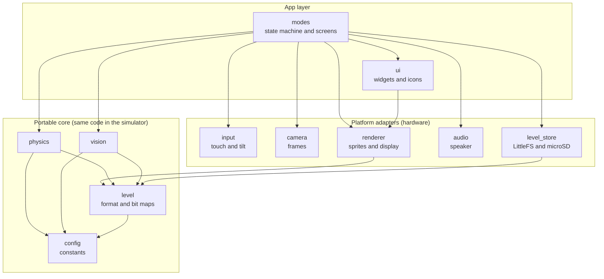
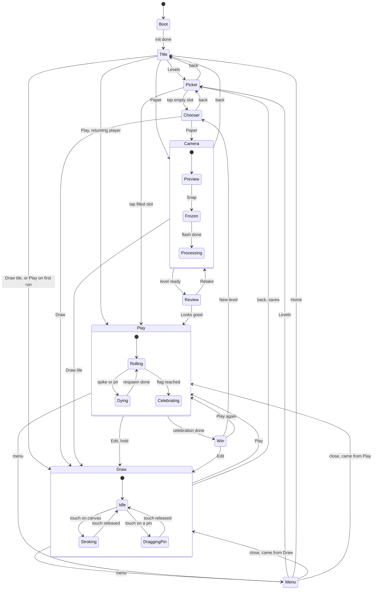

# Scribble Run — System Design

> Target: **M5Stack CoreS3** · C++ / PlatformIO (board `m5stack-cores3`) / M5Unified / M5GFX / esp32-camera · License: MIT
> Companion docs: [game-design.md](game-design.md) · [screens.md](screens.md) · [build-plan.md](build-plan.md)

## 1. Goals and constraints

### 1.1 Hardware facts we design around

| Part | Fact | Consequence |
|------|------|-------------|
| MCU | ESP32-S3, dual core, 240 MHz, single-precision FPU | `float` physics is fine; use core 0 for camera/vision, core 1 for the game loop |
| Memory | 512 KB SRAM (about 250–300 KB usable by us), **8 MB PSRAM**, **16 MB flash** | Big buffers (sprites, camera frames, vision workspace) live in PSRAM; hot data (level layers) in SRAM |
| Screen | 2.0″ IPS 320×240, ILI9342C over SPI, capacitive touch (single touch reliable) | A full-screen push is ~31 ms at 40 MHz SPI (**to be measured**), so Play repaints only changed rectangles |
| Camera | GC0308, **0.3 MP** (a retailer listing says "30 megapixels"; that is a typo for 30W = 300,000 pixels), front-facing, below the screen | QVGA (320×240) frames; fixed focus, small field of view (**both to be measured**) |
| IMU | BMI270 accelerometer + gyro (+ BMM150 magnetometer, unused) | Tilt = accelerometer X axis; read through M5Unified's `M5.Imu` |
| Audio | AW88298 amplifier, 1 W speaker | Synthesised tones, no audio files in v1 |
| Storage | LittleFS in flash, optional microSD | Levels in LittleFS; microSD for export/import |
| Power | AXP2101, 500 mAh battery | Camera + screen are thirsty; auto-save everywhere |
| **Missing** | **No vibration motor. No A/B/C touch buttons.** | Feedback = sound + screen effects; every control is an on-screen target |

### 1.2 Design principles

1. **Portable core.** `physics`, `vision`, `level` and `config` have no hardware calls, no dynamic allocation, no globals. The *same* code (ported line by line) runs in the browser simulator and is unit-tested on a PC.
2. **Hardware behind thin adapters.** `input`, `camera`, `renderer`, `audio`, `level_store` are the only modules that touch M5Unified/ESP-IDF. In the simulator they are replaced by canvas/mouse/file-upload implementations.
3. **One state machine** (`modes`) owns what's on screen. Everything else is a service it calls.
4. **Never block the game loop.** Camera capture and vision run in their own task; the UI keeps animating.
5. **Fixed sizes.** Every buffer has a compile-time size listed in §8.

---

## 2. Architecture

### 2.1 Modules

| Module | Layer | Responsibility |
|--------|-------|----------------|
| **config** | core | All constants (physics, layout, palette, vision parameters) from one shared file. |
| **level** | core | The `Level` struct, 1-bit layer helpers (`getBit`, `setBit`, brush stamping), the `.scrb` encoder/decoder (bytes ↔ struct), thumbnail generation. No file I/O. |
| **physics** | core | Fixed-step ball simulation, collision, events. Pure function of `(World, Level, StepInput)`. |
| **vision** | core | Camera frame → `Level`: crop, grayscale/HSV, background-normalised threshold, colour classification, clean-up, pin placement, quality report. |
| **input** | platform | Reads touch and IMU, produces one `InputState` per tick (edge-detected touch, filtered tilt, grip-safe rules). |
| **camera** | platform | Starts/stops the sensor, delivers RGB565 QVGA frames, locks exposure/white balance, averages frames at capture. |
| **renderer** | platform | Owns the scene sprite and frame sprites, dirty rectangles, camera-preview blit, screen transitions, particles. |
| **audio** | platform | Plays tones from a small fixed queue on its own task (non-blocking). |
| **level_store** | platform | LittleFS and microSD I/O: list/load/save/delete, autosave, thumbnail cache, settings, atomic writes. |
| **ui** | app | Widgets (button, chip, tab bar, ring-fill hold button, slot grid), icon drawing, hit-testing, hold gestures. |
| **modes** | app | The state machine and per-screen logic (Title … Win). The only module that knows about all the others. |

### 2.2 Dependencies and data flow



Rule: **arrows point downwards only.** `physics` and `vision` never call `renderer`, `audio` or anything with I/O; they return data and `modes` decides what to do with it.

### 2.3 How they talk (the interfaces)

```cpp
// ---- input.h : one snapshot per 60 Hz tick -------------------------------
struct Touch  { bool down, pressed, released; int16_t x, y; uint16_t heldMs; };
struct InputState { Touch touch; float tilt /* -1..1, filtered */; };

// ---- camera.h : runs in its own task --------------------------------------
struct Frame { const uint16_t* rgb565; int w /*320*/, h /*240*/; };
bool  camera_start();             void camera_stop();
bool  camera_latest(Frame& f);    // newest preview frame, no copy
bool  camera_snap(uint16_t* dst); // averages FRAME_AVG frames into dst (320*240)

// ---- vision.h : pure, deterministic ---------------------------------------
struct VisionParams { /* thresholds, §5.3 */ };
struct VisionReport { uint8_t status; /* OK, TOO_DARK, EMPTY, TOO_MUCH_INK, NOISY */
                      float inkCover, bgMean; uint16_t blobs; };
void vision_process(const uint16_t* rgb565, const VisionParams&,
                    VisionWork& work, Level& out, VisionReport& rep);
void vision_rethreshold(VisionWork& work, const VisionParams&, Level& out, VisionReport& rep);

// ---- physics.h : pure ------------------------------------------------------
struct Ball  { float x, y, vx, vy, angle; bool grounded; float coyote, jumpBuf; };
struct World { Ball ball; float time; uint8_t state; float stateTime; };
struct StepInput { float tilt; bool jumpPressed; };
enum : uint32_t { EV_JUMP=1, EV_LAND=2, EV_BOUNCE=4, EV_POP=8, EV_FELL=16, EV_RESPAWN=32, EV_WIN=64 };
uint32_t physics_step(World&, const Level&, const StepInput&);   // returns event bits

// ---- level.h ----------------------------------------------------------------
struct Level { uint8_t ground[7680], spike[7680], bouncy[7680];
               int16_t startX, startY, flagX, flagY; char name[24]; uint32_t rev; };
bool level_decode(const uint8_t* bytes, size_t n, Level&);      // validates magic, crc, size
size_t level_encode(const Level&, const Thumb*, uint8_t* out);
// ---- renderer.h, audio.h, level_store.h : see §6, §4.7
```

**Events, not callbacks.** `physics_step` returns a bitmask; `modes` turns it into sound (`audio_play(SFX_JUMP)`), particles (`renderer_burst(...)`) and state changes. The same pattern is used by `vision` (a report struct) and `ui` (button ids returned from `ui_update`).

**Threads.**

| Task | Core | Runs | Priority |
|------|------|------|----------|
| `loop` (game) | 1 | input → modes → physics → renderer at 60 Hz | normal |
| `camera/vision` | 0 | frame grabbing in Preview; `vision_process` after Snap | lower than `loop`, so the UI never stalls |
| `audio` | 0 | tone queue | high but tiny |

`modes` talks to the vision task through two flags (`visionRequested`, `visionDone`) and a shared `VisionWork` buffer; no locks are needed because only one side writes at a time.

---

## 3. State machine



* `Menu` remembers `returnTo` (Draw or Play) and the scene is frozen behind it.
* **Entering Draw** autosaves the previous level; **leaving Draw** (Play, ←, menu→Levels/Home) autosaves the current one (§4.7).
* `Processing` runs `vision_process` on the vision task; the screen plays a sparkle animation until `visionDone`.
* Every transition goes through `modes_goto(State)` which runs the old state's `exit()`, then the new state's `enter()`, so resources (camera, sprites) are started and stopped in exactly one place.

---

## 4. Level data format

One format for the device, the simulator and the future web editor. It is **binary**, little-endian, with a JSON twin for tools.

### 4.1 Coordinates and layers

* World is **320 × 192** pixels. A layer is **1 bit per pixel**, row-major, **MSB first** (bit 7 of byte 0 is pixel x=0), **40 bytes per row × 192 rows = 7,680 bytes**.
* Pixel lookup: `bit = (layer[y*40 + (x>>3)] >> (7 - (x&7))) & 1`.
* Three layers, in this order: **0 Ground**, **1 Spike**, **2 Bouncy**. Layers are **exclusive**: a pixel is set in at most one layer (decoders may assume it; encoders must guarantee it).

### 4.2 File layout (`.scrb`)

| Offset | Size | Type | Field | Value / notes |
|-------:|-----:|------|-------|---------------|
| 0 | 4 | char[4] | `magic` | `"SCRB"` |
| 4 | 1 | u8 | `version` | **1** |
| 5 | 1 | u8 | `encoding` | **0** = raw layers (1 = RLE, reserved for sharing) |
| 6 | 2 | u16 | `width` | 320 |
| 8 | 2 | u16 | `height` | 192 |
| 10 | 2 | u16 | `startX` | ball centre at spawn |
| 12 | 2 | u16 | `startY` | |
| 14 | 2 | u16 | `flagX` | pole base |
| 16 | 2 | u16 | `flagY` | |
| 18 | 1 | u8 | `layerCount` | 3 |
| 19 | 1 | u8 | `flags` | bit0 has extras · bit1 has thumbnail · bit2 made from paper |
| 20 | 24 | char[24] | `name` | UTF-8, NUL-padded (max 23 bytes) |
| 44 | 4 | u32 | `crc32` | CRC-32 (IEEE) of every byte from offset 64 to the end |
| 48 | 4 | u32 | `rev` | revision counter, +1 on every save (used by Wi-Fi sync) |
| 52 | 12 | u8[12] | `reserved` | zero |
| **64** | 1,080 | bytes | **thumbnail** | only if `flags.bit1`: 60×36, 4 bits/pixel, palette index (§4.5) |
| next | 7,680 | bytes | **ground** layer | |
| next | 7,680 | bytes | **spike** layer | |
| next | 7,680 | bytes | **bouncy** layer | |
| next | 1 + 5·n | bytes | **extras** | only if `flags.bit0`: `u8 count` (≤ 8), then `count × { u8 type, u16 x, u16 y }`; `type 1` = star |

Rules:

* **Version policy:** readers *reject* `version` > what they know (show a friendly "level from a newer game" tile) and *accept* all older versions. Unknown `flags` bits and `reserved` bytes are ignored on read and preserved on write by tools.
* **Validation on load:** magic ✓, version ✓, `width == 320 && height == 192`, `layerCount == 3`, file length matches, CRC ✓, `start`/`flag` inside the world, `name` NUL-terminated. A bad file is skipped (the slot shows as empty with a small ⚠ dot), never crashes.
* **Writes are atomic:** write to `/levels/Lnn.tmp`, `fsync`, rename over `Lnn.scrb`. A battery dying mid-save leaves the old file intact.

### 4.3 Size budget

| Part | Bytes |
|------|------:|
| Header | 64 |
| Thumbnail (optional) | 1,080 |
| 3 layers × 7,680 | 23,040 |
| Extras (max 8 stars) | ≤ 41 |
| **Typical file (thumbnail, no extras)** | **24,184** |
| **Maximum file** | **24,225** |
| On LittleFS (4 KB blocks) | 24,576 (6 blocks) |
| **10 levels** | **≈ 246 KB** of the ≈ 9 MB filesystem |

RLE (`encoding = 1`, for QR sharing, §10.2) is expected to give roughly 0.6–3 KB for typical drawn levels; this is **measured in Step 5**, not assumed.

### 4.4 JSON twin (for the web tool)

The web editor reads and writes either the `.scrb` bytes directly (preferred; a few lines with `DataView`) or this JSON, where layers are base64 of the raw 7,680 bytes:

```json
{
  "format": "scribble-run-level",
  "version": 1,
  "name": "Dad's Challenge",
  "origin": "paper",
  "width": 320, "height": 192,
  "start": { "x": 40,  "y": 104 },
  "flag":  { "x": 280, "y": 112 },
  "layers": {
    "ground": "<base64, 7680 bytes>",
    "spike":  "<base64, 7680 bytes>",
    "bouncy": "<base64, 7680 bytes>"
  },
  "thumbnail": { "w": 60, "h": 36, "format": "4bpp-palette", "data": "<base64, 1080 bytes>" },
  "extras": [ { "type": "star", "x": 160, "y": 60 } ]
}
```

`thumbnail` and `extras` are optional; a tool that omits the thumbnail gets one regenerated by the device on first load.

### 4.5 Thumbnails

* **60 × 36 px, 4 bits per pixel**, each value an index into the 9-colour palette ([screens.md](screens.md#palette-9-colours-rgb565-for-the-firmware)); 30 bytes/row × 36 = **1,080 bytes**, high nibble first.
* Generated at save time by sampling the 5.33 × 5.33 source block for each thumbnail pixel; priority **spike > bouncy > ground > paper**; a material wins if ≥ 25 % of the block is set. Start and Flag are drawn as small green dots.
* The picker reads only the first `64 + 1,080` bytes of each file (no need to load all 24 KB), then caches ten thumbnails in SRAM (10,800 B).

### 4.6 Settings and progress (not part of a level)

`/settings.bin` (≤ 64 bytes): `u8 version, u8 sound (0–2), u8 lastSlot, u16 solvedMask, u16 bestTimeMs[10], u8 firstRunDone`. Kept separate so sharing a level never shares progress.

### 4.7 Storage and autosave

| Path | Content |
|------|---------|
| `/levels/L00.scrb` … `/levels/L09.scrb` | the ten slots (LittleFS, internal flash) |
| `/settings.bin` | settings and progress |
| `/sd/scribble/levels/*.scrb` | optional **microSD export/import**; any `.scrb` there can be copied into a free slot from the menu (v1.1) |

**Autosave:** on leaving Draw/Edit, on "Looks good", and after 5 s idle with unsaved changes. Undo snapshots stay in PSRAM, so a crash loses at most 5 s. The level currently being edited has `rev` incremented on each save.

---

## 5. The vision pipeline (paper mode)

**Goal:** a QVGA photo of crayon on white paper → a `Level` (three bit layers + Start + Flag + quality report), in well under a second, with parameters we can tune from the Review screen, and a graceful path when the photo is bad.

### 5.1 Overview

```mermaid
flowchart LR
    A["0 Capture<br/>average 4 QVGA frames"] --> B["1 Crop<br/>centre 320x192"]
    B --> C["2 Convert<br/>gray, saturation, hue"]
    C --> D["3 Paper estimate<br/>16 px block max, smoothed"]
    D --> E["4 Ink strength<br/>and threshold"]
    E --> F["5 Classify<br/>ground, spike, bouncy"]
    F --> G["6 Clean up<br/>despeckle, close, thicken"]
    G --> H["7 Quality check"]
    H --> I["8 Place Start and Flag"]
    I --> J["9 Pack layers and thumbnail"]
```



All stages are integer maths on small arrays (no OpenCV, no floating point except where noted), identical in C++ and TypeScript, so the browser simulator reproduces the device's result.

### 5.2 Step by step

| # | Stage | What it does | Key detail |
|---|-------|--------------|------------|
| 0 | **Capture** | Exposure and white balance are *locked* after the preview has settled (≥ 0.5 s), then `FRAME_AVG` (4) consecutive RGB565 frames are averaged per pixel. | Averaging cuts sensor noise about 2×; locking stops the auto-exposure from "breathing" during capture. |
| 1 | **Crop** | Rows 24 … 215 of the 320×240 frame → **320 × 192**. | It's exactly what the framing guide showed. |
| 2 | **Convert** | RGB565 → 8-bit R, G, B. `gray = (77R + 150G + 29B) >> 8`. `max`, `min` of RGB. `sat = (max-min)·255 / max` (0 if `max < 16`). `hue` in degrees 0–359 by the standard integer HSV formula. | Pixels are processed in a single pass, row by row. |
| 3 | **Paper estimate** | Split into 16×16 blocks (20 × 12). `bg[block] = max gray` in the block. Then 3×3 box-blur the 20×12 grid, then **bilinear-upsample** to a per-pixel `bg(x,y)`. | The paper is the brightest thing in any block, so lighting gradients and soft shadows are divided out. A crayon stroke would have to be >16 px thick to fool it. |
| 4 | **Ink strength** | `ink(x,y) = 255 · (bg − gray) / bg`, clamped 0–255. A pixel is **ink** if `ink ≥ INK_THRESH` (default 30 % → 77). Pixels where `bg < BG_MIN` (80) are never ink. | `BG_MIN` stops a dark table or dark background being read as a huge ground blob. |
| 5 | **Classify** | For each ink pixel: if `V ≥ COLOR_V_MIN` (80) **and** `sat ≥ SAT_MIN` (90 ≈ 35 %): hue in `[345°, 360°) ∪ [0°, 20°]` → **Spike**; hue in `[195°, 255°]` → **Bouncy**. Everything else (dark or desaturated) → **Ground**. | The `V ≥ 80` test stops very dark pixels with noisy colour from being called blue. Black crayon is dark and nearly colourless → Ground. |
| 6 | **Clean up** | Per class mask: **(a) despeckle**: connected components smaller than `MIN_BLOB` (30 px) are removed; **(b) close** with a 5×5 square (joins gaps left by waxy, streaky crayon); **(c) thicken** with a `THICKEN_R` (2) dilation so every stroke is ≥ 8 px wide; **(d) border**: zero a 3 px margin (paper edges and shadows); **(e) priority**: where masks overlap, **Spike > Bouncy > Ground**. | Closing before thickening avoids growing noise. Priority makes a red line crossing a black one stay red. |
| 7 | **Quality check** | Computes ink coverage, blob count, mean paper brightness, and sets a status (§5.7). | Drives the Review screen's hints. |
| 8 | **Place pins** | **Start:** scan columns x = 16 … 120 left to right for the first column with a solid pixel (Ground/Bouncy) that has ≥ 24 px of clear space above; Start = (x, topY − 8 − 1). Not found → default (32, 32). **Flag:** same from x = 304 down to 200 (right to left); not found → (288, 100). If they end up < 100 px apart, push the Flag to the far right. | Both are draggable on Review. This reads "Start at the left, Flag at the far right" and also puts them on something solid when possible. |
| 9 | **Pack** | Bit-pack the three masks into `Level`, set `flags.bit2` (from paper), generate the thumbnail. | The output is an ordinary level (§4). |

**Re-thresholding** (Review's **− ink / + ink**): stage 4's `ink` array is kept in memory, so changing `INK_THRESH` re-runs only stages 5–9 (≈ 0.15 s) without touching the camera.

### 5.3 Tunable parameters (all in `config`)

| Parameter | Default | Range | Meaning |
|-----------|--------:|-------|---------|
| `FRAME_AVG` | 4 | 1–8 | Frames averaged at capture |
| `CROP_ROW0` | 24 | — | First row kept (192 rows) |
| `BG_BLOCK` | 16 | 8–32 | Paper-estimate block size (px) |
| `BG_MIN` | 80 | 40–140 | Darkest paper we accept |
| `INK_THRESH` | 77 (30 %) | 38–128 | Ink if darker than paper by this much; **the − / + ink buttons move it in steps of 13 (5 %)** |
| `SAT_MIN` | 90 (35 %) | 60–140 | Saturation needed to count as red or blue |
| `COLOR_V_MIN` | 80 | 40–140 | Brightness needed for red/blue |
| `HUE_RED` | 345–20° | — | Spike hue range |
| `HUE_BLUE` | 195–255° | — | Bouncy hue range |
| `MIN_BLOB` | 30 px | 10–100 | Smallest kept component |
| `CLOSE_R` | 2 | 0–4 | Gap-closing radius |
| `THICKEN_R` | 2 | 0–4 | Final dilation; strokes end up ≥ 4·`THICKEN_R`+1 wide |
| `EDGE_MARGIN` | 3 px | 0–8 | Zeroed border |
| `AE_LEVEL` | +1 | −2…+2 | Exposure bias (white paper fools auto-exposure into grey; tuned on device) |

### 5.4 Time budget (estimates at 240 MHz; **measured in Step 7**)

| Stage | Estimate | Notes |
|-------|---------:|-------|
| 0 Capture + average 4 frames | 130–170 ms | Camera-limited (~30 fps) |
| 1–2 Crop + convert (61,440 px) | 20–40 ms | PSRAM reads dominate |
| 3 Paper estimate | 10 ms | |
| 4–5 Ink + classify | 15 ms | |
| 6 Clean up (3 masks) | 80–150 ms | Separable 5×5 passes; components via a small stack |
| 7–9 Quality, pins, pack, thumbnail | 15 ms | |
| **Total** | **≈ 0.3 – 0.4 s** | Budget **≤ 0.6 s**; a sparkle animation covers it |

### 5.5 Memory (transient, in PSRAM; freed on leaving Camera/Review)

| Buffer | Bytes |
|--------|------:|
| Averaged QVGA capture (RGB565, 320×240) — shares the camera frame buffer | (153,600, already counted) |
| Cropped photo kept for the Review background (RGB565 320×192) | 122,880 |
| `ink` strength (u8) | 61,440 |
| `colour class` (u8: 0 none / 1 red / 2 blue) | 61,440 |
| `labels` (u8: 0 none / 1 ground / 2 spike / 3 bouncy) | 61,440 |
| Scratch for morphology | 61,440 |
| Paper grid (20×12) + tables | < 1,000 |
| **Vision workspace total** | **≈ 369 KB** |

### 5.6 Where the vision runs

* On the **vision task (core 0)**, so the UI animates. It is started by `modes` when the state enters `Processing`.
* In the **simulator** the same `vision.ts` runs on the main thread (or a worker) on an uploaded photo or a webcam frame that has been **resampled to 320×240 and quantised to RGB565**, so the browser sees what the device sees. Test presets in the simulator add "dim light", "gradient shadow", "8° tilt", and "sensor noise".

### 5.7 Limits and fallbacks

**Honest limits** (so we don't over-promise to a 7-year-old):

| Problem | What happens | What we do |
|---------|--------------|------------|
| **Low resolution** (0.3 MP, ~1 mm per pixel on an A4 page) | Thin lines and small details vanish | Crayon guide ("fat black crayon"); thickening stage; drawing big |
| **Pencil / light pens** | Too faint | `EMPTY` status → "draw darker" picture |
| **Pale colours** (yellow, light blue, pink) | Not detected as ink | Documented; only black, red, blue are used |
| **Poor light** | Low contrast; noisy | Lamp hint; − / + ink; auto-retry (below) |
| **Shadows** | A soft shadow is divided out by the paper estimate; a *sharp* shadow edge (a hand, the device) can leave a false dark band up to ~16 px wide | Lamp hint; Retake; fix in Edit. A stronger fix is a stretch item. |
| **Glare on waxy crayon** | Highlights drop ink pixels | The close step bridges small gaps |
| **Tilted page** | Perspective shrinks one side; lines slope | Framing guide; mild tilt (≲ 15°) is fine. Auto-deskew is a stretch item |
| **Coloured / patterned paper** | Background not uniform | Not supported in v1 (white paper only) |
| **Fixed focus / distance** | Blur if the paper is too close | Distance range found on day one (Step 6) and printed on the guide card |
| **Auto-exposure** | White paper is rendered mid-grey, lowering contrast | `AE_LEVEL` bias + exposure lock |

**Quality statuses** (stage 7) and what the app does:

| Status | Condition (defaults) | Review behaviour |
|--------|----------------------|------------------|
| `OK` | none of the below | Normal |
| `TOO_DARK` | mean paper brightness < 90 | Lamp icon; Retake pulses |
| `EMPTY` | ink coverage < 0.5 % | "Draw bigger and darker" picture; Retake pulses |
| `TOO_MUCH_INK` | ink coverage > 35 % | "Is the paper filling the frame?" picture; Retake pulses |
| `NOISY` | > 150 components survive despeckle | Retake pulses |

**Automatic retry (once, silently):** `EMPTY` or low contrast → re-threshold with `INK_THRESH` lowered by 25 %; `TOO_MUCH_INK` → raised by 25 %. The better of the two results (by status) is shown.
**Never a dead end:** whatever the status, **Looks good** stays enabled, **Retake** is one tap, and **Edit** can repair the level with a finger or start from a blank canvas.

---

## 6. Game loop and rendering

### 6.1 Loop (fixed 60 Hz physics)

```cpp
const float DT = 1.0f / 60.0f;
float acc = 0;  uint32_t last = micros();
for (;;) {
    uint32_t now = micros();
    acc += min((now - last) * 1e-6f, 0.1f);        // clamp: avoid a spiral of death
    last = now;
    InputState in = input_poll();                  // touch edges + filtered tilt
    int ticks = 0;
    while (acc >= DT && ticks < 6) {               // catch up, but never more than 6 ticks
        modes_tick(in, DT);                        // state machine; physics inside Play
        in.touch.pressed = in.touch.released = false;   // edges consumed once
        acc -= DT; ++ticks;
    }
    renderer_frame(modes_view());                  // draw the latest state
    renderer_wait_dma();                           // then sleep until the next tick
}
```

* **Physics is deterministic**: fixed `dt`, no `random()`, no wall-clock in the step. This is what makes ghost replays (stretch) possible.
* Rendering is decoupled: if a frame takes long, physics still advances in 1/60 s steps.

### 6.2 Rendering: a double-buffered sprite in PSRAM

| Buffer | Format | Size | Role |
|--------|--------|-----:|------|
| `scene` | RGB565 320×240 | 153,600 | Static art (level pixels with textures, pins, background dots), redrawn only when the level changes |
| `fb[0]`, `fb[1]` | RGB565 320×240 | 2 × 153,600 | Ping-pong frame buffers (the "double-buffered sprite") |

**Play and Draw (partial updates, target 60 fps):**
1. Wait for the previous DMA to finish (`display.waitDMA()`).
2. For each dirty rectangle `R` (ball's old and new box, particles, a moving pin): copy `scene → fb` in `R`, draw the dynamic objects on top.
3. Push **only `R`** to the screen (clip rectangle + DMA push). A 40 × 40 rectangle is 3.2 KB ≈ 0.7 ms at 40 MHz.
4. Flip `fb`.

**Full-screen scenes** (Title, Picker, Win, Review, Camera preview, transitions): draw the whole frame into the back buffer and push it with DMA while the CPU already prepares the next frame in the other buffer; ≈ 31 ms per push, so **~30 fps** (fine for those screens).

**Camera preview:** the 320×192 crop is contiguous in the camera's frame buffer, so it is copied straight into the back buffer, the guide and chips are drawn over it, and the buffer is pushed. The preview is limited by the camera's ~30 fps anyway.

> **Assumption to verify (Step 1):** SPI write speed (40 MHz?) and that the ESP32-S3 can DMA directly from PSRAM sprites. If PSRAM DMA is slow, fall back to a small (≤ 64 × 64) composite buffer in internal SRAM for the dirty rectangles and skip the second full sprite.

### 6.3 Frame-time budget (Play, 60 Hz = 16.67 ms)

| Stage | Budget | Notes |
|-------|-------:|-------|
| Input (touch read + IMU read over I²C) | ≤ 1.0 ms | M5Unified `update()`; ~0.3 ms each at 400 kHz |
| State machine + UI | ≤ 0.3 ms | |
| Physics (1 tick, ≤ 3 sub-steps) | ≤ 0.3 ms | ~400 bit lookups per tick |
| Compose dirty rectangles | ≤ 1.0 ms | 2 × 40×40 px |
| DMA push (background, CPU free) | ~1.5 ms | not counted against the CPU |
| **CPU total** | **≈ 2.6 ms (≈ 16 %)** | Leaves > 80 % for the camera task, audio and slack |
| **Full-screen scenes** | ≈ 31 ms per push | 30 fps; allowed because they have no gameplay |

---

## 7. Collision

**Ball:** circle, radius `R = 8`. **World:** three 1-bit layers. **Solid** = Ground or Bouncy. **Spike** is checked separately and is *not* solid.

### 7.1 Per sub-step algorithm

```
// split the tick so no sub-step moves more than MAX_STEP (4 px)
n   = ceil( max(|vx|,|vy|) * dt / MAX_STEP )          // ≤ 3 at MAX_SPEED
for each of n sub-steps (dt/n):
    ball.pos += ball.vel * (dt/n)

    // 1. push out of solids along the surface normal
    for iter in 0 .. MAX_PUSH-1:                       // MAX_PUSH = 8
        n_vec = contact_normal(ball)                   // see below; zero if no contact
        if no sample point is inside a solid: break
        ball.pos += n_vec * PUSH_STEP                  // 1.0 px
        last_n = n_vec; touched = true
    if touched: respond(last_n)

    // 2. detect resting contact (for grounded + friction)
    grounded = probe(ball, R + 1.5) hits a solid with normal.y < -0.5

    // 3. non-solid checks
    if spike hit (ring at 0.75*R)  → EV_POP
    if ball.y > 192 + 3R           → EV_FELL
    if dist(ball, flag_centre) < FLAG_HIT_RADIUS → EV_WIN
```

### 7.2 Contact normal from sample points

Sample **`N = 16`** points evenly around the circle at angle `θᵢ = 2πi/16`, position `(x + R cosθᵢ, y + R sinθᵢ)`, rounded down to pixels.

```
n = (0,0)
for each sample i inside a solid pixel:
    n -= (cosθᵢ, sinθᵢ)            // points from the contact toward the ball centre
if |n| > ε:  n /= |n|             // averaging many samples smooths pixel jaggies
else:        n = (0,-1)           // pinched between two surfaces: push up
```

Sampling 16 points averages away the staircase noise of a pixel map, so a hand-drawn (or photographed) line behaves like a smooth surface.

### 7.3 Response

```
vn = vel · n
if vn < 0:                                         // moving into the surface
    if touched_bouncy:    vel = n * BOUNCY_SPEED + (vel - vn*n) * 0.9    // launch
    else:                 vel -= (1 + e) * vn * n, with e = (|vn| < BOUNCE_MIN_SPEED ? 0 : RESTITUTION)
```

Friction is part of the rolling model (game-design §6), applied only while `grounded`.

### 7.4 Preventing tunnelling

* The **minimum thickness of any material is 8 px** (brush 8 px; paper levels thickened in vision stage 6c), and a sub-step never moves more than **4 px**, so the ball can never jump across a line.
* Eraser leftovers thinner than 8 px can exist; a sub-step of 4 px can in theory skip a 3-px sliver. Accepted (a visible sliver barely matters) and covered by the **unstick** rule below.

### 7.5 Edge cases

| Case | Rule |
|------|------|
| Ball deep inside ground after the player draws on it | After `MAX_PUSH` pushes, search a spiral up to 16 px for a free spot; if none, quietly respawn |
| Spike pixels touching ground | Spike wins (checked after the push) |
| Left/right edge | Treated as solid; top is open; bottom is the pit |
| Ball resting on a bouncy pad | Launches again each contact (a pogo); intended |
| Very steep drawn wall | Normal near-horizontal → the ball slides/bumps; no special case |

### 7.6 Tests (run on a PC in the simulator and with native C++ unit tests)

Rest on a flat floor stays still; roll at 150 px/s for 1 s over flat ground → 150 ± 2 px; jump apex = 50 ± 2 px; bouncy launch apex = 128 ± 4 px; drop at `MAX_SPEED` onto an 8 px line never tunnels (10,000 random trials); ball placed inside a 10 px blob is ejected or respawns within 0.1 s.

---

## 8. Memory budget (CoreS3)

### 8.1 Internal SRAM (512 KB total; we aim to stay under ~280 KB of our own use)

| Item | Bytes | Notes |
|------|------:|-------|
| Firmware data/bss, FreeRTOS, M5Unified, drivers | ~120,000 | Estimate; **measured in Step 0** |
| Active level (3 layers + header) | 23,104 | Hot data for collision |
| Thumbnail cache (10 × 1,080) | 10,800 | |
| Camera driver (DMA descriptors, line buffers) | ~30,000 | Estimate |
| Task stacks (loop 8 KB, camera/vision 12 KB, audio 4 KB) | 24,576 | |
| UI state, particles (32), audio queue, input buffers | ~8,000 | |
| Wi-Fi + HTTP server (version 2 only) | ~70,000 | Only when Wi-Fi is on |
| **Total (v1, without Wi-Fi)** | **≈ 216,000 (≈ 42 %)** | Leaves a healthy margin |

### 8.2 PSRAM (8 MB)

| Item | Bytes |
|------|------:|
| Camera frame buffers 2 × (320×240×2) | 307,200 |
| Vision workspace (§5.5) | 368,640 |
| `scene` sprite | 153,600 |
| `fb[0]`, `fb[1]` sprites | 307,200 |
| Undo ring: 8 snapshots × 23,104 | 184,832 |
| **Total** | **≈ 1,321,472 (≈ 1.26 MiB, ~16 %)** |

> Camera buffers are live only in Camera/Review; the vision workspace only while `Processing`/Review. They could share memory with the undo ring (Draw is not active at the same time) if PSRAM ever gets tight. It won't at 16 %.

### 8.3 Flash (16 MB)

| Partition | Size |
|-----------|-----:|
| Firmware (app0) | 3 MB |
| Second app slot (OTA, v2) | 3 MB |
| NVS, OTA data | ~48 KB |
| LittleFS (levels, settings; later the web editor assets) | ~9.9 MB |

---

## 9. Code sharing between simulator and firmware

### 9.1 Repo layout

```text
scribble/
├── LICENSE                     MIT
├── docs/                       these documents
├── shared/
│   ├── constants.json          single source of truth: physics, layout, palette, vision params
│   ├── levels/                 built-in lessons (.scrb) + JSON twins
│   └── golden/                 test vectors: physics runs, vision input photos + expected masks
├── sim/                        browser simulator (Vite + TypeScript + canvas)
│   └── src/
│       ├── config.ts           GENERATED from constants.json
│       ├── level.ts            format codec, bit maps, thumbnail   ↔ level.h/.cpp
│       ├── physics.ts                                              ↔ physics.h/.cpp
│       ├── vision.ts                                               ↔ vision.h/.cpp
│       ├── input.ts            mouse/touch, arrow keys, DeviceOrientation   ↔ input (M5Unified)
│       ├── camera.ts           upload / webcam → 320×240 RGB565            ↔ camera (esp32-camera)
│       ├── renderer.ts         canvas 320×240, drawn at 3×                 ↔ renderer (M5GFX)
│       ├── audio.ts            WebAudio tones                              ↔ audio
│       ├── level_store.ts      localStorage + file download/upload         ↔ level_store
│       ├── ui.ts                                                           ↔ ui
│       └── modes.ts                                                        ↔ modes
└── firmware/                   PlatformIO project (device phase)
    ├── platformio.ini          board = m5stack-cores3
    ├── src/ include/ test/     test/ = native unit tests incl. golden vectors
```

### 9.2 Portability rules

* **One constants file.** `shared/constants.json` generates `config.h` and `config.ts` (a ~30-line script), so a physics or vision value changes in exactly one place.
* **Same names, same signatures.** `physics_step` ↔ `physicsStep`, same struct fields.
* **Float discipline.** The device uses 32-bit `float`; the simulator uses `Math.fround` at assignment points in `physics.ts`. Results need not be bit-identical, but **golden tests allow ≤ 0.5 px drift over 600 ticks**.
* **Vision is integer-only** (except bilinear weights, done in fixed point), so C++ and TypeScript produce **identical masks**; golden tests compare byte-for-byte.
* **Bit order and endianness are fixed** (MSB first, little-endian) so `.scrb` files made in the browser load on the device and vice versa.
* **Core code has no allocation, no globals, no I/O, no time or random calls.** All buffers are passed in.

### 9.3 Browser simulator behaviours (built after review)

* `<canvas>` of exactly **320 × 240**, CSS-scaled 3× (`image-rendering: pixelated`).
* Mouse/touch = finger. **Arrow keys** (and the phone's `DeviceOrientation`) = tilt; **Space** or click = jump.
* **Upload photo** and **webcam** buttons feed `camera.ts`, which resamples to 320×240, quantises to RGB565 and optionally applies a *stress preset*, then runs the same `vision.ts`.
* **Download level** writes `.scrb`; **Load level** reads it. A debug panel shows the vision stages (gray, paper estimate, ink, labels).

---

## 10. Beyond version 1

### 10.1 Version 2: a tldraw web editor that sends levels over Wi-Fi

**Idea:** a bigger canvas on a laptop/tablet (tldraw) for drawing levels, a "Send to Scribble" button, and the same screen on the device. It can also run `vision.ts` on a **phone photo** of a paper drawing.

**Where the editor lives.** A web page served over **https** cannot call a plain **http** device on the LAN (mixed-content rules). So the editor is either (a) **served by the device itself** from LittleFS at `http://scribble.local/` (the bundle is a few MB; the CoreS3 has room), or (b) run locally during development (`npm run dev`, plain http). Option (a) needs no install and works offline.

**Licence check:** tldraw's SDK is *not* MIT-licensed (its own terms apply). Verify the terms for an open-source/hobby repo before depending on it; the fallback is a small canvas editor built from the simulator's code.

**Editor → level.** tldraw shapes are drawn in **three colours** (tldraw's `black`, `red`, `blue` map to Ground, Spike, Bouncy) plus two custom shapes, `start` and `flag`. To export: for each material render only that colour's shapes to an offscreen 320×192 canvas, enforce a minimum stroke width of 8 px, threshold alpha ≥ 128 to bits, resolve overlaps, and pack with `level.ts`.

**Device → editor.** A level (bitmaps) can't be turned back into vector shapes, so the editor shows it as a locked background image; the user draws on top.

**Device API** (HTTP/1.1, JSON unless noted, served by `ESPAsyncWebServer` or the IDF HTTP server):

| Method | Path | Body → Response | Notes |
|--------|------|-----------------|-------|
| GET | `/api/v1/info` | → `{ "device":"scribble-run","firmware":"0.1.0","formats":[1],"slots":10,"freeBytes":9000000 }` | Discovery; also advertised by mDNS `_scribble._tcp` |
| POST | `/api/v1/pair` | `{ "pin":"4821" }` → `{ "token":"…" }` | The device shows a 4-digit PIN in its menu; the token is sent as `Authorization: Bearer` |
| GET | `/api/v1/levels` | → `{ "slots":[ { "slot":0,"empty":false,"name":"Gap","rev":7,"bytes":24184 }, … ] }` | |
| GET | `/api/v1/levels/{slot}` | → `application/vnd.scribble.level` (the `.scrb` bytes) or JSON with `Accept: application/json` | |
| PUT | `/api/v1/levels/{slot}` | `.scrb` bytes or JSON → `204` | Validates (§4.2). `409` if that slot is open in Draw. `If-Match: <rev>` for optimistic concurrency |
| DELETE | `/api/v1/levels/{slot}` | → `204` | |
| GET | `/api/v1/levels/{slot}/thumb` | → 60×36 PNG | |
| POST | `/api/v1/play/{slot}` | → `204` | The device opens that level in Play ("send and play") |
| GET | `/api/v1/camera/frame` | → JPEG | Optional debugging aid for tuning the vision pipeline |

**Security:** LAN only, never port-forwarded; PIN pairing; PUT limited to 25 KB; no remote code paths. **Wi-Fi provisioning:** a first-run SoftAP (`Scribble-XXXX`) with a tiny form, then station mode with stored credentials.

### 10.2 Sharing without Wi-Fi

* **microSD:** copy `.scrb` files in/out. The browser simulator's "Download level" produces the same file. Simplest, works in v1.1.
* **QR codes (stretch):** the CoreS3 camera can **scan** a QR code shown on a big screen (a phone or laptop), which is the easier direction. A QR code's capacity limits what fits: roughly **1.2 KB** at a size a 320×240 camera can still resolve (about 2 px per module), versus **24 KB** for a raw level. So a QR needs the **RLE encoding** (`encoding = 1`) and probably the thumbnail dropped; **we measure real levels' compressed sizes in Step 5** before promising this. *Showing* a QR on the device for a phone to scan has the same size limit and the screen is small, so it is the lower priority.

---

## 11. Risks and assumptions to verify on the device

| # | Assumption / risk | How we check (build step) | If wrong |
|---|-------------------|---------------------------|----------|
| 1 | The camera works through `esp32-camera` alongside M5Unified (shared I²C/GPIO via the AW9523 expander, pin map from M5's CoreS3 camera example) | Step 6 | Use M5's own CoreS3 camera wrapper instead |
| 2 | GC0308 delivers RGB565 QVGA at ~30 fps | Step 6 | Use YUV422 and convert; accept 15–20 fps preview |
| 3 | Fixed focus works at 15–40 cm; field of view fits an A5/A4 page at a usable distance | Step 6 (measure and print on the guide card) | Re-scope paper size (A5) or add a "hold here" distance cue |
| 4 | Image orientation / mirroring of the front camera | Step 6 | `hmirror`/`vflip` settings |
| 5 | Exposure lock + `AE_LEVEL` give enough contrast on white paper in a normal room | Step 6–7 | Add a fixed-gain mode; ask for more light |
| 6 | Display SPI at 40 MHz; PSRAM sprites DMA well on the S3 | Step 1 | Use the SRAM composite buffer (§6.2) |
| 7 | Touch gives clean single-point data at 60 Hz+ with a child's finger | Step 1 | Add smoothing; widen hit areas |
| 8 | IMU X axis and sign; BMI270 noise | Step 2 | Remap axes; widen dead-zone |
| 9 | Vision time < 0.6 s | Step 7 | Lower `FRAME_AVG`, skip closing on one class |
| 10 | Battery life with camera/screen at normal brightness (a 500 mAh pack suggests *an hour or two*) | Step 8 | Dim after idle; lower brightness; ship a cable-friendly stand |
| 11 | Two I²C devices contend (touch, IMU, PMIC, camera SCCB) | Step 6 | Serialize bus access in the platform layer |
| 12 | tldraw licence suits an MIT repo | Before v2 | Build a minimal editor |
